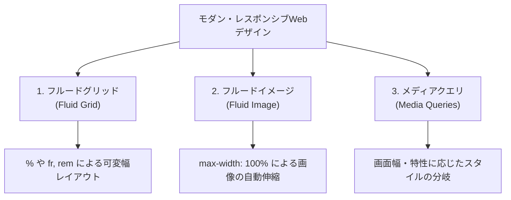
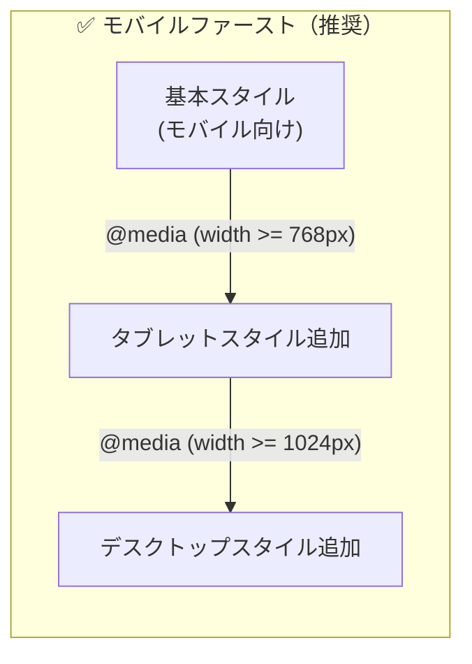
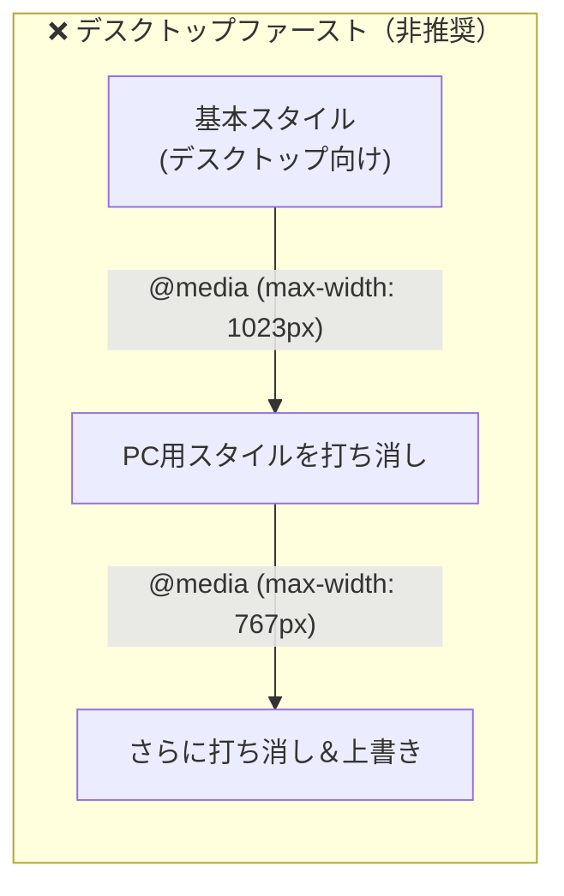
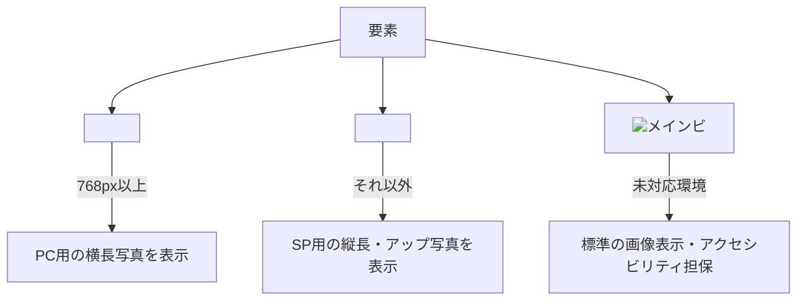
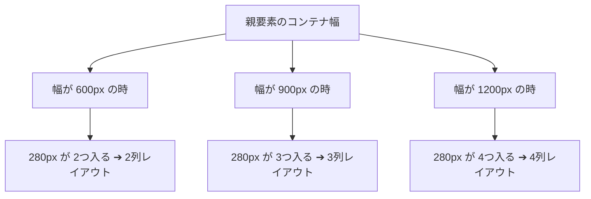
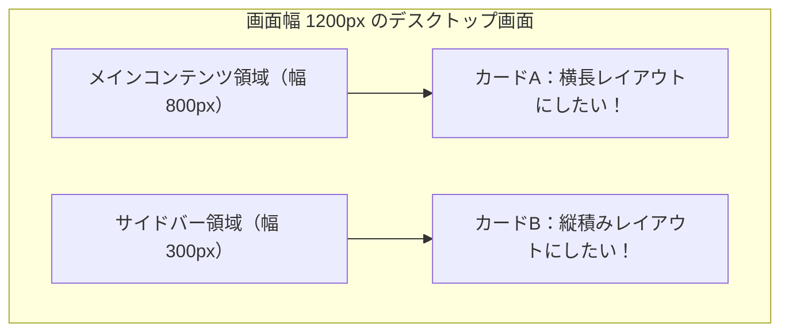

# 05_モダン・レスポンシブWebデザイン

### HTML+CSS（火1-2 / 水1）

[00_導入](https://app.notion.com/p/00_-3c8bdf471aca80e3a92afe2bc6031e14?pvs=21)

[01_**環境設定と確認課題**](https://app.notion.com/p/01_-3f0bdf471aca80d0b9acf946b73cceaf?pvs=21)

[**02_CSS設計とBEM**](https://app.notion.com/p/02_CSS-BEM-3f1bdf471aca80f7b23cc380f650eb0f?pvs=21)

[03_CSSプリプロセッサ](https://app.notion.com/p/03_CSS-3f1bdf471aca801aaefedf63d430a800?pvs=21)

[04_相対単位の使い分け](https://app.notion.com/p/04_-405bdf471aca801e8053c3b9af7384d2?pvs=21)

[**05_モダン・レスポンシブWebデザイン**](https://app.notion.com/p/05_Responsive-41abdf471aca8033990ec380f650eb0f?pvs=21)

---

# 1. はじめに

## 1-1. 前回の復習

前回（`04_相対単位の使い分け`）では、絶対単位である `px` への依存から脱却し、アクセシビリティと保守性に優れたWebサイトを作るための「相対単位（`rem`, `em`, `%`, `vw`, `vh`, `dvh`）」の使い分けを学びました。

```scss
// 前回の復習：Sass関数によるrem変換と8pxグリッド
@use "sass:math";

$font-size-base: 16;

// デザインカンプのpx数値をremに自動変換する関数
@function rem($px-value) {
  @return #{math.div($px-value, $font-size-base)}rem;
}

.card {
  padding: rem(24); // 8pxグリッド（24px = 1.5rem）
  border-radius: rem(12);

  &__title {
    // clamp() による流体タイポグラフィ（最小18px〜最大24pxの間で無段階可変）
    font-size: clamp(rem(18), 1.5rem + 1vw, rem(24));
    margin-bottom: rem(16);
  }

  &__text {
    font-size: rem(14);
    line-height: math.div(24, 14);
  }
}
```

**【前回学んだ重要ポイント】**
- **ブラウザの文字サイズ変更への配慮（アクセシビリティ）：** `px` で文字サイズを固定すると、弱視のユーザーなどがブラウザ設定で文字を大きくしても拡大されず、WCAG基準（達成基準 1.4.4）を満たせない。
- **`rem` と `em` の違い：** `rem` はルート要素（`<html>`）を基準とするためネストしても破綻しない。`em` は親（または自分）の `font-size` を基準とするため、字間（`letter-spacing`）やボタンの内側余白の連動に適している。
- **Sass関数 `@function rem()`：** デザインカンプの数値をそのまま渡すだけで、電卓不要で安全な `rem` にコンパイルできる。
- **8pxグリッドシステム：** 余白を4px/8pxの倍数で揃えることで、統一感のあるリズムを生み出す。

前回学んだ相対単位によって、**「文字や余白が画面やユーザー環境に応じてしなやかに拡縮する土台」** は完成しました。
しかし、スマートフォンのような縦長の小さな画面と、パソコンのような横長の巨大なディスプレイでは、**レイアウトの構造（カラム数や配置順序、画像のトリミング、テーブルの見せ方）そのものを根本から切り替える** 必要があります。

---

## 1-2. 前回の課題の確認

**【見本】**

[Roysha](https://takagino.github.io/tri-education/wf1/2nd/markup-advanced/06-Roysha-rem/completed/index.html)

- 全ての文字サイズ・余白に `rem()` 関数を活用できましたか？
- ブラウザのフォントサイズを「極大」に変更した際、文字が追従して大きくなりましたか？
- 余白の数値が場当たり的にならず、8pxグリッドのリズムを意識できましたか？

---

# 2. 今回学ぶこと

本単元では、過去の「単にメディアクエリでスマホ用に上書きするだけの制作手法」をアップデートし、**「最新のCSS仕様とSassを駆使した、破綻のないモダン・レスポンシブWebデザイン」** を体系的に習得します。

1. **レスポンシブWebデザインの原則と最新構文**（Fluid Grid, Fluid Image, Viewport, レンジ構文 `@media (width >= 768px)`）
2. **モバイルファーストの設計思想**（なぜSPファーストが業界標準なのか）
3. **メディアクエリの配置設計とSassによる一元管理**（セレクタ直下配置・CSSネストの課題 ➔ Sassマップと `@mixin mq()`、スターターキットのスニペット登録）
4. **実務で直面するレスポンシブ・テクニック**
   - 文節に応じたスマートな改行制御（`inline-block`, `<wbr>`, `text-wrap: balance / pretty`）
   - テーブル（`<table>`）のスマホ最適化（横スクロール vs カード型変形）
   - `<picture>` 要素によるアートディレクションと次世代フォーマット（WebP/AVIF）
5. **メディアクエリに頼りすぎない「内包的レスポンシブ」**（`repeat(auto-fit, minmax(...))`）
6. **次世代の標準：コンテナクエリ（Container Queries: `@container`）の基礎**
7. **スマホ対応の落とし穴と対策**（横揺れバグの特定法、48pxタップ領域、iOSフォーム自動拡大防止、セーフエリア対応）

---

## 2-1. サンプルデータ（仮）

[HTML+CSS - Google Drive](https://drive.google.com/drive/folders/1TerVbEHQw_gibRX-d6709S3wUu9QeoBk?usp=sharing)

- **授業用演習データ**：準備中（後日配布）
- **課題データ**：準備中（後日配布）

※ 現在デザインデータを調整中です。授業内での指示に従ってください。

---

## 2-2. 見本（仮）

[Renome（参考・前期見本）](https://takagino.github.io/doc-markup-advanced/06-renome-sass/completed/index.html)

---

## 2-3. 途中経過（仮）

[tri-education/wf1/2nd/markup-advanced at main · takagino/tri-education](https://github.com/takagino/tri-education/tree/main/wf1/2nd/markup-advanced)

---

# 3. レスポンシブWebデザインの原則とViewport

## 3-1. レスポンシブWebデザイン（RWD）の3大要素

2010年にイーサン・マルコッテ（Ethan Marcotte）氏によって提唱されたレスポンシブWebデザインは、以下の **3つの技術的基盤** によって成り立っています。



### ① Fluid Grid（フルードグリッド / 流動的格子）
画面の横幅を固定のピクセル（例：`width: 960px;`）で決めるのではなく、`%` や `vw`、CSS Gridの `fr` 単位を用いて、**画面サイズに合わせてコンテンツが伸び縮みする柔軟な骨格** を作ります。

### ② Fluid Image（フルードイメージ / 流動的画像）
画像や動画などのメディアが、親要素の幅を突き破って画面外にはみ出さないよう、CSSのリセットで以下を定義します。

```scss
img,
picture,
video {
  max-width: 100%; // 親要素の幅を超えて巨大化しない
  height: auto;    // アスペクト比（縦横比）を保ったまま縮小する
  vertical-align: middle; // 画像下部の微小な隙間を解消
}
```

### ③ Media Queries（メディアクエリ）
画面の横幅や端末の向き（縦向き・横向き）、解像度などの条件に応じて、適用するCSSルールを動的に切り替えます。

---

## 3-2. Viewport（ビューポート）の仕組み

レスポンシブ対応を行う上で、HTMLの `<head>` 内に必ず記述しなければならないのが **Viewportメタタグ** です。

```html
<meta name="viewport" content="width=device-width, initial-scale=1.0">
```

### なぜ Viewport タグが必要なのか？
スマートフォンのブラウザ（Mobile SafariやChrome）は、レスポンシブ対応されていない昔のWebサイト（横幅960px前後で作られたPC専用サイト）を表示する際、**「仮想的な980pxの画面幅」** を作り、それをスマホ画面の幅（390pxなど）に無理やりギュッと縮小して画面全体を収めようとします。

もし Viewport メタタグを書き忘れると、**いくらCSSでスマホ対応のメディアクエリを書いても、ブラウザは「980pxのPC画面」として解釈してしまい、スマホ表示に切り替わりません。**

| 属性・値 | 意味と役割 |
| --- | --- |
| `width=device-width` | 表示領域の幅を、端末本来のスクリーン幅（論理ピクセル：390pxや414pxなど）と一致させる |
| `initial-scale=1.0` | ページ初回読み込み時の拡大縮小比率を 1.0（等倍）に設定する |

<aside>
⚠️

**【要注意】アクセシビリティを破壊する「ズーム禁止設定」は厳禁！**

昔のコードでよく見られた以下の記述は、**現在では重大なアンチパターン** とされています。
```html
<!-- ❌ 絶対にやってはいけない記述 -->
<meta name="viewport" content="width=device-width, initial-scale=1.0, user-scalable=no, maximum-scale=1.0">
```
`user-scalable=no`（ユーザーによる拡大を禁止）や `maximum-scale=1.0` を設定すると、視力の弱いユーザーがピンチアウト操作で文字を拡大できなくなります。これは **WCAG 1.4.4（レベルAA）の基準に明確に違反** します。特別な理由がない限り、標準の `width=device-width, initial-scale=1.0` のみを使用してください。

</aside>

---

## 3-3. モバイルファースト vs デスクトップファースト

レスポンシブCSSを記述する際、設計方針には大きく分けて2つのアプローチがあります。





### なぜ「モバイルファースト」が世界標準なのか？

1. **コードが圧倒的に美しく、短くなる（打ち消しコードの排除）：**
   デスクトップから作り始めると、モバイル用メディアクエリの中で `float: none;`、`width: 100%;`、`margin-left: 0;`、`display: block;` のように、**「PC用につけたスタイルを打ち消すための無駄なコード」** が大量に発生します。
   モバイルファーストであれば、「シンプルな1カラムレイアウト」からスタートし、画面が広くなるにつれて `display: grid;` や列幅を **追加（プログレッシブ・エンハンスメント）** していくため、打ち消しがほとんど発生しません。
2. **モバイルのパフォーマンス最適化：**
   モバイル通信環境（4G/5G）において、余計なリセットコードの解釈を減らし、初回描画（First Contentful Paint）を高速化できます。

---

# 4. メディアクエリの最新構文とブレイクポイント設計

## 4-1. レンジ構文（Media Queries Level 4: Range Syntax）

現在すべてのモダンブラウザ（Chrome, Safari, Firefox, Edge）で、**Media Queries Level 4 の「レンジ構文（Range Syntax）」** が完全に利用可能です。

数学の不等号（`>=`, `<=`, `<`, `>`）を使って直感的に記述できるようになりました。

```scss
/* 従来の古い書き方（min-width / max-width） */
@media (min-width: 768px) {
  // 768px以上
}

@media (min-width: 768px) and (max-width: 1023px) {
  // 768px以上 〜 1023px以下（767.98pxなどの端数問題が起きやすい）
}

/* 現代のモダンなレンジ構文（推奨！） */
@media (width >= 768px) {
  // 768px以上（モバイルファーストの基本）
}

@media (768px <= width < 1024px) {
  // 768px以上 かつ 1024px未満（タブレットのみ）
}

@media (width < 768px) {
  // 768px未満（スマホ専用スタイルをどうしても当てたい時）
}
```

### レンジ構文のメリット
- **「以上」「以下」「未満」の境界値が一目瞭然：** 従来の `max-width: 767px` だと、「767.5px のRetina画面でどちらのスタイルも当たらない空白の一瞬が生じる」というバグを防ぐため `767.98px` のような不自然な数値を書く必要がありましたが、レンジ構文なら `width < 768px` と書くだけで完璧に排他制御できます。

---

## 4-2. ブレイクポイントの設計思想

### ❌ デバイス依存の罠（Device-driven Breakpoint）
「iPhone 16が402pxだから402pxで区切る」「iPadが810pxだから810pxにする」という発想は **大きな間違い** です。
毎年新しい端末が登場し、画面幅は無数に多様化しています。また、iPadのSplit View（画面分割表示）やPCブラウザのウィンドウ縮小など、画面幅は端末のサイズとは一致しません。

### ⭕️ コンテンツドリブン（Content-driven Breakpoint）
プロのマークアップエンジニアは、**「コンテンツ（レイアウトや文字組み）が崩れそうになったり、視認性が低下したタイミング」** をブレイクポイントとして設定します。

実務で迷った際は、以下の **3段階（2つのブレイクポイント）** をベースにするのが業界標準です。

| デバイス分類 | 画面幅の目安 | 代表的なブレイクポイント値 | レイアウトの特徴 |
| --- | --- | --- | --- |
| **スマートフォン（SP）** | 〜 767px | 基本スタイル（`width < 768px`） | 1カラム、縦スクロール、ハンバーガーメニュー |
| **タブレット（TB）** | 768px 〜 1023px | `768px`（`width >= 768px`） | 2カラム、余白の拡大、グリッド分割 |
| **デスクトップ（PC）** | 1024px 〜 | `1024px`（`width >= 1024px`） | 3〜4カラム、グローバルナビ横並び、最大幅コンテナ制限 |

※ 案件やデザインによっては、大型ディスプレイ向けに `1280px` や `1440px` を追加することもあります。

---

# 5. メディアクエリの配置とSassによる一元管理

## 5-1. CSS末尾に `@media` を書く旧来手法の限界

CSSの学習を始めたばかりの段階では、スタイルシートの最下部に `@media` をまとめて書く手法をよく見かけます。

```css
/* ❌ 旧来の書き方：CSSファイルの末尾にまとめて記述する */
.header { ... }
.btn {
  width: 100%;
}
.card { ... }
.footer { ... }

/* --- 数百〜数千行下 --- */
@media (width >= 768px) {
  .header { ... }
  .btn {
    width: auto; // 上のスタイルを打ち消し・上書き
  }
  .card { ... }
  .footer { ... }
}
```

一見すると整理されているように見えますが、実務の大規模なWeb制作では以下のような **深刻な問題** を引き起こします：
1. **画面のスクロール往復地獄：** `.btn` のスタイルを確認・修正したいだけなのに、ファイルの上（モバイル用）と最下部（PC用）を何度も激しくスクロールして往復しなければならない。
2. **モジュールの独立性（カプセル化）の破壊：** BEMで「パーツ単位で完結する設計」を目指しているのに、そのパーツのコードがファイル内でバラバラに引き裂かれてしまう。
3. **消し忘れによるデッドコード：** 不要になった `.card` をHTMLから削除した際、末尾のメディアクエリ内にある `.card` を消し忘れて、使われない無駄なコードが残り続ける。

---

## 5-2. 改善ステップ：セレクタのすぐ直下に書く（生のCSS）

この問題を解決するための現代の標準的な考え方が、**「そのセレクタのすぐ直下にメディアクエリを配置し、パーツごとにコードを完結させる」** というアプローチです。

生のCSSでも、以下のように書くことができます。

```css
/* ✅ 改善案（生のCSS）：セレクタのすぐ下にメディアクエリを並べて書く */
.btn {
  width: 100%;
  padding: 12px;
}
@media (width >= 768px) {
  .btn {
    width: auto;
    padding: 12px 24px;
  }
}

.card {
  padding: 16px;
}
@media (width >= 768px) {
  .card {
    padding: 24px;
  }
}
```

さらに、近年のモダンブラウザで正式サポートされた **CSS Nesting（CSSネスト仕様）** を使えば、生のCSSでもセレクタの内部に直接メディアクエリを入れ子（ネスト）して書くことすら可能です。

```css
/* ✅ モダンCSS（ネスト仕様）：セレクタの内部に直接入れ子にする */
.btn {
  width: 100%;
  padding: 12px;

  @media (width >= 768px) {
    width: auto;
    padding: 12px 24px;
  }
}
```

パーツの「スマホ表示」と「PC表示」が同じ場所にまとまり、格段に読みやすく修正しやすくなりました。

### しかし、生のCSSには「新たな壁」が立ちはだかる……
この書き方を生のCSSで推し進めると、次の実務上の重大な問題が発生します。

> **「`768px`」というブレイクポイントの数値が、CSSのあちこちに無数にハードコード（直接書き込み）されてしまう！**

もしプロジェクトの途中でクライアントやデザイナーから、
**「タブレットの切り替えを、デザインの都合で 768px から 800px に変更したい」**
と言われたらどうなるでしょうか？

CSSファイル全体から何十箇所、何百箇所と散らばった `@media (width >= 768px)` を手作業で検索・置換しなければならず、置換漏れやタイプミスによる大惨事につながります。

---

## 5-3. Sassによるブレイクポイントとメディアクエリの一元管理

そこで真価を発揮するのが **Sass（SCSS）** です！

Sassを使えば、**「セレクタのすぐ下にネストして書きたい」** という利便性を維持したまま、**「ブレイクポイントの数値はたった1箇所で一元管理する」** という理想の制作環境を簡単に実現できます。

ブレイクポイントをマップ型変数（`$breakpoints`）で定義し、それを呼び出す Mixin（`@mixin mq()`）をセットで構築します。

```scss
// _breakpoints.scss または style.scss の冒頭
@use "sass:map";

// 1. ブレイクポイントの数値をマップで一元管理！
$breakpoints: (
  "sm": 640px,  // 大型スマホ〜小型タブレット
  "md": 768px,  // 一般的なタブレット
  "lg": 1024px, // ノートPC・デスクトップ
  "xl": 1280px  // 大型ディスプレイ
);

// 2. メディアクエリを自動生成するMixin
@mixin mq($bp: "md") {
  $width: map.get($breakpoints, $bp);

  @media (width >= $width) {
    @content; // @include したブロックの中身（CSSルール）がここに展開される！
  }
}
```

- **`map.get($breakpoints, $bp)`**：マップから指定されたキー（`"md"`など）の数値（`768px`）を取り出します。
- **`@content`**：Mixinを呼び出した側（`@include mq(md) { ... }`）の中に書かれたCSSのスタイル宣言が、そのままメディアクエリの内部に流し込まれます。

---

## 5-4. 完成形：BEM × Sass によるコンポーネント指向のネスト記法

この `@mixin mq()` を使うと、BEMブロックの中に直接レスポンシブの振る舞いを美しく閉じ込めることができます。

```scss
// 実装コード（SCSS）
.card {
  padding: 16px;
  background-color: #fff;
  border-radius: 8px;

  &__inner {
    display: flex;
    flex-direction: column;
    gap: 12px;

    // タブレット以上（768px〜）で横並びに切り替え
    @include mq(md) {
      flex-direction: row;
      align-items: center;
      gap: 24px;
    }
  }

  &__title {
    font-size: 16px;

    // デスクトップ以上（1024px〜）で文字サイズを大きく
    @include mq(lg) {
      font-size: 20px;
    }
  }
}
```

```css
/* コンパイル後の CSS（自動生成された結果） */
.card {
  padding: 16px;
  background-color: #fff;
  border-radius: 8px;
}
.card__inner {
  display: flex;
  flex-direction: column;
  gap: 12px;
}
@media (width >= 768px) {
  .card__inner {
    flex-direction: row;
    align-items: center;
    gap: 24px;
  }
}
.card__title {
  font-size: 16px;
}
@media (width >= 1024px) {
  .card__title {
    font-size: 20px;
  }
}
```

### なぜこのアプローチが実務で圧倒的に支持されるのか？
- **高い凝集性（パーツ完結）：** モジュールのすべての状態（スマホ・PC）が1箇所にまとまっているため、コードを読む際も修正する際も一切迷わない。
- **変更への強さ（一元管理）：** もしブレイクポイントの数値を変更したくなっても、変数マップ `$breakpoints` の数値を1箇所書き換えるだけで、サイト内のすべてのメディアクエリが一瞬で自動更新される。
- **タイプミスの根絶：** `@include mq(md)` と書くだけなので、「`768px` と `786px` を間違えた」「不等号を書き間違えた」といった人為的ミスが原理的に発生しない。

---

## 5-5. 開発効率を劇的に上げる「Sassスターターキット」のスニペット登録

ここまで学んだ「変数（色・フォント・ブレイクポイント）」「自作関数（`rem()` / `ls()` / `pct()`）」「Mixin（`mq()` / `inner()`）」は、**今後のすべてのWeb制作課題・実務案件で毎回必ず使う共通テンプレート** です。

毎回手動でゼロから書いたり、過去のファイルをコピー＆ペーストするのは非効率的です。
VS Codeの **「ユーザースニペット機能」** に登録し、`!kit` と入力するだけで一瞬で展開できるように設定しておきましょう！

### ① 授業用 Sass スターターキットの構成

```scss
@use "sass:math";
@use "sass:map";

// --- Variables ---

// Colors
$color-text:   #333333;
$color-base:   #ffffff;
$color-main:   #000000;
$color-accent: #e40065;
$color-bg:     #f8f9fa;

// Typography
$font-size-base: 16;
$font-family-gothic: "Helvetica Neue", Arial, "Hiragino Kaku Gothic ProN", "Hiragino Sans", "Yu Gothic", Meiryo, sans-serif;
$font-family-mincho: "Times New Roman", Times, "Hiragino Mincho ProN", "Yu Mincho", "MS PMincho", serif;

// Breakpoints
$breakpoints: (
  "sm": 640px,  // 大型スマホ〜小型タブレット
  "md": 768px,  // 一般的なタブレット
  "lg": 1024px, // ノートPC・デスクトップ
  "xl": 1280px  // 大型ディスプレイ
);

// --- Functions ---

// pxをremに変換
@function rem($px-value) {
  @return #{math.div($px-value, $font-size-base)}rem;
}

// XD/Figmaのトラッキング値をemに変換
@function ls($xd-value) {
  @return #{math.div($xd-value, 1000)}em;
}

// 親要素の幅に対する「%」を自動計算
@function pct($target-px, $parent-px) {
  @return math.percentage(math.div($target-px, $parent-px));
}

// --- Mixins ---

// メディアクエリ（モバイルファースト）
@mixin mq($breakpoint: md) {
  $width: map.get($breakpoints, $breakpoint);

  @media (width >= $width) {
    @content;
  }
}

// インナーコンテナ幅の指定
@mixin inner($mw: 1000px, $w: 90%) {
  max-width: $mw;
  width: $w;
  margin-left: auto;
  margin-right: auto;
}
```

---

### ② VS Code へのスニペット登録手順

1. **スニペット設定を開く：**
   - Mac: `Cmd + Shift + P`（Windows: `Ctrl + Shift + P`）を押してコマンドパレットを開きます。
   - 入力欄に `Snippets` と入力し、**「基本設定: ユーザースニペットの構成（Snippets: Configure User Snippets）」** を選択します。
   - （または画面左下の歯車アイコン ⚙️ ➔「ユーザースニペット」を選択）
2. **対象言語ファイルを選択：**
   - 検索バーに **`scss`** と入力し、表示された **`scss.json`** を選択して開きます。
3. **JSONコードを貼り付ける：**
   - 中括弧 `{ ... }` の中に、以下のスニペット定義コードを貼り付けて保存（`Cmd + S`）します。

```json
{
  "Sass Starter Kit": {
    "prefix": "!kit",
    "description": "Sass用の初期変数・関数・Mixinテンプレートを一括展開します",
    "body": [
      "@use \"sass:math\";",
      "@use \"sass:map\";",
      "",
      "// --- Variables ---",
      "",
      "// Colors",
      "\\$color-text:   #333333;",
      "\\$color-base:   #ffffff;",
      "\\$color-main:   #000000;",
      "\\$color-accent: #e40065;",
      "\\$color-bg:     #f8f9fa;",
      "",
      "// Typography",
      "\\$font-size-base: 16;",
      "\\$font-family-gothic: \"Helvetica Neue\", Arial, \"Hiragino Kaku Gothic ProN\", \"Hiragino Sans\", \"Yu Gothic\", Meiryo, sans-serif;",
      "\\$font-family-mincho: \"Times New Roman\", Times, \"Hiragino Mincho ProN\", \"Yu Mincho\", \"MS PMincho\", serif;",
      "",
      "// Breakpoints",
      "\\$breakpoints: (",
      "  \"sm\": 640px,  // 大型スマホ〜小型タブレット",
      "  \"md\": 768px,  // 一般的なタブレット",
      "  \"lg\": 1024px, // ノートPC・デスクトップ",
      "  \"xl\": 1280px  // 大型ディスプレイ",
      ");",
      "",
      "// --- Functions ---",
      "",
      "// pxをremに変換",
      "@function rem(\\$px-value) {",
      "  @return #{math.div(\\$px-value, \\$font-size-base)}rem;",
      "}",
      "",
      "// XD/Figmaのトラッキング値をemに変換",
      "@function ls(\\$xd-value) {",
      "  @return #{math.div(\\$xd-value, 1000)}em;",
      "}",
      "",
      "// 親要素の幅に対する「%」を自動計算",
      "@function pct(\\$target-px, \\$parent-px) {",
      "  @return math.percentage(math.div(\\$target-px, \\$parent-px));",
      "}",
      "",
      "// --- Mixins ---",
      "",
      "// メディアクエリ（モバイルファースト）",
      "@mixin mq(\\$breakpoint: md) {",
      "  \\$width: map.get(\\$breakpoints, \\$breakpoint);",
      "",
      "  @media (width >= \\$width) {",
      "    @content;",
      "  }",
      "}",
      "",
      "// インナーコンテナ幅の指定",
      "@mixin inner(\\$mw: 1000px, \\$w: 90%) {",
      "  max-width: \\$mw;",
      "  width: \\$w;",
      "  margin-left: auto;",
      "  margin-right: auto;",
      "}"
    ]
  }
}
```

### ③ 動作確認
SCSSファイル（`style.scss` など）を新規作成し、空のファイル上で **`!kit`** と入力して `Tab` または `Enter` キーを押してください。
上記の初期コードが一瞬で自動展開されれば登録成功です！

---

# 6. 実務で直面するレスポンシブ・テクニック

## 6-1. 改行（Line Break）のスマートな制御

日本語のWebデザインにおいて、「スマホではここで改行したいが、PCでは1行で表示したい」「中途半端な位置で単語が千切れて読みにくい」という問題は日常茶飯事です。状況に応じて最適な手法を選択しましょう。

### 手法①：ユーティリティクラスによる `<br>` の表示・非表示

最も手軽ですが、多用しすぎないよう注意が必要な方法です。

```html
<p class="hero__desc">
  最高の一杯をお届けするために、<br class="u-show-sp">
  厳選されたスペシャリティコーヒー豆だけを使用しています。
</p>
```

```scss
// ユーティリティクラスの定義
.u-show-sp {
  display: block;

  @include mq(md) {
    display: none; // タブレット以上では改行を消す
  }
}

.u-hide-sp {
  display: none;

  @include mq(md) {
    display: block; // タブレット以上でのみ改行する
  }
}
```

<aside>
⚠️

**【注意】スクリーンリーダーへの影響**

音声読み上げブラウザの中には、`<br>` に出会うと「文の終わり（読点や句点）」と判定して不自然な間（ポーズ）を入れるものがあります。長文の本文中で `<br>` を連発するのは避け、後述の `<span>` やモダンCSSを活用しましょう。

</aside>

---

### 手法②：文節単位の `<span>` ＋ `display: inline-block;`

文節ごとに `<span>` で囲み、インラインブロック化することで、「枠に収まる限りは横に並び、入り切らなくなったら文節の区切りで自然に改行する」という挙動を作れます。

```html
<h2 class="concept__title">
  <span>心地よい空間で、</span>
  <span>心を満たすひとときを。</span>
</h2>
```

```scss
.concept__title {
  span {
    display: inline-block; // 文節のかたまりを保持して折り返す
  }
}
```

---

### 手法③：`<wbr>` と `word-break: keep-all;`

中国語・日本語・韓国語（CJK環境）では通常、文字単位で自由に折り返されます。`word-break: keep-all;` を指定すると単語の途中での改行が禁止されます。そこに **`<wbr>`（Word Break Opportunity：改行候補点）** を挿入すると、「ここなら折り返してOK」という位置を明示的に指定できます。

```html
<p class="lead-text">
  私たちは美味しい料理を通じて、<wbr>何気ない日常を<wbr>特別な記念日に変えるお手伝いをします。
</p>
```

```scss
.lead-text {
  word-break: keep-all; // 単語の途中で切れるのを防ぐ
  overflow-wrap: break-word; // 長い英単語などが枠を突き破るのを防ぐ保険
}
```

---

### 手法④：【Modern CSS】`text-wrap: balance` と `text-wrap: pretty`

2023年以降、CSSに待望のテキスト折り返し制御プロパティが登場しました！

```scss
// 見出しの行の長さを均等にバランス調整する（見出し専用）
.section-title {
  text-wrap: balance;
}

// 段落の最後の行に「1文字だけポツンと落ちる（Orphan）」のを自動防止する
p {
  text-wrap: pretty;
}
```

| プロパティ値 | 役割と効果 | 推奨される適用先 |
| --- | --- | --- |
| **`text-wrap: balance`** | 折り返し後の各行の文字数が均等になるようブラウザが自動計算する | `h1`〜`h6`、キャッチコピー、モーダルのタイトルなど（※計算負荷があるため6行以下の短いテキスト限定） |
| **`text-wrap: pretty`** | 文末に1文字や短い単語だけが取り残されるのを賢く回避する | `p`、リード文、カードの解説テキストなどの長文 |

---

## 6-2. テーブル（`<table>`）のスマホ対応パターン

スマホなどの狭い画面で表組みを表示すると、セルが極端に押し潰されて文字が縦書きのようになってしまいます。実務では主に **2つのパターン** を使い分けます。

### パターンA：横スクロール方式（料金表・スペック表・比較表向け）
表の構造（行と列の対応関係）をそのまま維持したい場合に最適です。

```html
<div class="table-scroll">
  <table class="schedule-table">
    <thead>
      <tr>
        <th>曜日</th>
        <th>ランチ (11:30-15:00)</th>
        <th>ディナー (18:00-22:00)</th>
        <th>備考</th>
      </tr>
    </thead>
    <tbody>
      <tr>
        <th>月〜金</th>
        <td>営業中（L.O. 14:30）</td>
        <td>営業中（L.O. 21:00）</td>
        <td>平日限定ランチあり</td>
      </tr>
      <tr>
        <th>土日祝</th>
        <td>営業中（L.O. 15:00）</td>
        <td>営業中（L.O. 21:30）</td>
        <td>コース料理のみ</td>
      </tr>
    </tbody>
  </table>
</div>
```

```scss
.table-scroll {
  overflow-x: auto; // 横スクロールを可能にする
  -webkit-overflow-scrolling: touch; // iOSでの慣性スクロール
  padding-bottom: 8px; // スクロールバーと表の被りを防ぐ

  table {
    width: 100%;
    min-width: 600px; // 表が潰れない最小幅を確保！
    border-collapse: collapse;
  }

  th, td {
    padding: 12px 16px;
    border: 1px solid #e0e0e0;
    white-space: nowrap; // セル内の不自然な改行を防ぐ
  }
}
```

<aside>
💡

**【UX向上のヒント】スクロール可能であることをユーザーに伝える**

スマホではデフォルトでスクロールバーが非表示になるため、ユーザーが「表の右側が隠れていること」に気づかない恐れがあります。
表の右端に「うっすらグラデーションの影」をCSSでつけたり、「※横にスクロールしてご覧いただけます ⇄」という注記テキストを添えるのが現場の親切な設計です。

</aside>

---

### パターンB：カード型変形方式（会社概要・問い合わせ確認画面向け）
項目数が少なく、縦に並べ替えても意味が通じる表（2列の表）に有効です。

```html
<table class="company-table">
  <tbody>
    <tr>
      <th>会社名</th>
      <td>株式会社サンプルデザイン</td>
    </tr>
    <tr>
      <th>所在地</th>
      <td>愛知県名古屋市中村区名駅3丁目</td>
    </tr>
    <tr>
      <th>設立</th>
      <td>2020年4月1日</td>
    </tr>
  </tbody>
</table>
```

```scss
.company-table {
  width: 100%;
  border-collapse: collapse;

  // モバイル表示：tableの構造をblockに崩して縦積みにする
  tr, th, td {
    display: block;
    width: 100%;
  }

  th {
    padding: 12px 16px 4px;
    background-color: #f7f7f7;
    font-weight: bold;
    text-align: left;
  }

  td {
    padding: 4px 16px 16px;
    border-bottom: 1px solid #eee;
  }

  // タブレット以上：本来の横並びテーブルに戻す
  @include mq(md) {
    tr {
      display: table-row;
    }
    th, td {
      display: table-cell;
      width: auto;
      padding: 16px;
      border-bottom: 1px solid #eee;
    }
    th {
      width: 200px;
    }
  }
}
```

---

## 6-3. 画像の出し分け（Art Direction & 高解像度対応）

レスポンシブWebでは、単に1枚の画像を拡大縮小するだけでは不十分なケースが多々あります。
そこで使用するのが **HTML5の `<picture>` 要素** です。



### ① アートディレクション（画面幅に応じたトリミング・写真の変更）
PCでは「横長で広大な風景写真」、スマホでは「被写体にグッと寄った縦長の写真」を見せたい場合、CSSの `display: none;` で2枚の `` を切り替えてはいけません（**ブラウザが両方の画像を無駄にダウンロードして通信量を圧迫してしまうため**）。

`<picture>` 要素を使えば、**条件に一致した片方の画像のみをブラウザが判定してダウンロード** します。

```html
<picture class="hero__image">
  <!-- 768px以上（PC/タブレット）のときに読み込む画像 -->
  <source media="(width >= 768px)" srcset="./images/hero_pc.jpg">
  
  <!-- 768px未満（スマホ）のときに読み込む画像 -->
  <source srcset="./images/hero_sp.jpg">
  
  <!-- 未対応ブラウザ用のフォールバック兼、アクセシビリティ情報の定義 -->
  
</picture>
```

<aside>
⚠️

**【超重要】`<picture>` のルール**

- `alt` 属性や `width`, `height`, `loading="lazy"` などの属性は、`<source>` ではなく **必ず末尾の `` 要素に指定** します。
- スタイル（CSS）で `border-radius` や `object-fit` などを当てる際も、`<picture>` ではなく中の **`img` セレクタ（`.hero__image img`）に対して指定** してください。

</aside>

---

### ② 高解像度ディスプレイ（Retinaディスプレイ）対応
iPhoneやMacBookなどの高解像度画面では、通常の画像をそのまま表示するとボヤけて見えます。
`srcset` 属性に `2x`（2倍密度用）を指定することで、くっきり美しい画像を提供できます。

```html

```

---

### ③ 次世代画像フォーマット（WebP / AVIF）へのフォールバック
JPEGやPNGよりも軽量で高品質な次世代フォーマット（WebPやAVIF）を配信する場合も、`<picture>` が大活躍します。

```html
<picture>
  <!-- AVIF対応ブラウザなら最軽量のAVIFを読み込む -->
  <source type="image/avif" srcset="./images/banner.avif">
  
  <!-- AVIF非対応・WebP対応ならWebPを読み込む -->
  <source type="image/webp" srcset="./images/banner.webp">
  
  <!-- どちらも非対応の古い環境なら従来のPNGを読み込む -->
  
</picture>
```

---

# 7. 【Modern CSS】メディアクエリに頼りすぎない「内包的レスポンシブ」

これまでのWeb制作では、「画面幅が変わるたびにメディアクエリを細かく書いて手動で数値を微調整する」のが常識でした。
しかし現代のCSSでは、**「要素自身が自身の置かれたスペースに応じて自律的にレイアウトを切り替える」＝ 内包的レスポンシブ（Intrinsic Web Design）** が急速に普及しています。

## 7-1. メディアクエリ不要のCSS Grid自動折り返し

カード一覧レイアウトを作る際、メディアクエリを1行も書かずに、スマホ（1列）→ タブレット（2列）→ PC（3〜4列）へ自動変形させることができます。

```scss
.card-grid {
  display: grid;
  // 魔法の1行：各アイテムの最小幅を「280px」、余ったスペースは均等配分（1fr）
  grid-template-columns: repeat(auto-fit, minmax(280px, 1fr));
  gap: 24px;
}
```



### コードの解説
- **`repeat()`**：繰り返しの定義。
- **`auto-fit`**：親の幅に入る分だけ自動で列を生成し、余った隙間があれば要素を拡大して埋める。
- **`minmax(280px, 1fr)`**：1列の幅は「最小でも280px、最大なら空きスペースを均等配分（1fr）」。

メディアクエリで `@media (width >= 768px)` などをいちいち指定する必要がなく、画面幅が何ピクセルであっても常に最適な列数で美しくフィットします。

---

# 8. 【次世代の標準】コンテナクエリ（Container Queries）入門

## 8-1. メディアクエリの決定的な限界

Web制作がコンポーネント指向（部品単位の設計）にシフトする中で、従来のメディアクエリには大きな壁がありました。

**「同じカードコンポーネントなのに、置かれる場所によって利用可能な幅が違う問題」** です。



画面全体の幅は `1200px`（PCサイズ）であるため、メディアクエリ `@media (width >= 1024px)` では、**サイドバーの中にある狭いカードまで横長レイアウトに変形してしまい、デザインが崩壊してしまいます。**

要素が本当に知りたいのは「画面全体の幅」ではなく、**「自分が収められている親コンテナの幅」** なのです。

---

## 8-2. コンテナクエリ（`@container`）の基本構文

現在、コンテナクエリはすべてのモダンブラウザで完全サポートされています。

```scss
// 1. 親要素を「コンテナ（測定対象）」として宣言する
.card-wrapper {
  container-type: inline-size; // 横幅の変化を監視する
  container-name: cardContainer; // （省略可能）コンテナに名前をつける
}

// 2. 子要素側で「コンテナの幅」に応じたスタイルを指定する
.card {
  display: flex;
  flex-direction: column; // デフォルトは縦積み
  gap: 16px;

  // 親コンテナの横幅が 480px 以上になったら横並びに変化！
  @container (min-width: 480px) {
    flex-direction: row;
    align-items: center;

    &__image {
      width: 40%;
    }

    &__body {
      width: 60%;
    }
  }
}
```

### メディアクエリとコンテナクエリの使い分け
- **メディアクエリ（マクロレイアウト）：** ページ全体の骨格（ヘッダー、メイン領域、サイドバーの配置など）の制御。
- **コンテナクエリ（ミクロレイアウト）：** ボタン、カード、バナーなどの独立した再利用可能コンポーネント内のレイアウト制御。

---

# 9. スマホ対応で初心者が直面する落とし穴と対策

## 9-1. 画面が左右にガタガタ揺れる（横スクロール発生バグ）

スマホ実機や検証モードでWebサイトを確認した際、**画面が左右に数ピクセル横揺れ（意図しない横スクロールが発生）してしまう** のは、制作現場で最も頻発する不具合の1つです。

### 主な原因
1. `width: 100vw;` の使用（WindowsやMacのスクロールバーの幅を含んでしまうため、はみ出す）。
2. 画像や動画に `max-width: 100%;` が当たっていない。
3. `padding` や `border` を持った要素に `box-sizing: border-box;` が効いていない。
4. ネガティブマージン（`-margin`）で要素を広げたまま親でクリップしていない。

### 一発で原因要素を特定するデバッグ技
ブラウザの検証ツール（DevTools）のコンソール（Console）に以下のコードを貼り付けて実行すると、**画面幅を突き破って横揺れの原因になっている犯人要素が赤枠でハイライト表示** されます。

```javascript
// コンソールに貼り付けてEnterを押すだけ！
document.querySelectorAll('*').forEach(el => {
  if (el.offsetWidth > document.documentElement.offsetWidth) {
    console.log('はみ出し要素:', el);
    el.style.outline = '2px solid red';
  }
});
```

---

## 9-2. タップターゲット（タッチ領域）のアクセシビリティ

マウスカーソルと違い、人間の指先は太く曖昧です（平均的な指の接触面は約9〜11mm）。
ボタンやリンクが小さすぎたり密集していると、誤タップが頻発して強烈なストレスになります。

GoogleのLighthouseやWCAG 2.5.8基準では、**最低でも「48px × 48px（または44px × 44px）」のタップ可能領域を確保すること** が推奨されています。

```scss
// 見た目のアイコンは小さく（24px）、タップ判定だけ48pxに広げるプロのテクニック
.close-button {
  width: 24px;
  height: 24px;
  position: relative;
  background: transparent;
  border: none;

  // 疑似要素で上下左右に見えない判定を広げる
  &::before {
    content: "";
    position: absolute;
    top: 50%;
    left: 50%;
    transform: translate(-50%, -50%);
    width: 48px;
    height: 48px;
  }
}
```

---

## 9-3. iOS Safari のフォーム自動拡大（ズーム）問題

iPhoneのSafariで入力フォーム（`<input>` や `<select>`, `<textarea>`）をタップした際、**画面が勝手にグッと拡大されて元に戻らなくなる** 現象があります。

### 原因
iOS Safariには、**「フォントサイズが 16px 未満の入力欄にフォーカスが当たると、文字を読みやすくするために強制的に画面をズームする」** という仕様があるためです。

### 対策
スマホ表示時の入力欄の `font-size` は、必ず **`16px` 以上** に設定します。

```scss
input[type="text"],
input[type="email"],
input[type="tel"],
select,
textarea {
  font-size: 16px; // 16px以上にしておけば自動ズームは発動しない！

  @include mq(md) {
    font-size: rem(14); // PCなら14pxに小さくしても問題なし
  }
}
```

---

## 9-4. セーフエリア（Safe Area）とノッチ対応

近年のiPhoneやAndroid端末には、画面下部の「ホームバー」や画面上部の「ノッチ / ダイナミックアイランド」があります。
画面最下部に「固定フッター」や「固定追従ボタン（CVボタン）」を配置する場合、そのまま `bottom: 0;` にすると、**端末のホームバーとボタンが被ってタップできなくなります。**

```html
<!-- 1. HTMLのviewportに viewport-fit=cover を追加 -->
<meta name="viewport" content="width=device-width, initial-scale=1.0, viewport-fit=cover">
```

```scss
// 2. CSSの env() 関数でセーフエリア分の余白を下部に確保する
.fixed-footer {
  position: fixed;
  bottom: 0;
  left: 0;
  width: 100%;
  background-color: #fff;
  
  // 通常の余白（16px）＋ 端末固有のホームバー領域の高さを合算
  padding-bottom: calc(16px + env(safe-area-inset-bottom));
}
```

---

# 10. レスポンシブ実装チェックリスト

納品前・提出前に必ず以下の項目を確認しましょう。

- [ ] `<meta name="viewport" content="width=device-width, initial-scale=1.0">` が正しく記述されているか？
- [ ] すべての画像に `max-width: 100%; height: auto;` が効いているか？
- [ ] スマホ表示で画面が左右にガタガタ揺れる（横スクロール）箇所はないか？
- [ ] ブレイクポイントは特定の機種依存ではなく、コンテンツの破綻を防ぐ位置に設定されているか？
- [ ] Sassの `@mixin mq()` を使って、モジュール内にレスポンシブスタイルがネストされているか？
- [ ] 見出しや本文の改行位置は、不自然な単語分断を起こさず美しく整えられているか？
- [ ] ボタンやリンクは指で押しやすい十分なタップ面積（44〜48px以上）が確保されているか？
- [ ] 表組み（`<table>`）はスマホで潰れず、スクロールやカード化の対応ができているか？
- [ ] 高解像度ディスプレイ（Retina）や次世代画像フォーマット（WebP等）への配慮ができているか？
- [ ] iPhoneで入力フォームをタップしたときに勝手な拡大ズームが起きないか（`font-size: 16px` 以上）？

---

# 11. 課題（仮）

BEM記法とSass（SCSS）の設計ルールに則り、指定のデザインカンプをレスポンシブWebデザインでマークアップしてください。

※ 現在、新しいデザインカンプを準備中です。本課題のデータファイルおよび詳細な提出条件は後日アナウンスします。

### 課題の達成目標（予定）
1. **モバイルファーストのSass設計：**
   - Sassマップ `$breakpoints` と `@mixin mq()` を構築し、メディアクエリのネストを活用してコーディングすること。
2. **画像の出し分け（`<picture>` 要素）：**
   - メインビジュアル等の特定箇所において、スマホ版とPC版で画像を適切に出し分けること。
3. **改行の適切な制御：**
   - 画面幅に応じた文節コントロール（`inline-block` や `<wbr>`、`text-wrap` 等）を施すこと。
4. **テーブルのレスポンシブ化：**
   - 営業案内やスペック等の表組みを、スマホ画面で破綻なく閲覧可能にすること。
5. **横揺れの完全排除：**
   - 320px〜1920pxのどの画面幅で閲覧しても横スクロールが発生しないこと。
