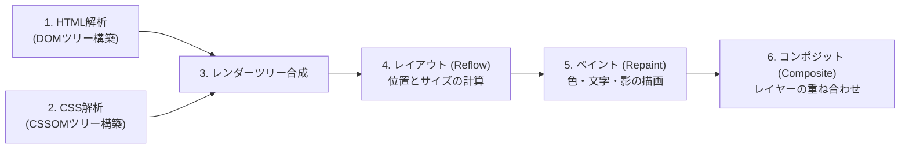
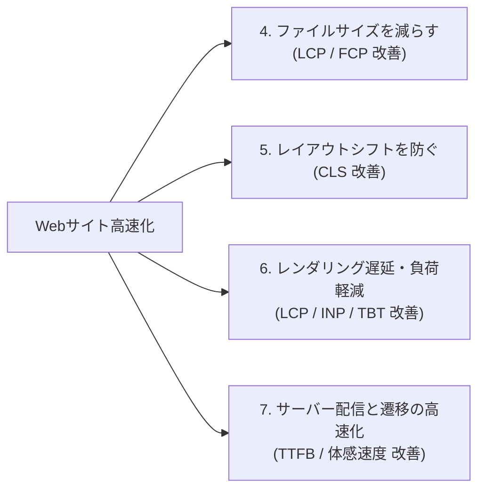

# 06_Webサイトパフォーマンス

### HTML+CSS（火1-2 / 水1）

[00_導入](https://app.notion.com/p/00_-3c8bdf471aca80e3a92afe2bc6031e14?pvs=21)

[01_**環境設定と確認課題**](https://app.notion.com/p/01_-3f0bdf471aca80d0b9acf946b73cceaf?pvs=21)

[**02_CSS設計とBEM**](https://app.notion.com/p/02_CSS-BEM-3f1bdf471aca80f7b23cc380f650eb0f?pvs=21)

[03_CSSプリプロセッサ](https://app.notion.com/p/03_CSS-3f1bdf471aca801aaefedf63d430a800?pvs=21)

[04_相対単位の使い分け](https://app.notion.com/p/04_-405bdf471aca801e8053c3b9af7384d2?pvs=21)

[05_モダン・レスポンシブWebデザイン](https://app.notion.com/p/05_Responsive-41abdf471aca8033990ec380f650eb0f?pvs=21)

[**06_Webサイトパフォーマンス**](https://app.notion.com/p/06_Web-29fbdf471aca8041b8bcda0bb4a2bd70?pvs=21)

---

# 1. はじめに

## 1-1. 前回の復習

前回（`05_モダン・レスポンシブWebデザイン`）では、モバイルファーストの設計思想のもと、Sassのマップと `@mixin mq()` によるブレイクポイントの一元管理、そして最新のCSS仕様を活用したレスポンシブ実装を学びました。

```scss
@use "sass:math";
@use "sass:map";

// 1. ブレイクポイントの一元管理とレンジ構文のMixin
$breakpoints: (
  "md": 700px,
);

@mixin mq($breakpoint: md) {
  $width: map.get($breakpoints, $breakpoint);

  @media (width >= $width) {
    @content;
  }
}

// 2. BEMモジュール内へのメディアクエリのネスト
.btn {
  display: block;
  width: 100%; // モバイルファースト：基本はSP向けの横幅100%

  @include mq(md) {
    width: rem(240); // 700px以上で固定幅に切り替え
  }
}

// 3. メディアクエリに頼らない「内包的レスポンシブ」
.menu__list {
  display: grid;
  grid-template-columns: repeat(auto-fit, minmax(260px, 1fr));
  gap: rem(32);
}
```

**【前回学んだ重要ポイント】**
- **モバイルファースト設計：** シンプルなSP（1カラム）をベースに書き、`@media (width >= ...)` で広い画面向けのレイアウトを追加していくことで、無駄な打ち消しコードを排除できる。
- **パーツ完結のネスト設計：** `@mixin mq()` を各BEMセレクタの直下にネストすることで、モジュールの独立性とメンテナンス性を高く保てる。
- **実務のレスポンシブ手法：** 文節を意識した改行制御（`inline-block`, `<wbr>`, `text-wrap: balance / pretty`）、テーブルの横スクロール・カード変形、`<picture>` によるアートディレクションと次世代画像配信。
- **内包的レスポンシブとコンテナクエリ：** `auto-fit` + `minmax()` や `@container` により、画面幅ではなく「親要素のスペース」に応じた自律的なレイアウトが可能になる。

---

## 1-2. 前回の演習の確認

**【見本】**

[KOMA ROASTERY - TOP](https://takagino.github.io/tri-education/wf1/2nd/markup-advanced/07-roastery-responsive/completed/index.html)

[KOMA ROASTERY - ABOUT & INFO](https://takagino.github.io/tri-education/wf1/2nd/markup-advanced/07-roastery-responsive/completed/about.html)

- モバイルファーストで1カラムから2カラムへの切り替えがスムーズに実装できましたか？
- `<picture>` 要素や `srcset` による画像の出し分けが正しく動作しているか、検証ツール（DevTools）で確認できましたか？

---

# 2. 今回学ぶこと

どれだけデザインが美しく、BEMやSassで綺麗に設計されたWebサイトであっても、**「開くのに何秒もかかる」「ボタンを押しても反応が鈍い」「読み込み中に画面がガタガタ動く」** サイトは、ユーザーに強いストレスを与え、すぐに閉じられてしまいます。

本単元では、現代のフロントエンド開発において必須スキルである **「Webサイトパフォーマンス（表示速度と操作性の最適化）」** の仕組み・計測手法・2026年現在のベストプラクティスを体系的に習得します。

1. **Webサイトパフォーマンスの基礎とブラウザ描画の仕組み**（直帰率・SEO、クリティカル・レンダリング・パス）
2. **Core Web Vitals（コアウェブバイタル）の3大指標**（`LCP`, `INP`, `CLS` の意味と合格基準）
3. **計測ツールの使い方**（PageSpeed Insights, Lighthouse, Chrome DevTools の Networkタブ）
4. **具体的な4大改善アプローチ**
   - ① **ファイルサイズを減らす**（次世代画像 WebP/AVIF・リサイズ・圧縮、GIFの動画化、日本語Webフォントのサブセット化、CSS/JSの軽量化）
   - ② **レイアウトシフト（CLS）をゼロにする**（`width`/`height` 属性、`aspect-ratio`、Webフォント最適化）
   - ③ **レンダリング遅延とメインスレッド負荷をなくす**（`defer`、`@import` 廃止、`fetchpriority="high"` と `loading="lazy"`、CSS背景画像の罠と `preload`、YouTubeのファサード化、`IntersectionObserver`）
   - ④ **サーバー配信とページ遷移を爆速化する**（CDN、Speculation Rules API による「0秒ページ遷移」）

---

## 2-1. Webサイトパフォーマンスとは？

Webサイトパフォーマンスとは、そのサイトがどれだけ **「速く表示され」**、**「快適に操作できるか」** を測る総合的な品質指標です。

単に「データのダウンロードが完了するまでの時間」だけではなく、**人間の目と指が感じる「ユーザー体験（UX）の質」** として以下の3つの側面が重視されます。

| 側面 | ユーザーの体感 | 対応する主な指標 |
| --- | --- | --- |
| **1. 表示速度（Loading）** | ページを開いたとき、主要なコンテンツ（メイン画像や見出し）がどれだけ速く目に飛び込んでくるか。 | **LCP** / FCP |
| **2. 応答性（Interactivity）** | ハンバーガーメニューのタップやボタンのクリックに対して、画面が引っかからず即座に反応するか。 | **INP** / TBT |
| **3. 視覚的安定性（Visual Stability）** | ページを読んでいる最中に、遅れて読み込まれた画像や広告のせいで文字やボタンが「ガタン！」とズレないか。 | **CLS** |

---

## 2-2. パフォーマンスがもたらす重大な影響

「たかが1〜2秒の違い」と侮ってはいけません。Webサイトの表示速度は、サイトの成果（売上・問い合わせ・閲覧数）に直結します。

1. **直帰率（離脱率）の急増：**
   Googleの調査によると、モバイルページの読み込み時間が **1秒から3秒に遅くなるだけで直帰率は32%増加** し、**5秒になると90%増加** します。多くのユーザーは3秒以上待ってくれません。
2. **コンバージョン率（CVR・売上）の低下：**
   ECサイトや予約サイトでは、表示が0.1秒速くなるだけで購入完了率が数%〜10%近く向上するという事例（Amazon、Walmart、Rakutenなど）が多数報告されています。
3. **ブランドイメージと信頼性の毀損：**
   反応が鈍いサイトや、タップしようとした瞬間にレイアウトがズレて誤タップを誘発するサイトは、「管理が行き届いていない」「技術力が低い企業」という悪印象を与えます。
4. **SEO（Google検索順位）への影響：**
   Googleは後述する **「Core Web Vitals」を検索ランキングの評価要因（ページエクスペリエンスシグナル）** として公式に組み込んでいます。同等のコンテンツであれば、速くて快適なサイトが上位に表示されます。

---

## 2-3. ブラウザが画面を表示する仕組み（クリティカル・レンダリング・パス）

パフォーマンス改善のテクニックを丸暗記するのではなく、**「ブラウザがHTMLを受け取ってから画面に絵を描くまでの裏側の手順（Critical Rendering Path）」** を知っておくと、なぜ各対策が必要なのかが一発で理解できるようになります。



| ステップ | ブラウザが行っている処理 | パフォーマンスが落ちる原因（ボトルネック） |
| --- | --- | --- |
| **1. DOM構築** | HTMLを上から1行ずつ読み解き、要素の親子関係（DOMツリー）を作る。 | 途中で `defer` のない `<script>` に出会うと、**HTMLの解析がそこで一時停止（ブロック）** してしまう。 |
| **2. CSSOM構築** | CSSファイルを読み込み、どの要素にどのスタイルが当たるか（CSSOM）を作る。 | CSSの解析が終わるまで、ブラウザは画面を一切描画できない（**レンダリングブロック**）。だからCSSは `<head>` のなるべく上に置き、`@import` を使わず並列に読み込む必要がある。 |
| **3. レンダーツリー** | DOMとCSSOMを合体させ、「実際に画面に表示される要素だけ」の設計図を作る（`display: none` は除外される）。 | 不要なHTML要素（過剰な `div` ネスト）や複雑すぎるCSSセレクタが多いと合成に時間がかかる。 |
| **4. レイアウト**<br>（Reflow） | 画面幅に合わせて、すべての要素の「正確な座標（X, Y）と幅・高さ」を計算する。 | 画像に `width`/`height` がないと、画像が届いた瞬間に **「4. レイアウト」のやり直し（再レイアウト＝CLS）** が発生する。 |
| **5. ペイント**<br>（Repaint） | 計算された座標の枠内に、文字や色、画像、影（`box-shadow`）を塗る。 | 巨大な未圧縮画像のデコードや、広範囲の `filter: blur()` などはペイント負荷が高い。 |
| **6. コンポジット**<br>（Composite） | 分割されたレイヤーをGPU（グラフィックス処理装置）で重ね合わせて画面に出力する。 | `transform` と `opacity` だけを使ったアニメーションは、**4（レイアウト）と5（ペイント）を飛ばして6（GPU合成）だけで処理できるため、圧倒的に滑らかで軽い！** |

---

# 3. ページ読込速度を計測・診断する

パフォーマンス改善の鉄則は、**「推測するな、計測せよ（Don't guess, measure.）」** です。
まずは現状のスコアとボトルネック（足を引っ張っている原因）をツールで可視化しましょう。

---

## 3-1. 数値で確認する（総合診断ツール）

**目的：** サイトの「総合得点（0〜100点）」と「どの指標が基準を満たしていないか」を素早く把握する。

### ① PageSpeed Insights（Webツール）
URLを入力するだけで、モバイル版・デスクトップ版それぞれのパフォーマンスを診断できるGoogle公式ツールです（※インターネット上に公開されているサイトが対象）。

- [PageSpeed Insights](https://pagespeed.web.dev/)

### ② Lighthouse（Chrome デベロッパー・ツール内蔵）
PageSpeed Insightsと同じ計測エンジンを、手元のChromeブラウザ内で直接実行できる機能です。**制作中のローカル環境（Live Serverなど）でも計測できる** のが最大の強みです。

1. Chromeで検証ツール（`Cmd + Option + I` / `F12`）を開く。
2. 上部タブから **「Lighthouse」** を選択する。
3. モード「ナビゲーション」、デバイス「モバイル（またはデスクトップ）」、カテゴリ「パフォーマンス」にチェックを入れて **「ページ読み込みを分析」** をクリックする。

<aside>
💡

**【重要】Lighthouseで正確に計測するためのコツ**

Chromeの拡張機能（広告ブロッカーや翻訳ツールなど）が動いていると、拡張機能の処理時間が加算されてスコアが低く出てしまいます。Lighthouseを実行する際は、**「シークレットウィンドウ（ゲストモード）」** で開いて計測するのが鉄則です。

</aside>

---

## 3-2. Core Web Vitals（コアウェブバイタル）と主要指標

Googleが「すべてのWebサイトが満たすべき快適なユーザー体験の基準」として定めている最重要の3指標が **Core Web Vitals（`LCP`, `INP`, `CLS`）** です。

（※2024年3月より、従来の応答性指標だった `FID` に代わって、ページ滞在中のすべての操作応答性を測る **`INP`** が正式なCore Web Vitalsとなりました。）

| 指標 | 名称 | 意味（何を測っているか） | 🟢 良好（Good） | 🔴 要改善（Poor） | 主な悪化原因 |
| --- | --- | --- | --- | --- | --- |
| **LCP**<br>★最重要 | Largest Contentful Paint<br>（最大視覚コンテンツの表示） | ファーストビュー内で **一番大きな要素（メインビジュアル画像や大見出し）** が表示されるまでの時間。 | **2.5秒以内** | 4.0秒超 | ・メイン画像の容量が大きすぎる<br>・メイン画像をCSSの `background-image` で読み込んでいる<br>・メイン画像に誤って `loading="lazy"` を付けている |
| **INP**<br>★最重要 | Interaction to Next Paint<br>（次の描画までのインタラクション） | ユーザーがクリック・タップ・キー入力してから、**画面が次の状態に描画されるまでの応答時間**。 | **200ミリ秒以内** | 500ミリ秒超 | ・JavaScriptの処理が重く、メインスレッドを長時間占有している<br>・`scroll` イベント等で毎フレーム重い処理を実行している |
| **CLS**<br>★最重要 | Cumulative Layout Shift<br>（累積レイアウトシフト） | ページの読み込み中〜閲覧中に、**要素が予期せずガタついて移動した距離の合計スコア**。 | **0.1以下** | 0.25超 | ・`` に `width` / `height` 属性がない<br>・`<iframe>` や広告枠の高さが確保されていない<br>・Webフォント読み込み時の文字サイズ変化 |
| **FCP** | First Contentful Paint<br>（最初のコンテンツ表示） | ページを開いてから、**最初の文字や画像など「何かしら1つ目」** が画面に描かれるまでの時間。 | **1.8秒以内** | 3.0秒超 | ・`<head>` 内のCSSや同期JavaScriptが描画をブロックしている<br>・Webフォントの読み込み待ち（FOIT） |
| **TTFB** | Time to First Byte<br>（最初の1バイト到達時間） | ブラウザがリクエストを送ってから、**サーバーから最初の1バイトのデータが返ってくるまでの時間**。 | **0.8秒以内** | 1.8秒超 | ・レンタルサーバー自体の性能不足<br>・WordPress（PHP/データベース）の動的生成処理が重い<br>・キャッシュやCDNが効いていない |

---

## 3-3. パフォーマンススコア（0〜100点）の内訳指標

Lighthouseの総合スコア（0〜100点）の計算には、上記の `LCP`（配点25%）、`CLS`（配点25%）、`FCP`（配点10%）に加えて、以下の2つのラボ計測指標が使われます。

| 指標 | 名称・配点 | 意味 | 主な原因 |
| --- | --- | --- | --- |
| **TBT** | Total Blocking Time<br>（合計ブロッキング時間 / **配点30%**） | 読み込み中にメインスレッドが50ミリ秒以上フリーズし、**ユーザーの操作を受け付けられなかった合計時間**（※ラボ環境における `INP` の代替指標）。 | ・重すぎるJavaScriptライブラリやアニメーション処理<br>・YouTubeやSNS埋め込みなどのサードパーティ製スクリプトの過剰な読み込み |
| **SI** | Speed Index<br>（スピードインデックス / **配点10%**） | ページを開いてから、**目に見える範囲のコンテンツがどれだけ素早く埋まっていくか** の視覚的な平均速度。 | ・ファーストビュー付近に重い画像やレンダリングブロック要素が集中している |

---

## 3-4. データの読み込み順とファイル容量を調べる（Networkタブ）

**目的：** 「なぜ遅いのか」「どのファイルが犯人なのか」をファイル単位で特定する。

Chromeデベロッパー・ツールの **「Network（ネットワーク）」タブ** を使うと、ページが読み込んでいるすべてのファイル（HTML, CSS, JS, 画像, フォント）の容量と読み込み時間（ウォーターフォール）を精密検査できます。

1. 検証ツールを開き、**「Network」タブ** を選択する。
2. 上部の **「キャッシュを無効化（Disable cache）」** にチェックを入れる（※初回訪問者の状態を再現するため）。
3. その状態で **「スーパーリロード」**（Mac: `Cmd + Shift + R` / Windows: `Ctrl + Shift + R`）を実行する。
4. 一覧の **「Size（サイズ）」** や **「Time（時間）」** の列見出しをクリックして降順ソートし、数百KB〜数MBある巨大な画像・フォントや読み込みの遅いファイルを特定する。
5. 画面最下部のサマリーバーで、ページ全体の **「リクエスト数」「転送サイズ合計（Transferred）」「リソースサイズ合計（Resources）」** を確認する。

---

## 3-5. パフォーマンス改善の4大方針

原因が特定できたら、効果の高い以下の4つのアプローチで改善を進めます。



---

# 4. ファイルサイズを減らす（最重要：LCP / FCP 改善）

Webページの総データ容量のうち、**約70%〜85%を占めているのは「画像・動画・Webフォント」** です。
まずはここを削減することが、最も少ない労力で劇的な効果を生む最優先事項です。


---

## 4-1. 画像の最適化（フォーマット選択・リサイズ・圧縮）

画像をWebサイトに載せる際は、**「① 適切なピクセル寸法にリサイズ ➔ ② 最適なフォーマット（WebP / AVIF / SVG）を選択 ➔ ③ 圧縮ツールで軽量化＆不要メタデータ（Exif）削除」** をセットで行います。

| フォーマット | 特徴・得意な画像 | 透過 | アニメーション | 2026年現在の推奨度・用途 |
| --- | --- | --- | --- | --- |
| **WebP** | 写真も透過イラストも高圧縮できるGoogle開発の次世代形式。JPEG比で25〜35%軽量。 | ⭕️ | ⭕️ | **◎ 第一選択（標準）**<br>全モダンブラウザ対応（サポート率98%超）。写真・バナーの基本形式。 |
| **AVIF** | WebPをさらに上回る圧倒的な圧縮率（JPEG比で約50%軽量）を誇る最新形式。 | ⭕️ | ⭕️ | **◎ 最高効率**<br>全主要ブラウザ対応（サポート率94%超）。特にメインビジュアル等の大きな写真に最適。 |
| **SVG** | 座標と数式で描画するベクター形式。どれだけ拡大しても一切ボヤけず、容量も極小。 | ⭕️ | ⭕️ (CSS/JS) | **◎ ロゴ・アイコンの絶対標準**<br>ロゴ、アイコン、単純な図形・イラスト、数文字のデザイン見出しはすべてSVGにする。 |
| **JPG (JPEG)** | フルカラーの写真やグラデーションに向く従来形式。 | ❌ | ❌ | **◯ フォールバック・変換元用**<br>新規制作ではWebP/AVIFへの変換元、または古い環境向けのフォールバックとして使用。 |
| **PNG** | 可逆圧縮でクッキリ表現でき、半透明（アルファチャンネル）に対応。ただし写真に使うと容量が数MBに肥大化する。 | ⭕️ | ❌ (APNGは可) | **△ 限定的**<br>写真への使用は厳禁。SVG化できない複雑な透過画像で、WebPが使えない場合のみ。 |
| **GIF** | 最大256色しか扱えない古い形式。アニメーション用途で使われてきたが、ファイルサイズが異常に重くなる。 | ⭕️ (1bit) | ⭕️ | **❌ 原則非推奨**<br>静止画ならSVG/WebP、アニメーションなら **`<video>`（MP4/WebM）** に置き換える。 |

### 画像変換・圧縮ツール（メタデータ削除も同時に完了します）

カメラやスマホで撮影した画像には「撮影日時」「GPS位置情報」などの不要なメタデータ（Exif情報）が含まれていますが、以下の変換・圧縮ツールを通すことで **メタデータの削除・減色圧縮・WebP/AVIF変換が1ステップで同時に完了** します。

- [Squoosh（Google公式・ブラウザ上でリサイズ＋AVIF/WebP変換＋画質比較ができる最強ツール）](https://squoosh.app/)
- [TinyPNG（AVIF, WebP, PNG, JPEG をドラッグ＆ドロップで一括高圧縮）](https://tinypng.com/)
- [Crushee（Mac/Windows対応の一括画像圧縮・WebP/AVIF変換デスクトップアプリ）](https://crushee.app/)
- [PNG・JPEGをWebP画像に一括変換（サルワカ道具箱）](https://saruwakakun.com/tools/png-jpeg-to-webp/)

### 実装方法（`` 単体 または `<picture>` 要素）

2026年現在、**WebPはほぼすべてのブラウザ（98%以上）で完全サポート** されているため、通常の案件では `<picture>` を使わず `` と直接記述しても実務上問題ありません。

さらに軽量な **AVIF** を優先配信しつつ、非対応環境向けにWebPやJPGへ安全にフォールバックさせたい場合は、前回学んだ `<picture>` 要素を使用します。

```html
<picture>
  <!-- 1. AVIF対応ブラウザには最軽量のAVIFを配信 -->
  <source srcset="./images/pic_roast.avif" type="image/avif">
  <!-- 2. AVIF非対応ならWebPを配信 -->
  <source srcset="./images/pic_roast.webp" type="image/webp">
  <!-- 3. フォールバック兼、alt・サイズ属性の定義 -->
  
</picture>
```

<aside>
⚠️

**【超重要】表示サイズに合わせたリサイズを忘れずに！**

画面上で「横幅 400px（Retina考慮で最大 800px）」でしか表示しないカード画像に、デジカメやスマホで撮影した **「横幅 4000px × 3000px」の元画像をそのまま読み込ませるのは絶対NG** です。フォーマット変換の前に、必ず必要なピクセル寸法（表示サイズの最大2倍程度）にリサイズしましょう。

</aside>

---

## 4-2. 巨大なGIFアニメを `<video>`（MP4 / WebM）に置き換える

制作現場や進級展作品でよく見かける「数秒間のループアニメーション」に `.gif` を使うと、たった5秒で **5MB〜20MB** もの巨大なファイルになり、ページの読み込みを壊滅的に遅くします。

これを MP4（または WebM）動画に変換し、HTMLの `<video>` タグで貼り付けると、**画質が劇的に向上するにもかかわらず、ファイルサイズは10分の1以下（数百KB）** に激減します。

```html
<!-- ❌ NG：数MB〜十数MBある巨大なGIFアニメーション -->


<!-- ⭕️ OK：軽量・高画質な <video> による自動再生ループ（GIFと同じ見た目で容量1/10！） -->
<video src="./movies/demo.mp4" autoplay loop muted playsinline width="800" height="450"></video>
```

- **`autoplay`**：自動再生する
- **`loop`**：繰り返し再生する
- **`muted`**：無音にする（※モダンブラウザでは `muted` がないと自動再生がブロックされます）
- **`playsinline`**：iPhone（iOS Safari）で勝手に全画面プレーヤーが立ち上がるのを防ぎ、ページ内で再生させる

---

## 4-3. 日本語Webフォントの容量肥大化を防ぐ（進級展で最頻出の減点原因！）

進級展やポートフォリオ制作で非常に多いのが、デザインにこだわるあまり **Google Fonts で日本語フォントを2〜3種類（ゴシック＋明朝＋手書き風など）、さらに太さ（ウェイト）を何種類も読み込んでしまい、フォントだけで 5MB〜10MB の通信が発生してスコアが赤点になるケース** です。

アルファベット（英数字）が数十文字しかない欧文フォント（約20KB）に対し、日本語フォントは漢字・ひらがな・カタカナを数千文字収録しているため、**1ウェイトあたり数MB** と桁違いに重いことを必ず意識しましょう。

### ① 「本文はOS標準フォント」＋「見出しだけWebフォント」のハイブリッド設計
長文の本文（`<p>`）には、ダウンロード不要（0バイト）で一瞬で表示されるOS標準フォント（ヒラギノ角ゴ / 游ゴシック）を指定し、デザインの印象を決める **セクション見出し（`h1`, `h2`）や欧文サブタイトルにだけWebフォントを適用する** のがプロの定石です。

### ② 数文字だけのキャッチコピーやロゴは「SVG（アウトライン化）」にする
「ファーストビューのメインコピー15文字だけ特殊な明朝体やデザイン書体を使いたい」という場合、その15文字のために数MBのフォントファイルを丸ごと読み込むのは大きな無駄です。FigmaやIllustratorで文字をアウトライン化して **SVG画像（数KB）** として書き出せば、通信量を99%削減できます。

### ③ Google Fonts の `text=` パラメータで必要な文字だけを抽出（サブセット化）する
もし「見出しで使う特定の文字だけ」をGoogle Fontsで読み込みたい場合、URLの末尾に **`&text=使いたい文字列`** を追加すると、Googleのサーバーがその文字だけを含んだ超軽量なフォントファイル（数KB）を動的に生成して返してくれます！

```html
<!-- 「KOMA ROASTERY」と「心地よい空間で、心を満たす一杯を。」の文字だけを抽出してダウンロード（容量90%以上削減！） -->
<link
  href="https://fonts.googleapis.com/css2?family=Shippori+Mincho:wght@700&display=swap&text=KOMAROASTERY心地よい空間で、を満たす一杯。"
  rel="stylesheet"
>
```

### ④ 読み込む太さ（ウェイト）を最大2種類までに絞る
Google Fontsの選択画面で `100, 300, 400, 500, 700, 900` と片っ端からチェックを入れるのは厳禁です。実際にCSSで指定する **`400`（標準）と `700`（太字）の2つだけ** に絞りましょう。

---

## 4-4. CSS・JavaScriptの軽量化（Minifyと不要コードの削除）

### ① VS Code「Live Sass Compiler」で自動Minify（圧縮）する
私たちがコードを読みやすくするために書いている「改行」「インデント（空白）」「コメント」は、ブラウザがページを描画する上では不要です。
Live Sass Compiler の設定（`settings.json`）で、出力フォーマットを **`compressed`** に変更すると、コンパイル時に自動的に空白やコメントが除去された軽量なCSSが出力されます。

```json
// VS Code の settings.json
"liveSassCompile.settings.formats": [
  {
    "format": "compressed", // expanded から compressed に変更すると自動Minifyされる！
    "extensionName": ".css",
    "savePath": "/css"
  }
]
```

### ② 未使用のCSS・JS（デッドコード）を見つけて削除する
- たった1つの簡単な動きのためだけに読み込んでいる巨大なJavaScriptライブラリや、使われなくなったCSSルールを見直します。
- Chrome検証ツールのコマンドパレット（`Cmd + Shift + P`）から **`Show Coverage`（カバレッジを表示）** を開いてリロードすると、**「読み込まれたCSS/JSのうち、現在のページで実際に使われていないコードの割合（赤色バー）」** を一目で特定できます。
- 参考記事：[そのCSS、もっと簡潔に書けるかも - Qiita](https://qiita.com/hibikikudo/items/99f70793628ad3568b78)

---

# 5. レイアウトシフト（CLS）をゼロにする

ページを読んでいる最中に、後から読み込まれた画像やフォントによって画面が「ガタン！」とズレる現象（レイアウトシフト）を防ぎ、**CLSスコア 0.1以下（理想は 0.00）** を目指します。

鉄則は、**「後から読み込まれる要素のために、あらかじめ正確な縦横スペースを確保しておくこと」** です。

---

## 5-1. 画像によるレイアウトシフトを防ぐ（最重要）

`` タグにサイズ指定がないと、ブラウザは画像データのダウンロードが完了するまで「高さ 0px」として扱います。そして画像が届いた瞬間に突然場所を押し広げるため、下の文章がガタンと押し下げられてしまいます。

**対策：すべての `` タグに `width` と `height` 属性を必ず記述する。**

```html
<!-- ❌ NG：画像が読み込まれるまで高さが分からず、レイアウトシフト（CLS）を起こす -->


<!-- ⭕️ OK：ブラウザが読み込み前に「1600:900（16:9）」のアスペクト比を認識して場所を確保する！ -->

```

<aside>
💡

**レスポンシブCSS（`max-width: 100%; height: auto;`）と併用して大丈夫？**

**まったく問題ありません（むしろ併用が必須です）！**
現在のモダンブラウザは、HTMLの `width="1600" height="900"` を見ると、それを「固定ピクセル」としてではなく **「縦横比（アスペクト比 16 : 9）のヒント」** として賢く計算します。
そのため、CSS側に `img { max-width: 100%; height: auto; }` が書いてあれば、スマホ画面でも横幅100%にフィットした上で、最初から正確な高さの空き枠を確保してくれます。

- `width` / `height` 属性には **単位（`px`）や `%` は付けず、元画像のピクセル整数値のみ** を記述します。

</aside>

---

## 5-2. 動画やマップ（`<iframe>`）やカード画像の枠を `aspect-ratio` で確保する

GoogleマップやYouTubeの埋め込み `<iframe>`、あるいはCMS（WordPress等）でユーザーが様々なサイズの画像を投稿するサムネイル枠では、CSSの **`aspect-ratio` プロパティ** を使ってあらかじめ比率を固定します。

```html
<div class="access__map">
  <iframe
    src="https://www.google.com/maps/embed?pb=..."
    width="600"
    height="450"
    style="border:0;"
    allowfullscreen=""
    loading="lazy"
    referrerpolicy="no-referrer-when-downgrade"
  ></iframe>
</div>
```

```scss
.access__map {
  width: 100%;
  aspect-ratio: 16 / 9; // 読み込み前から「16:9」のスペースをピタッと確保！

  iframe {
    width: 100%;
    height: 100%;
  }
}
```

---

## 5-3. Webフォントによるレイアウトシフトと表示遅延を防ぐ

対策をせずにWebフォントを読み込むと、以下の2つの問題を引き起こします。

- **FOIT（Flash of Invisible Text）：** フォントのダウンロードが終わるまで数秒間、**画面の文字が真っ白で何も表示されない**（FCP / LCP の大幅悪化）。
- **FOUT（Flash of Unstyled Text）によるCLS：** 最初にシステムフォントが表示され、Webフォントに切り替わった瞬間に文字幅や行間が変わってレイアウトがガタつく。

### 対策①：`preconnect`（事前接続）と `display=swap` を必ず指定する

Google Fontsを使用する場合は、`<head>` 内に **`rel="preconnect"`**（フォントサーバーへのDNS・TLS接続準備を先回りして行う指定）と、URL末尾の **`&display=swap`**（読み込み中はシステムフォントを即座に表示し、完了後に差し替える指定）をセットで記述します。

```html
<!-- Google Fonts の最適な読み込みコード -->
<link rel="preconnect" href="https://fonts.googleapis.com">
<link rel="preconnect" href="https://fonts.gstatic.com" crossorigin>
<link href="https://fonts.googleapis.com/css2?family=Noto+Sans+JP:wght@400;700&display=swap" rel="stylesheet">
```

### 対策②：自分で `@font-face` を定義する場合
フォーマットは最も圧縮率の高い **`.woff2`** を使用し、**`font-display: swap;`** を必ず追加します。

```scss
@font-face {
  font-family: "MyWebFont";
  src: url("../fonts/myfont.woff2") format("woff2");
  font-display: swap; // 読み込み完了まで代替フォントを即座に表示する
}
```

- **【より高度な対策】** [Self-HostなGoogle Fontsを使ってPageSpeedに怒られないようにする](https://tm23forest.com/contents/selfhosted-googlewebfonts-psi-okoraren)

---

# 6. レンダリング遅延とメインスレッド負荷をなくす（LCP / INP / TBT 改善）

ブラウザがHTMLを上から順番に読み込んで画面を描画する際、重いJavaScriptや画面外の画像が邪魔をして描画が止まってしまう現象（レンダリングブロック）や、操作時のカクつき（INP悪化）を解消します。

---

## 6-1. JavaScriptの読み込みを最適化する（`defer` / `type="module"`）

デフォルトの `<script src="main.js"></script>` は、ブラウザがその行に到達した瞬間、**HTMLの解析と画面の描画を完全にストップ（フリーズ）** させ、JSファイルのダウンロードと実行が終わるまで待ち続けます。これがファーストビューの表示を遅らせる最大の原因です。

**対策：`<head>` 内に書く `<script>` タグには、必ず `defer` 属性（または `type="module"`）を付ける。**

```html
<head>
  <meta charset="UTF-8">
  <meta name="viewport" content="width=device-width, initial-scale=1.0">
  <title>KOMA ROASTERY</title>
  <link rel="stylesheet" href="https://cdn.jsdelivr.net/npm/destyle.css/destyle.min.css">
  <link rel="stylesheet" href="./css/style.css">
  <!-- ⭕️ defer を付けることで、HTMLの描画を一切止めずに裏で読み込み、HTML解析完了後に実行される！ -->
  <script src="./js/main.js" defer></script>
</head>
```

| 記述方法 | HTML解析（画面描画）への影響 | 実行されるタイミング | 主な用途 |
| --- | --- | --- | --- |
| `<script src="...">`<br>（属性なし） | ❌ **HTML解析を一時停止してブロックする** | ダウンロード完了直後 | **原則非推奨**（昔の書き方） |
| **`<script src="..." defer>`** | ⭕️ **止めない**（裏で並行ダウンロード） | **HTMLの解析がすべて完了した直後**（記述順を保証） | **◎ 通常のJSファイルの標準** |
| **`<script type="module" src="...">`** | ⭕️ **止めない**（自動的に `defer` と同じ挙動になる） | **HTMLの解析がすべて完了した直後** | **◎ モダンJS（ES Modules）の標準** |
| `<script src="..." async>` | △ ダウンロード中は止めないが、完了した瞬間にHTML解析を割り込み停止して実行する | ダウンロードが終わった順（順序保証なし） | Google Analytics等の独立した外部計測タグのみ |

---

## 6-2. CSSの読み込み位置と `@import` の禁止

CSSの読み込みが遅れると、スタイルが当たっていないHTMLが一瞬表示されたり（FOUC）、CSSOMの構築待ちによってファーストビューの描画が止まります。

1. **`<link rel="stylesheet">` は `<head>` のなるべく上部に配置する。**
2. **CSSファイル内で `@import url("...");` は絶対に使わない。**

```css
/* ❌ NG：CSSファイルの中で @import を使う（直列読み込みになり表示が遅れる） */
@import url("reset.css");
@import url("https://fonts.googleapis.com/css2?family=Noto+Sans+JP&display=swap");
```

`@import` を使うと、ブラウザは「① HTMLを読む ➔ ② メインCSSをダウンロードする ➔ ③ その中に書かれた `@import` を見つけてから初めて別のCSSをダウンロードしに行く」という **数珠つなぎ（直列）の待ち時間** が発生します。
複数のSCSSファイルをまとめる際は Sass の **`@use`** を使い、外部CSSやWebフォントは必ずHTMLの **`<head>` 内の `<link>` タグ** で並列に読み込ませましょう。

---

## 6-3. 画像の読み込み優先度を制御する（`loading="lazy"` と `fetchpriority="high"`）

ページを開いた瞬間に、画面のはるか下（フッター付近など）にある何十枚もの画像を同時に読み込もうとすると、通信帯域が奪われ、一番最初に見せたいメインビジュアル（LCP）の表示が遅くなります。

ここでの2026年現在のベストプラクティスは、**「ファーストビューの画像」と「スクロールしないと見えない画像」で属性を明確に使い分けること** です。

```html
<!-- ① ファーストビューのメインビジュアル（LCP要素） -->
<!-- ❗️ loading="lazy" は絶対につけない！ fetchpriority="high" で最優先ダウンロードさせる -->


<!-- ② スクロールしないと見えない2画面目以降の画像やGoogleマップ -->
<!-- ⭕️ loading="lazy" と decoding="async" で遅延読み込みさせる -->

```

| 配置場所 | 推奨する属性 | 理由 |
| --- | --- | --- |
| **ファーストビューの画像**<br>（特にメインビジュアル＝LCP要素） | **`fetchpriority="high"`**<br>（※`loading="lazy"` は**厳禁**） | ブラウザに「この画像がページの主役（LCP）なので最優先でダウンロードして！」と伝え、LCPを劇的に短縮する。 |
| **スクロール下の画像・`<iframe>`**<br>（2画面目以降・YouTube・Googleマップ） | **`loading="lazy"`**<br>**`decoding="async"`** | ユーザーが近くまでスクロールしてくるまで読み込みを後回しにし、初回表示の通信量とメインスレッド負荷を大幅に減らす。 |

<aside>
⚠️

**【初心者が最もやりがちなミス】LCP画像への `loading="lazy"` 付与**

「画像は全部 `loading="lazy"` にすれば速くなる！」と勘違いして、**一番上のメインビジュアルにまで `loading="lazy"` を付けてしまうミス** が非常に多く見られます。
これをやると、ブラウザは「画面レイアウトの計算がすべて終わるまでメイン画像の読み込みを開始しない」ため、**LCPスコアが大幅に悪化し、PageSpeed Insightsで赤点（警告）になります。** ファーストビューの画像には絶対に `loading="lazy"` を付けないでください。

</aside>

---

## 6-4. メインビジュアルをCSSの `background-image` にする罠と `rel="preload"`

進級展の作品などで、ファーストビューの大きなメインビジュアルの上に文字を重ねたいとき、CSSの **`background-image: url(...)`** を使って実装していませんか？

実は、**LCP（メインビジュアル）にCSSの `background-image` を使うと、表示速度が大きく遅れます。**
なぜなら、ブラウザは「① HTMLを読む ➔ ② CSSファイルをダウンロードする ➔ ③ CSSを解析してDOMと照合する」という手順を踏むまで、**背景画像の存在に気づくことすらできない** ためです。

### 解決策A（推奨）：HTMLの ``（または `<picture>`）＋ `object-fit: cover` で実装する
HTML内に `` として記述しておけば、ブラウザはHTMLを開いた0.01秒後にすぐ画像のダウンロードを開始できます。文字を重ねたい場合は、CSS Gridの同一セル重ね合わせや `position: absolute;` を使います。

```scss
//  を使いつつ、背景画像のように領域いっぱいに敷き詰めるモダン実装
.hero {
  position: relative;
  min-height: 100dvh;
  display: grid;
  place-items: center;

  &__bg {
    position: absolute;
    inset: 0; // top: 0; right: 0; bottom: 0; left: 0; の省略記法
    width: 100%;
    height: 100%;
    object-fit: cover; // アスペクト比を保ったまま背景のようにトリミング
    z-index: -1;
  }
}
```

### 解決策B：どうしても `background-image` を使う場合は `<link rel="preload">` で先読みさせる
設計上の都合でどうしてもCSSの背景画像にする場合は、HTMLの `<head>` 内に **`rel="preload"`（プリロード：強制先読み）** を記述し、CSSの解析を待たずに最優先で画像をダウンロードさせます。

```html
<head>
  <!-- CSSの解析を待たず、HTMLを開いた瞬間にメイン背景画像を最優先で先読みさせる！ -->
  <link rel="preload" as="image" href="./images/bg_hero.webp" fetchpriority="high">
  <link rel="stylesheet" href="./css/style.css">
</head>
```

---

## 6-5. YouTube・SNS埋め込みの重さを解消する「ファサード（Facade）パターン」

ページ内にYouTube動画やInstagram・X（旧Twitter）の埋め込みコードをそのまま2〜3個貼り付けると、たとえユーザーが再生ボタンを押さなくても、裏側で **数MBにおよぶ大量の外部JavaScriptプレイヤーが強制的に読み込まれ、TBT（ブロッキング時間）が悪化してスコアが30〜40点急落** します。

### 対策：最初は「軽い画像（ダミーの看板＝Facade）」だけを表示する
最初は「軽量なサムネイル画像＋再生ボタンアイコン」だけを表示しておき、**ユーザーがクリックした瞬間に初めて本物の `<iframe>` を生成して再生する** 手法を **「ファサード（Facade＝建物の正面外観）パターン」** と呼びます。

GoogleのChrome開発チームも推奨している軽量Webコンポーネント **`lite-youtube-embed`** を使えば、通常の `<iframe>` と比べて **読み込み速度が約90%以上高速化** されます。

- [paulirish/lite-youtube-embed（GitHub）](https://github.com/paulirish/lite-youtube-embed)

```html
<!-- lite-youtube-embed の読み込み（わずか数KB） -->
<link rel="stylesheet" href="https://cdn.jsdelivr.net/npm/lite-youtube-embed@0.3.3/src/lite-yt-embed.min.css">
<script src="https://cdn.jsdelivr.net/npm/lite-youtube-embed@0.3.3/src/lite-yt-embed.min.js" defer></script>

<!-- 使い方：videoid にYouTubeのIDを指定するだけ！クリックされるまで重いJSを一切読み込まない -->
<lite-youtube videoid="ここにYouTubeのID" playlabel="紹介動画を再生"></lite-youtube>
```

---

## 6-6. スクロール演出とアニメーションの軽量化（INP / TBT 対策）

進級展の作品でよく実装する「スクロールしたら要素がフワッと現れる演出」やホバーアニメーションも、書き方を間違えるとスマホで画面がカクつく原因になります。

### ① `scroll` イベントの監視をやめ、`IntersectionObserver` を使う
昔のコードのように `window.addEventListener("scroll", ...)` でスクロールするたびに各要素の座標（`getBoundingClientRect()`）を計算させると、1秒間に何十回も重い処理が走り、メインスレッドが詰まって `INP` が悪化します。

現在は、**「要素が画面内（ビューポート）に交差した瞬間だけ1回だけ通知してくれる」ブラウザ標準API `IntersectionObserver`** を使うのが鉄則です。

```javascript
// ⭕️ モダンで超軽量なスクロール出現検知（IntersectionObserver）
const observer = new IntersectionObserver((entries) => {
  entries.forEach((entry) => {
    if (entry.isIntersecting) {
      entry.target.classList.add("is-visible");
      observer.unobserve(entry.target); // 1回表示したら監視を解除してメモリを節約！
    }
  });
});

document.querySelectorAll(".fade-in").forEach((el) => observer.observe(el));
```

### ② アニメーションは `transform` と `opacity` で実装する
2-3（クリティカル・レンダリング・パス）で学んだ通り、`width`, `height`, `top`, `left`, `margin` をアニメーションさせると、毎フレーム「レイアウトの再計算（Reflow）」が発生して画面がカクつきます。
移動や拡大縮小は **`transform: translate() / scale()`**、フェード表示は **`opacity`** を使うことで、GPU合成のみで滑らかに動作します。

```scss
// ⭕️ GPU合成だけで動く超軽量なフェードイン演出
.fade-in {
  opacity: 0;
  transform: translateY(24px); // top や margin-top ではなく transform を使う！
  transition: opacity 0.6s ease, transform 0.6s ease;

  &.is-visible {
    opacity: 1;
    transform: translateY(0);
  }
}
```

### ③ 長大なページの描画をスキップする `content-visibility: auto`
縦に非常に長いLP（ランディングページ）やブログ記事において、画面外のセクションに `content-visibility: auto;` を指定すると、ブラウザはそのセクションが画面に近づくまで **レンダリング（描画計算）自体をスキップ** し、初期表示速度を大幅に高速化できます。

```scss
// 画面下部の重いセクションの描画計算をスキップするモダンCSS
.lower-section {
  content-visibility: auto;
  contain-intrinsic-size: auto 600px; // スキップ中の仮の高さ（スクロールバーのガタつき防止）
}
```

---

# 7. サーバー配信とページ遷移の高速化（TTFB / 体感速度 改善）

## 7-1. 高速なホスティングとCDN（コンテンツ・デリバリー・ネットワーク）の活用

どれほどHTML・CSS・画像を完璧に軽量化しても、データを送り出すサーバー自体が遅ければ表示は速くなりません。

- **モダンなホスティングの活用：** 静的サイト（HTML/CSS/JS）であれば、**GitHub Pages、Cloudflare Pages、Vercel、Netlify** などを利用すると、世界中に配置されたエッジサーバー（CDN）からユーザーに最も近い拠点経由で超高速に配信され、ブラウザキャッシュも自動で最適化されます。
- **WordPress等のレンタルサーバー：** 動的サイトを運用する場合は、最新の通信規格（HTTP/3）とサーバーサイドキャッシュ機能が充実した高速なサーバーを選定し、必要に応じてキャッシュプラグインを導入します。
  - 参考：[CDNとは | CDNの仕組みとメリット | Cloudflare](https://www.cloudflare.com/ja-jp/learning/cdn/what-is-a-cdn/)
  - 参考：[WordPress高速化プラグインの速度ランキング | マニュオン](https://wp-search.org/ja/blog/wordpress-plugin-speed-ranking/)

<aside>
💡

**豆知識：HTTP/2・HTTP/3 の「多重化通信」により、無理なファイル結合は不要に！**

昔のWeb制作（HTTP/1.1時代）では同時接続数が制限されていたため、「リクエスト（ファイル）の数を1つでも減らすために、複数のアイコンを1枚の画像に繋ぎ合わせる（CSSスプライト）」といった工夫が必要でした。
しかし現在のサーバーは、1度の接続で何十個ものファイルを同時に並列ダウンロードできる **HTTP/2・HTTP/3** に標準対応しているため、リクエスト数を過度に気にする必要はなくなっています。

</aside>

---

## 7-2. 【2026年の最新標準】Speculation Rules API による「0秒ページ遷移」

最後に、自分のブログや複数ページ構成の進級展作品の **体感速度を劇的に別次元へ引き上げる最新のWeb標準技術「Speculation Rules API（投機的ルールAPI）」** を紹介します。

通常、Webサイトは「ユーザーがリンクをクリックしてから」次のページの読み込みを始めます。
しかし、以下の `<script type="speculationrules">` をHTMLの `<head>` 内（または `</body>` 直前）に数行貼り付けるだけで、**「ユーザーがリンクにマウスカーソルを乗せた（またはスマホでタッチし始めた）瞬間、裏側で次のページを先回りして事前描画（prerender）する」** ようになります！

結果として、ユーザーがクリックを終えた瞬間にはすでに次のページの描画が完了しており、**待ち時間 0.0秒（一瞬）でページが切り替わります。**

```html
<!-- HTMLの <head> 内または </body> 直前に貼り付けるだけ！ -->
<script type="speculationrules">
  {
    "prerender": [
      {
        "where": {
          "href_matches": "/*"
        },
        "eagerness": "moderate"
      }
    ]
  }
</script>
```

- **`"href_matches": "/*"`**：同じサイト内のすべてのページリンクを対象にする。
- **`"eagerness": "moderate"`**：ユーザーがリンクに200ミリ秒ホバーした（またはポインターダウンした）タイミングで、無駄な通信を抑えつつ賢く事前描画を開始する推奨設定。

---

# 8. パフォーマンス改善チェックリスト

自分のサイトを高速化する際、以下の項目を上から順番にチェックして潰していきましょう。

- [ ] **【計測】** シークレットウィンドウの Lighthouse（または PageSpeed Insights）で改善前のスコアと `LCP`, `INP`, `CLS` を記録したか？
- [ ] **【画像最適化】** 表示サイズに合わせてリサイズし、写真は **WebP（またはAVIF）**、ロゴ・アイコン・数文字の装飾見出しは **SVG** に変換・圧縮したか？
- [ ] **【動画化】** 容量の重いアニメーションGIFを `<video autoplay loop muted playsinline>`（MP4/WebM）に置き換えたか？
- [ ] **【Webフォント】** 日本語Webフォントを読み込みすぎていないか？ `preconnect` と `display=swap` を指定し、不要な太さ（ウェイト）の削除や `text=` によるサブセット化を行ったか？
- [ ] **【CLS対策】** すべての `` タグに **`width` と `height` 属性**（単位なしの整数）が記述されているか？
- [ ] **【CLS対策】** GoogleマップやYouTubeなどの `<iframe>` 枠に CSS の **`aspect-ratio`** で高さを確保しているか？
- [ ] **【LCP対策】** ファーストビューのメイン画像には `loading="lazy"` を付けず、**`fetchpriority="high"`** を指定したか？（CSS背景画像なら `rel="preload"` を指定したか？）
- [ ] **【遅延読込】** 2画面目以降の画像や `<iframe>` には **`loading="lazy"`** を指定したか？（YouTubeが複数ある場合は `lite-youtube-embed` 等のファサード化を検討したか？）
- [ ] **【JS・演出】** `<head>` 内の `<script>` には **`defer`** を付け、スクロール検知は **`IntersectionObserver`**、アニメーションは **`transform` / `opacity`** で実装しているか？
- [ ] **【CSS・遷移】** CSSファイル内で `@import` を使わず Live Sass Compiler で圧縮（`compressed`）出力し、複数ページサイトでは `speculationrules` による先読みを導入したか？

---

# 9. 実践課題

**サイトのデザインやレイアウトが崩れないよう気をつけながら、「自分のブログ」や「進級展の作品」をできる限り高速化させてください。**

### 実践の進め方
1. **現状の計測（Before）：**
   PageSpeed Insights または Chrome の Lighthouse（シークレットウィンドウ）で現在のサイトを計測し、モバイル・デスクトップのスコアとボトルネック項目を確認する。
2. **改善の実施：**
   本資料の「8. パフォーマンス改善チェックリスト」に沿って、画像のWebP/AVIF化・リサイズ・圧縮、Webフォントの整理、`width`/`height` 属性の付与、`loading="lazy"` と `fetchpriority="high"` の適切な設定、JavaScriptの `defer` 化、Speculation Rules API の導入などを1つずつ適用する。
3. **再計測と検証（After）：**
   改善後に再度 Lighthouse で計測し、表示崩れがないか、LCP・INP・CLS・総合スコアがどれだけ向上したかを確認する。
