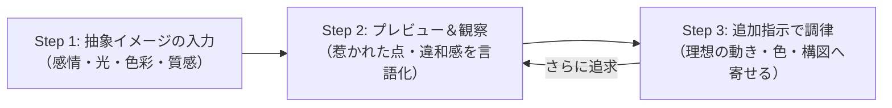

# 03_p5jsの基礎

### コンテンツ制作（金1-2）

[00_導入](https://app.notion.com/p/00_-3cebdf471aca8099b067d7a323310d2e?pvs=21)

[01_Arduinoの基礎](https://app.notion.com/p/01_Arduino-3ecbdf471aca805198efd80b40681979?pvs=21)

[02_**センサー入力値の調整**](https://app.notion.com/p/02_-3f3bdf471aca80408e5acdb3862906cb?pvs=21)

[03_p5jsの基礎](https://app.notion.com/p/03_p5js-3f9bdf471aca80839972fc3e65dda794?pvs=21)

# 1. はじめに

## 1-1. 今回学ぶこと

- **ジェネラティブアートの概念と、p5.jsの基本サイクル（`setup` と `draw`、座標系）**
- **クリエイティブコーディングの必須色彩空間「HSBカラーモード」**
- **パラパラ漫画の原理と「光の残像エフェクト」の作り方**
- **運動の数理①：三角関数（`sin` / `cos`）による呼吸・脈動・円運動**
- **座標変換（`translate`, `rotate`, `push` / `pop`）による幾何学展開**
- **運動の数理②：乱数（`random`）とパーリンノイズ（`noise`）による有機的な揺らぎ**

---

# 2. p5.jsとは？

## 2-1. 概要

**p5.js** は、デザイナー、アーティスト、教育者、そしてプログラミング初学者のために開発された、JavaScriptのクリエイティブコーディング用オープンソースライブラリです。

| 項目 | 内容 |
| --- | --- |
| **起源** | メディアアートやジェネラティブアートのデファクトスタンダードである「**Processing（プロセッシング）**」の思想を、Webブラウザ環境（JavaScript / HTML5 Canvas）へ移植したもの。 |
| **特徴** | 本来なら複雑な数学やHTML5 Canvas APIの専門構文が必要な図形描画・アニメーションを、短く直感的なコードで記述できる。 |
| **公式サイト** | [p5.js 公式サイト（p5js.org）](https://p5js.org/) |
| **作品共有** | [OpenProcessing（世界中の作品コードが見られるコミュニティ）](https://openprocessing.org/) |

---

## 2-2. ジェネラティブアートとは？

**ジェネラティブアート（Generative Art）** とは、「生成する（Generate）」という言葉の通り、人間が完成した絵を直接描くのではなく、**「描画のルール・数理（アルゴリズム）」や「偶然性（乱数）」をプログラムとして記述し、コンピュータ自身に作品を自律的・リアルタイムに生成させるアート手法** です。

| 比較項目 | 従来のデジタル制作（イラスト・CG） | ジェネラティブアート（プログラム生成） |
| --- | --- | --- |
| **制作アプローチ** | 人の手で線や色を1つずつ描く（「結果」を描く） | 描画の「ルールや数式」をプログラムする（「仕組み」をつくる） |
| **再現性** | 何度見ても全く同じ静止画・動画 | 乱数や計算により、実行するたびに異なる「一期一会のビジュアル」 |
| **拡張性・応答性** | 修正には描き直しや再レンダリングが必要 | 数値を1つ書き換えるだけで無限のバリエーション、センサーやマウス入力に即座に反応 |

**【ジェネラティブアートを支える3大要素】**

1. **アルゴリズム（規則・数理）**：幾何学の規則性、反復（ループ）、三角関数などの計算による美しい幾何学パターン。
2. **偶発性・ゆらぎ（乱数・ノイズ）**：プログラムによるランダム性や自然界の揺らぎ（パーリンノイズ）を取り入れることで、予測不能で有機的な表情を生み出す。
3. **インタラクション（外部入力）**：時間経過だけでなく、マウス・キーボード操作、さらには **「センサー（距離や明るさ）」** のデータを取り込んでリアルタイムに変幻自在に変化する。

p5.js を使うことで、この高度で魅力的なジェネラティブアートの世界を、わずか数行〜数十行の直感的なJavaScriptコードで手軽に体験・制作することができます。

---

## 2-3. 最小限のHTMLテンプレートと実行サイクル

p5.jsは、HTMLファイルの中にCDN経由で読み込むだけで、すぐに使い始めることができます。

**`index.html`**

```html
<!DOCTYPE html>
<html lang="ja">
<head>
  <meta charset="utf-8">
  <title>p5.js 基礎</title>
</head>
<body>
  <!-- p5.js CDNの読み込み -->
  <script src="https://cdn.jsdelivr.net/npm/p5@2/lib/p5.min.js"></script>
  <!-- 2. プログラム本体（外部JS）の読み込み -->
  <script src="sketch.js"></script>
</body>
</html>
```

**`sketch.js`**

```jsx
function setup() {
  createCanvas(600, 400); // 幅640px, 高さ480pxのキャンバスを生成
  background(230);         // 背景色を濃いグレーで塗る
}

function draw() {
  // アニメーションの描画コードをここに書く
}
```

<aside>
💡

**2大コア関数：`setup()` と `draw()`**

- **`setup()`**：画面起動時に **1回だけ** 呼び出されます。キャンバスの大きさの決定（`createCanvas`）や、カラーモードの設定など、準備作業を行います。
- **`draw()`**：スケッチが動いている間、**1秒間に約60回（60fps）自動で超高速ループ** し続けます。ここに変化する数値を渡すことで、滑らかなアニメーションが生まれます。
</aside>

---

## 2-4. p5.jsの座標系

p5.jsのキャンバスは、**「左上の角が原点 (0, 0)」** です。


- **X軸**: 右に進むほどプラス（`0` 〜 `width`）
- **Y軸**: **下に進むほどプラス**（`0` 〜 `height`）※一般的な数学のグラフと上下が逆なので注意！

p5.jsには、現在のキャンバスの幅と高さを保持する便利なシステム変数 **`width`** と **`height`** が常に用意されています。

**`sketch.js`**

```jsx
function setup() {
	createCanvas(600, 400);
	background(230);
}

function draw() {
	console.log(width, height); // 640 480
}
```

---

# 3. 図形の描画とスタイリング

キャンバス上に基本的な幾何学図形を描画してみましょう。

**`sketch.js`**

```jsx
function setup() {
  createCanvas(600, 400);
  background(230); // 明るいグレー

  // 1. 点: point(x, y)
  strokeWeight(8); // 点や線の太さ（px）
  stroke(255, 0, 0); // 線の色（赤）
  point(100, 100);

  // 2. 線: line(x1, y1, x2, y2)
  strokeWeight(3);
  stroke(0, 100, 255); // 青
  line(50, 200, 250, 200);

  // 3. 矩形（四角）: rect(x, y, width, height)
  noStroke(); // 枠線を消す
  fill(0, 200, 100); // 塗りつぶしの色（緑）
  rect(350, 50, 120, 80);

  // 4. 円・楕円: circle(x, y, 直径) または ellipse(x, y, 幅, 高さ)
  fill(255, 180, 0); // オレンジ
  circle(500, 250, 100);
}

function draw() {
  // 静止画なのでdrawは空
}
```

**【基本図形の描画メソッド】**

| メソッド | 役割・説明 |
| --- | --- |
| **`point(x, y)`** | 指定した座標に「点」を描く |
| **`line(x1, y1, x2, y2)`** | 2つの座標を結ぶ「直線」を描く |
| **`rect(x, y, w, h)`** | 四角形（矩形）を描く |
| **`circle(x, y, d)`** | 円を描く |
| **`ellipse(x, y, w, h)`** | 楕円を描く |
| **`triangle(x1, y1, x2, y2, x3, y3)`** | 3つの頂点を結ぶ「三角形」を描く |

**【画面設定・スタイルのメソッド】**

| メソッド | 役割・説明 | 備考・注意点 |
| --- | --- | --- |
| **`createCanvas(w, h)`** | 指定した幅と高さの描画エリア（`<canvas>`）を生成する | `setup()` の先頭で必ず呼び出します。 |
| **`background(色)`** | キャンバス全体を指定色で塗りつぶす | 過去に描いたものをすべてリセットします。 |
| **`fill(色)`** | これ以降に描く図形の「塗りつぶし色」を指定する | 別の `fill()` を呼ぶまで設定が維持されます（ステートフル）。 |
| **`noFill()`** | 図形の塗りつぶしを「なし（透明）」にする | 線画だけを描きたいときに使います。 |
| **`stroke(色)`** | これ以降に描く図形の「枠線・点」の色を指定する | `noStroke()` を呼ぶと枠線を消せます。 |
| **`strokeWeight(太さ)`** | 線の太さをピクセル単位で指定する | 初期の太さは `1` です。 |

<aside>
⚠️

**基準点の違いに注意！**

- **`circle()` / `ellipse()`**: 指定した `(x, y)` が図形の **中心** になります。
- **`rect()`**: デフォルトでは指定した `(x, y)` が図形の **左上の角** になります。
もし四角形も中心基準で扱いたい場合は、`setup()` 内で **`rectMode(CENTER);`** を実行します。
</aside>

---

## ⭐️ 練習

以下の国旗を描いてみましょう。

1. 日本
2. フランス


- 正解のソースコード
    
    ```jsx
    function setup() {
    	createCanvas(600, 400);
    	background(230);
    
    	// 日本
    	// 白い旗地
    	fill(255);
      rect(150, 30, 300, 150);
    
    	// 日の丸の赤
    	fill(188, 0, 45);
    	circle(300, 105, 90);
    
    	// フランス
    	// 左の帯：青
    	fill(0, 38, 84);
    	rect(150, 220, 100, 150);
    
    	// 中央の帯：白
    	fill(255);
    	rect(250, 220, 100, 150);
    
    	// 右の帯：赤
    	fill(237, 41, 57);
    	rect(350, 220, 100, 150);
    }
    
    function draw() {
    }
    ```
    

<aside>
💡

**座標空間の把握ポイント**

- **矩形の基準点（左上の角）**:
`rect(x, y, w, h)` の `(x, y)` は **「長方形の左上の角」** を指します。
- **円の中心と長方形の位置関係**:
日本の日の丸の中心は、長方形の左上の角 `(150, 30)` から「幅の半分（+150）」と「高さの半分（+100）」を足した **`(300, 130)`** になります。
- **横並びのX座標のシフト**:
フランス国旗のように同じ幅（100px）の長方形を横に並べる時は、開始のX座標に幅の分だけ足していく（`150` ➔ `250` ➔ `350`）ことで綺麗に隣り合います。
</aside>

---

# 4. 色彩の数理：HSBカラーモードをマスターする

## 4-1. なぜクリエイティブコーディングではRGBではなく「HSB」なのか？

Webデザインではおなじみの **RGB（赤・緑・青）** は、コンピュータのディスプレイにとっては都合が良いですが、**「コードで色を滑らかに変えたい」ときには直感的ではありません**。

例えば、「色合いはそのままで少し暗くしたい」「虹色にじわじわ変化させたい」とき、RGBだと3つの数値を同時に複雑に計算しなければなりません。

そこでクリエイティブコーディングでは **HSB（Hue, Saturation, Brightness）** を使います。


- **H（色相 / Hue）: `0 〜 360`** ➔ 色の種類（色相環をぐるっと1周する角度）
- **S（彩度 / Saturation）: `0 〜 100`** ➔ 鮮やかさ（0でモノトーン、100で鮮烈なビビッドカラー）
- **B（明度 / Brightness）: `0 〜 100`** ➔ 明るさ（0で完全な黒、100で一番明るい色）
- **Alpha（透明度）: `0 〜 100`** ➔ 透け感（0で完全透明、100で不透明）

---

## 4-2. 実験：ランダム正方形で体感する「固定」と「ゆらぎ」

「プロの色彩ルール」をさらに深く体感するために、**画面上のランダムな位置にランダムな大きさで正方形が次々と描画されていくジェネラティブアート** を作ってみましょう。

このコードの最大のポイントは、冒頭の4つの設定（色相・彩度・明度・透明度）に **「数値を入れると固定」** され、**「null（何もない状態）にするとランダム」** になる仕掛けです。

**`sketch.js`**

```jsx
const FIX_HUE = null;        // 色相: 0〜360 で固定、または null（全色ランダム）
const FIX_SATURATION = 85;   // 彩度: 0〜100 で固定、または null（白っぽさランダム）
const FIX_BRIGHTNESS = 95;   // 明度: 0〜100 で固定、または null（暗さランダム）
const FIX_ALPHA = 60;        // 透明度: 0〜100 で固定、または null（透け感ランダム）

function setup() {
  createCanvas(600, 400);
  rectMode(CENTER);
  // カラーモードを HSB（H:0〜360, S:0〜100, B:0〜100, 透明度:0〜100）に設定
  colorMode(HSB, 360, 100, 100, 100);
  background(15); // 最初に一度だけ濃いダークグレーで塗る
  noStroke();     // 枠線なし
}

function draw() {
  // 画面のランダムな位置と大きさ
  let x = random(width);
  let y = random(height);
  let size = random(20, 90);

  // 1. 色相（Hue）: 指定があればその値、nullなら 0〜360 のランダム
  let h = (FIX_HUE !== null) ? FIX_HUE : random(360);

  // 2. 彩度（Saturation）: 指定があればその値、nullなら 0〜100 のランダム
  let s = (FIX_SATURATION !== null) ? FIX_SATURATION : random(100);

  // 3. 明度（Brightness）: 指定があればその値、nullなら 0〜100 のランダム
  let b = (FIX_BRIGHTNESS !== null) ? FIX_BRIGHTNESS : random(100);
  
  // 4. 透明度（Alpha）: 指定があればその値、nullなら 0〜100 のランダム
  let a = (FIX_ALPHA !== null) ? FIX_ALPHA : random(100);

  // 透明度 60% で重ねていくことで、重なり部分が美しく透ける
  fill(h, s, b, a);
  rect(x, y, size, size);
}
```

**【実験レシピ：数値を書き換えて試してみよう】**

コード先頭の `FIX_HUE`, `FIX_SATURATION`, `FIX_BRIGHTNESS`（および `FIX_ALPHA`）の組み合わせを変えて実行し、画面の印象がどう変わるか確かめてみましょう。

| 実験パターン | `FIX_HUE`（色相） | `FIX_SATURATION`（彩度） | `FIX_BRIGHTNESS`（明度） |
| --- | --- | --- | --- |
| **パターン1：トーン統一** | `null` (ランダム) | **`85`** (固定) | **`95`** (固定) |
| **パターン2：単色グラデーション** | **`200`** (シアン青) | `null` (ランダム) | `null` (ランダム) |
| **パターン3：すべて完全ランダム** | `null` | `null` | `null` |
| **パターン4：パステルトーン** | `null` (ランダム) | **`30`** (低彩度固定) | **`95`** (高明度固定) |
| **パターン5：深海・ダークシック** | `null` (ランダム) | **`90`** (高彩度固定) | **`45`** (低明度固定) |

<aside>
💡

**ジェネラティブアートの配色の極意**

「完全なランダム（パターン3）」は一見面白そうですが、色が濁りやすくチグハグになりがちです。

**「彩度と明度を固定して、色相だけをランダムにする（パターン1）」**、あるいは **「色相を固定して、明度だけをランダムにする（パターン2）」** のように、**「どこかを固定し、どこかにゆらぎ（ランダム）を与える」** のが、プロの美しいジェネラティブ表現の基本テクニックです。

</aside>

---

# 5. アニメーションの基礎と残像（トレイル）エフェクト

## 5-1. アニメーションは「パラパラ漫画」：消すと残すの違い

アニメーションを作る大原則は **「毎フレーム新しい絵を描く前に、前回の絵を消すこと（パラパラ漫画の原理）」** です。

試しに、さっきのコードの `draw()` の先頭に **`background(15);`** を1行追加してみましょう。

**`sketch.js`**

```jsx
function setup() {
  createCanvas(600, 400);
  rectMode(CENTER);
  colorMode(HSB, 360, 100, 100, 100);
  noStroke();
}

function draw() {
  // ★ 毎フレーム、画面全体を濃いグレーで完全に塗りつぶして「消す」
  background(15);

  let x = random(width);
  let y = random(height);
  let size = random(20, 90);
	  .
	  .
	  .
}
```

毎フレーム前回の正方形が完全に消去されるため、**「正方形が画面中をテレポートするように1個だけチカチカ点滅する」** ようになります。

---

## 5-2. 透明度つき背景による「光の残像（トレイル）」

次は、`background()` の第4引数に **透明度（Alpha: 10〜15%）** を指定して、毎フレーム薄いベールを重ねるように上書きしてみましょう。

**`sketch.js`**

```jsx
function setup() {
  createCanvas(600, 400);
  rectMode(CENTER);
  colorMode(HSB, 360, 100, 100, 100);
  noStroke();
}

function draw() {
  // ★ 魔法の1行：透明度10%の背景を重ねる！（過去の絵が徐々にフェードアウトする）
  background(15, 10);

  let x = random(width);
  let y = random(height);
  let size = random(20, 90);
	  .
	  .
	  .
}
```

新しく現れた正方形が、過去の軌跡をぼんやり残しながらふわっと消えていく、**幻想的な残像エフェクト（トレイル）** に進化します。

---

## ⭐︎ 練習

1. 図形を円や線に変更してみましょう。
2. 自分が一番気持ちいいと感じる値に調整してみましょう。

---

# 6. 三角関数（`sin` / `cos`）による生命感

ただ直線的に動くだけでは、機械的で退屈な動きになってしまいます。
生物のような「呼吸」「脈動」「浮遊」「円運動」を生み出す最強の数理ツールが **三角関数（`sin` と `cos`）** です。

**【準備】**

新規jsファイル（**`circular.js`**）を作成し、htmlに読み込んでおいてください。

**`circular.js`**

```jsx
function setup() {
  createCanvas(600, 400);
	rectMode(CENTER);
	angleMode(DEGREES); // 角度を扱いやすい「度数法（0〜360度）」に設定
	colorMode(HSB, 360, 100, 100, 100);
}

function draw() {

}
```

---

## 6-1. 三角関数を「-1 から +1 を行き来する振り子」と捉える

プログラミングにおいて、`sin()` は **「時間を渡すと、-1.0 から +1.0 の間をなめらかに往復し続ける振り子運動」** です。

[https://pin.it/1bHffaq47](https://pin.it/1bHffaq47)

**【呼吸する円（脈動アニメーション）】**

**`circular.js`**

```jsx
function setup() {
  createCanvas(600, 400);
  rectMode(CENTER);
  angleMode(DEGREES);
  colorMode(HSB, 360, 100, 100, 100);
}

function draw() {
  background(0, 0, 10);

  // 1. 時間の経過（frameCount:プログラム実行時から経過したフレーム数）
  let wave = sin(frameCount); // waveは -1.0 から +1.0 を滑らかに行き来する

  // 2. 単元2で学んだ map() を使って、-1〜+1 を 半径 40px 〜 200px へ変換！
  let diameter = map(wave, -1, 1, 40, 200);

  fill(340, 80, 95); // 鮮やかなピンク
  noStroke();
  circle(width / 2, height / 2, diameter);
}
```

---

## 6-2. 円運動の公式（`cos` と `sin` のペア）

円周上をぐるぐる回る動きは、中学校で習った円の公式そのものです。

- **`x = 中心X + cos(角度) * 半径`**
- **`y = 中心Y + sin(角度) * 半径`**

**`circular.js`**

```jsx
let angle = 0;

function setup() {
  createCanvas(600, 400);
  rectMode(CENTER);
  angleMode(DEGREES);
  colorMode(HSB, 360, 100, 100, 100);
}

function draw() {
  background(0, 0, 10, 20); // 残像を残す

  let centerX = width / 2;
  let centerY = height / 2;
  let radius = 120; // 回る円の半径

  // 角度（度）を少しずつ増やす（毎フレーム2度進む ➔ 180フレーム＝約3秒で1周！）
  angle += 2;

  // 円運動の座標計算
  let x = centerX + cos(angle) * radius;
  let y = centerY + sin(angle) * radius;

  // 軌跡を描く惑星サークル
  fill((frameCount * 2) % 360, 80, 100);
  noStroke();
  circle(x, y, 24);
}
```

---

## ⭐️ 練習

好きな画像を左右に往復移動させてみましょう。

**【画像の準備】**

1. [画像をダウンロードできるサイト](https://dot-illust.net/)から、好きな画像をダウンロード。
2. html、jsと同じフォルダに入れておく。

**`circular.js`**

```jsx
let charImg;

async function setup() {
  createCanvas(600, 400);
  rectMode(CENTER);
  angleMode(DEGREES);
  colorMode(HSB, 360, 100, 100, 100);
  imageMode(CENTER); // 画像の中心を基準座標 (x, y) にする

  // 同じフォルダに保存したローカル画像を読み込む（完了まで待機）
  charImg = await loadImage('character.png');
}

function draw() {
  background(30); // 毎フレーム背景を上書きして、前フレームの絵を消す

  let speed = 1;       // 行き来のスピード（数値を大きくすると速くなる）
  let amplitude = 200;    // 左右に揺れる幅（中心から片道200px）

  // sin() は -1.0 〜 +1.0 をなめらかに往復する
  let wave = sin(frameCount * speed);

  // パターンA：中心座標に (wave * 振り幅) を足し引きする（おすすめ！）
  let x = width / 2 + wave * amplitude;

  // ※パターンB：map() 関数を使う書き方でも同じことができます
  // let x = map(wave, -1, 1, width / 2 - amplitude, width / 2 + amplitude);

  let y = height / 2; // Y座標は画面中央に固定

  image(charImg, x, y, 100, 100);
}
```

**【発展】**

1. 上下にも動きを足してみる。
2. 「6-2. 円運動の公式」を参考に、円周上をぐるぐる回してみる。

---

# 7. 座標変換（`translate`, `rotate`, `scale`, `push` / `pop`）

## 7-1. 座標変換とは？（p5.jsの描画の仕組み）

p5.js で図形を回転させたり動かそうとしたとき、最初に知っておくべき **2つの事実（描画の仕組み）** があります。

**【事実1：一度描いた図形を後から動かすことはできない】**

p5.js はキャンバス（ピクセルの集まり）に直接色を塗る仕組み（即時描画モード）です。デザインツールのオブジェクトのように「一度描いた四角形を掴んで後から動かしたり回したりする」ことはできません。

図形を動かしたいときは、**`background()` で画面全体を塗りつぶして一度リセットし、新しい位置で「最初からもう一度描き直す」** しかありません（パラパラ漫画と同じ原理です）。

**【事実2：図形自体を回転させて描く命令が存在しない】**

`rect(x, y, w, h)` や `circle(x, y, d)` などの基本図形命令には、**「図形自体を何度傾けて描くか」を指定する角度引数が存在しません**。

<aside>
💡

図形そのものを回転させたり、キャンバスの中央を基準に幾何学模様を展開するとき、p5.js では **「キャンバスの座標系（方眼紙そのもの）を移動・回転・拡大縮小させる」** というアプローチを取ります。

</aside>

**【具体的な流れ】**

1. 図形を描く**前**に、`translate()` や `rotate()`, `scale()` を使って座標空間をあらかじめ移動・回転・伸縮させる
2. 変化した座標空間の基準（原点 `(0, 0)` など）に図形を描く
3. 結果として、その位置で回転・変形した図形がキャンバスに描画される

| 命令 | 日本語 | 役割 | 主な引数 |
| --- | --- | --- | --- |
| **`translate(x, y)`** | 平行移動 | 座標の原点 `(0, 0)` を新しい位置へ移動させる | 移動先 `x`, `y` |
| **`rotate(angle)`** | 回転 | 原点 `(0, 0)` を軸に座標軸を回転させる | 角度（デフォルトはラジアン） |
| **`scale(s)`** | 拡大・縮小 | 原点 `(0, 0)` を中心に座標の縮尺を伸縮させる | 倍率（1.0が等倍、2.0で2倍、0.5で半分） |

---

## 7-2. 実験：グリッドと正方形で「座標系の動き」を可視化する

座標変換が直感的にわかりにくい最大の理由は、**普段は「目に見えない座標軸（方眼紙）」が勝手に動いているから** です。

そこで、画面に **格子（グリッド線）** と **X軸・Y軸**、そして **原点 (0, 0) に置いた正方形** を可視化して、座標系がどう動いているのかを目で見てみましょう。

**【準備】**

新規jsファイル（**`axis.js`**）を作成し、htmlに読み込んでおいてください。

**`axis.js`**

```jsx
function setup() {
  createCanvas(600, 400);
  rectMode(CENTER);
  imageMode(CENTER);
  angleMode(DEGREES);
  colorMode(HSB, 360, 100, 100, 100);
  textAlign(CENTER, CENTER);
  textSize(12);
}

function draw() {
  background(20); // 濃いダークグレー

  // ① 原点を移動
  //translate(100, 100);

  // ② 原点を軸に回転
  //rotate(45);

  // ③ 原点を中心に拡大・縮小
  //scale(2);

  drawGrid();

	// 半透明のシアンブルーの正方形
  fill(190, 80, 100, 50);
  stroke(190, 90, 100);
  strokeWeight(2);
  rect(0, 0, 100, 100);

  // 原点 (0, 0) のポイントとラベル
  fill(0, 0, 100);
  noStroke();
  circle(0, 0, 8);
  text("(0, 0)", 0, -18);
}

// ---------------------------------------------------
// 座標系（グリッド線とXY軸）を可視化するヘルパー関数
// ---------------------------------------------------
function drawGrid() {
  strokeWeight(1);

  // 方眼のグリッド線
  stroke(0, 0, 25);
  let gridSize = 40;
  for (let x = -300; x <= 300; x += gridSize) {
    line(x, -300, x, 300);
  }
  for (let y = -300; y <= 300; y += gridSize) {
    line(-300, y, 300, y);
  }

  // X軸
  stroke(0, 80, 100);
  strokeWeight(2);
  line(-260, 0, 260, 0);
  fill(0, 80, 100);
  noStroke();
  text("+X", 275, 0);

  // Y軸
  stroke(120, 80, 100);
  strokeWeight(2);
  line(0, -260, 0, 260);
  fill(120, 80, 100);
  noStroke();
  text("+Y", 0, 275);
}
```

<aside>
💡

**実行して観察してみよう**

- 赤い線（X軸）と緑の線（Y軸）の交点が **原点 `(0, 0)`** です。
- 正方形が自分で回っているのではなく、**方眼紙（グリッド全体）が中央でお引越しし、方眼紙ごと回転・伸縮している** ことがハッキリ見えます。
- この「方眼紙ごと動かす」という感覚こそが、p5.js（およびコンピュータグラフィックス全般）の座標変換の正体です。
</aside>

---

## 7-3. 座標を元に戻す：`push()` と `pop()`

`translate()` や `rotate()` などの座標変換は、**実行するたびに直前の状態の上にどんどん足し算（累積）** されていきます。

そのため、何もしないままだと次のような問題が起こります。

- **特定の図形だけを回転させたいのに、その後に描く別の図形や文字まで一緒に回ってしまう**
- **`for` 文の中で使うと、ループごとに座標や角度が足し算され、意図しない場所（渦巻き状など）へ飛んでいってしまう**

**【例：画面中央にランダムに回転させた矩形を描画したい】**

```jsx
// ❌ 問題例：for文の中でそのまま座標変換を使うと累積してしまう
for (let i = 0; i < 5; i++) {
  translate(width/2, height/2); // 1回目はwidth/2、2回目はさらにwidth/2）...と累積！
  rotate(random(360));
  rect(0, 0, 100, 100);
}
```

そこで、座標変換を特定の図形だけに限定したいときや、`for` 文の中で図形ごとに独立して回転させたいときは、**`push()`** と **`pop()`** を使います。

| 命令 | 役割 |
| --- | --- |
| **`push()`** | 現在の座標状態（原点の位置、回転角度、拡大率など）を一時保存（セーブ）する |
| **`pop()`** | 直前に `push()` で保存した状態を呼び戻して復元（ロード）する |

```jsx
// ⭕ 正解例：push() と pop() でループごとに座標をリセットする
for (let i = 0; i < 5; i++) {
	push();                       // 1. この周の描画前の座標状態をセーブ
  translate(width/2, height/2); // 2. 画面中央へ移動
  rotate(random(360));                   // 3. その場で30度だけ回転
  rect(0, 0, 100, 100);         // 4. 新しい原点 (0, 0) に描画
  pop();                        // 5. 座標状態を元に戻す（次の周に回転や移動を引き継がせない！）
}
```

---

## ⭐️ 練習

最初の練習で作成した「ランダム正方形（**`sketch.js`**）」をランダムに回転させてみよう！

**【変更のポイント（Before / After）】**

```jsx
// ✕ Before（第4-2章）：水平・垂直のまま
fill(h, s, b, a);
rect(x, y, size, size);
```

```jsx
// ◯ After（座標変換）：ランダムに回転
translate(x, y);         // 1. 描きたい位置 (x, y) に原点をお引越し
rotate(random(360));     // 2. 0〜360度 ランダムに回転
fill(h, s, b, a);
rect(0, 0, size, size);  // 3. 原点 (0, 0) に正方形を描く！
```

---

# 8. 乱数（`random`）と有機的な揺らぎ（`noise`）

コンピュータに「ゆらぎ（偶発性）」を与える手法には、大きく分けて2種類あります。

| 手法 | 特徴 | 視覚的な動きのイメージ | 代表的な用途 |
| --- | --- | --- | --- |
| **`random()`** | **完全な乱数**。直前の値と一切関係なくバラバラの値を返す。 | カクカクと激しく点滅・振動する、砂嵐、火花 | 火花、グリッチノイズ、突発的な破片 |
| **`noise()`** | **パーリンノイズ**。連続したなめらかな乱数。隣り合う値が緩やかに繋がる。 | 水面の波、煙のゆらめき、生物のうねり | 雲、波、風、生き物の自律的な動き |

---

## 8-1. 比較実験：`random` と `noise` の違いを体感する

まずは、同じ乱数でも `random()` と `noise()` で動きがどれほど異なるのか、2つの円を並べて実行してみましょう。

**【準備】**

新規jsファイル（**`random.js`**）を作成し、htmlに読み込んでおいてください。

**`random.js`**

```jsx
function setup() {
  createCanvas(600, 400);
  rectMode(CENTER);
  imageMode(CENTER);
  angleMode(DEGREES);
  colorMode(HSB, 360, 100, 100, 100);
}

function draw() {
  background(0, 0, 10);

  // --- 左側: random() による暴れる点 ---
  let randomY = random(100, 300);
  fill(0, 80, 100);
  noStroke();
  circle(width * 0.3, randomY, 30);

  // --- 右側: noise() によるなめらかに浮遊する点 ---
  let n = noise(frameCount * 0.01);
  let noiseY = map(n, 0, 1, 100, 300);
  fill(200, 80, 100); // 青
  circle(width * 0.7, noiseY, 30);
}
```

---

## 8-2. パーリンノイズ（`noise()`）の仕組み

**`noise()` は、**映画『トロン』のCG制作などで有名なケン・パーリン氏が開発したアルゴリズムです。

- 返す値は常に **`0.0 〜 1.0`** の範囲です。
- **「引数に渡した数値が近いと、返ってくる値も近い」** という決定的な特徴を持っています。
- 時間（`frameCount`）を少しずつ進めながら渡すことで、隣り合う値が緩やかに繋がった、滑らかな波のような数値が得られます。

**【値をコンソールに出力して観察してみよう】**

実際にどんな数値が出ているのか、`draw()` の中で `console.log()` を使ってブラウザのコンソールに出力してみましょう。

**`random.js`**

```jsx
function draw() {
  background(0, 0, 10);

  let r = random(0, 1);
  let n = noise(frameCount * 0.01);

  // コンソールに数値を表示（小数点以下3桁に揃えて比較）
  console.log("random:", r.toFixed(3), " | noise:", n.toFixed(3));
}
```

`random()` は毎フレーム大きく乱高下しているのに対し、`noise()` は「**前後の数値がなだらかに繋がっている」**ことが数値のログからもハッキリと確認できます。

**【`frameCount * 0.01` の「0.01」を変えるとどうなる？】**

`noise()` の引数に渡している `frameCount * 0.01` の **掛け算の数値（係数）** は、**「時間の進むスピード（波をサンプリングする歩幅）」** を表しています。

コードの `0.01` の部分をいろいろ書き換えて、青い円の動きがどう変化するか実験してみましょう！

```jsx
let n = noise(frameCount * 0.01); // 👈 この 0.01 を書き換えてみる
```

| 設定値（係数） | 動きの印象 | 特徴と用途 |
| --- | --- | --- |
| **`0.002`** | 超ゆったり・大波 | 歩幅が非常に小さいため、極めて穏やかな動き（深海のクラゲ、大きな雲のうねり） |
| **`0.01`** | **自然で心地よい揺らぎ** | 生き物の呼吸や浮遊感に最も適した定番のスピード（おすすめ！） |
| **`0.05`** | キビキビとした小刻みな揺れ | 小動物の警戒するような動き、風に細かく揺れる木の葉 |
| **`0.5`** | **カクカク暴れる** | 歩幅が大きすぎて隣り合う値の連続性が崩れ、**ほぼ `random()` と同じ激しいブレ** になってしまう！ |

<aside>
💡

**パーリンノイズ使用時のポイント**

`noise()` から返ってくる値は、**常に `0.0 〜 1.0` のごくわずかな数値** です。

そのため、そのまま座標や図形のサイズに代入しても最大でたった 1 ピクセルしか動かず、画面上ではほとんど変化が分かりません。

そこで、取得した値を **「掛け算」** または **`map()` 関数** を使って、画面上で使いたい数値範囲（例: 100px〜300px）へ変換して利用します。

```jsx
let n = noise(frameCount * 0.01); // 0.0 〜 1.0

// 幅（0 〜 width px）いっぱいに広げたいとき
let x = n * width;

// 角度（0度 〜 360度）にしたいとき
let angle = n * 360;

// 0.0〜1.0 の値を、100〜300 の範囲にスケーリング変換！
let y = map(n, 0, 1, 100, 300);
```

</aside>

---

## ⭐️ 練習

最初の練習で作成した「ランダム正方形（**`sketch.js`**）」をパーリンノイズによるランダムに変更してみよう！

毎フレーム画面のあちこちに瞬間移動して描かれていた正方形が、`noise()` を使うことで **「まるで生き物が空中をなめらかに泳ぎ回るような有機的な軌跡」** へと劇的に変化します。

**【変更のポイント（Before / After）】**

```jsx
// ✕ Before（完全ランダム）：毎フレーム画面のあちこちに散らばる
let x = random(width);
let y = random(height);
let size = random(20, 90);
```

```jsx
// ◯ After（パーリンノイズ）：滑らかな曲線を描いて空間を漂う
let x = noise(frameCount * 0.01) * width;
let y = noise(frameCount * 0.01 + 100) * height; // ★ オフセットをずらすのがコツ！
let size = map(noise(frameCount * 0.02), 0, 1, 20, 90);
```

<aside>
💡

**ワンポイント：なぜ `y` に `+ 100` するの？**

もし `x` と `y` に全く同じ `noise(frameCount * 0.01)` を渡してしまうと、`x` と `y` の計算結果が常に同じになり、**画面の左上から右下へ斜め一直線上しか動かなくなってしまいます**。

`+ 100` や `+ 1000` のように引数（サンプリングする座標）をずらす（オフセットをつける）ことで、X軸とY軸で全く異なる波を取り出すことができ、画面全体を2次元的に自由に泳ぎ回るようになります！

</aside>

**【発展チャレンジ：学んだ技術を全部合体させてみよう！】**

第7章で学んだ回転（`rotate`）や、第4章の色相（HSB）にも `noise()` を適用すると、さらに幻想的な表現になります：

```jsx
// 回転もノイズでゆっくりゆらゆら揺らす
rotate(noise(frameCount * 0.01) * 360);

// 色相（H）もノイズでなだらかにグラデーション変化させる
let h = noise(frameCount * 0.005) * 360;
```

---

# 9. 課題

## 9-1. 課題概要とテンプレート

本日学んだ以下の技術要素を組み合わせて、**動的で美しいオリジナルのジェネラティブグラフィック作品** を1つ制作してください。

- **HSBカラーモード**（世界観を統一した色彩設計）
- **アルファ付き背景による残像エフェクト**（`background(H, S, B, Alpha);`）
- **三角関数（`sin` / `cos`）**（呼吸、脈動、円運動、滑らかな往復）
- **座標変換（`translate`, `rotate`, `scale`, `push` / `pop`）**（幾何学的な展開）
- **パーリンノイズ（`noise`）**（有機的で滑らかな揺らぎ）

【**スタート用テンプレート（雛形コード）**】

```jsx
function setup() {
  createCanvas(600, 400);
  rectMode(CENTER);
  imageMode(CENTER);
  angleMode(DEGREES);                 // 角度は度数法（0〜360度）
  colorMode(HSB, 360, 100, 100, 100); // 色彩はHSBモード
}

function draw() {
  // ここにコードを書いていく
}
```

**【提出先】**

[03_p5jsの基礎 - Google Drive](https://drive.google.com/drive/folders/1CgI0GgH6SaUt6eodbOiOt-_lI3EtsHO6?usp=drive_link)

※ 〆切：10月23日(金) 朝9時まで

---

## 9-2. 制作アプローチ：抽象的な「イメージ」から理想の作品を育てる

<aside>
💡

**具象物（動物や植物）ではなく「抽象的なイメージ」から生み出そう**

「クラゲ」「花」「鳥」のような形ある生き物・モチーフを指定すると、誰もが似たようなイラスト表現になりがちです。
ジェネラティブアートの本来の面白さは、**「数式と偶然性が生み出す、現実にはない不思議な美しさ」** にあります。

「静寂」「夜明けの光」「焦燥」「宇宙のゆらぎ」など、**あえて実態のない抽象的な言葉（感情・情景・空気感）** をAIに投げかけてみてください。AIが数理幾何学やパーティクル、有機的な流線として、あなたの想像を超えたビジュアルの種を提示してくれます。

</aside>

### AIと作品を育てる「3ステップ」



1. **Step 1: 抽象的なイメージを投げてベースコードを作る（種まき）**
   - 下記のプロンプトを使い、「抽象的なテーマ」「表現したい感情や空気感」「色彩パレット」「動きの質感」をAIに伝えます。
   - ※プロンプト内で「具象的なイラストではなく、幾何学や抽象グラフィックで描くこと」をあらかじめ指示します。
2. **Step 2: 動かしてみて、自分の感覚を観察する（観察・言語化）**
   - 画面を眺めて、「この残像の引き方は綺麗だな」「でも動きがせわしなくて落ち着かない」「色が少し派手すぎるかも」など、自分の心がどう動いたかを観察・言語化します。
3. **Step 3: 対話で自分の「理想」へと近づける（調律・ブラッシュアップ）**
   - 観察した内容をそのままAIに伝え、パラメータや動きを修正させます。「一発で完成させる」のではなく、「対話を重ねて理想の作品へと育てていく」ことが、あなただけのオリジナリティを生み出す鍵です。

---

## 9-3. AIへのプロンプト例（ベース生成用）

以下の文章をコピーし、`【作りたい抽象的なイメージ】` や `【使いたい技術要素】` を自分の言葉に書き換えてAIに送信してください。

```
p5.js でジェネラティブアートを制作しています。
以下の前提条件と setup() の設定を厳守した上で、draw() のコードを作成してください。

【前提条件】
- ライブラリ: p5.js (v2.x)
- カラーモード: HSB（colorMode(HSB, 360, 100, 100, 100)）
- 角度モード: 度数法（angleMode(DEGREES)）※ラジアン（PIやTWO_PI）は使わず、0〜360度で指定してください
- キャンバスサイズ: 600 x 400（rectMode, imageMode 共に CENTER）

【ベースの setup() コード】
function setup() {
  createCanvas(600, 400);
  rectMode(CENTER);
  imageMode(CENTER);
  angleMode(DEGREES);
  colorMode(HSB, 360, 100, 100, 100);
}

【表現の重要なルール】
- 動物・植物・乗り物のような「実態のある具象的なイラスト」は描かないでください。
- 円、四角形、波、線、パーティクル、メッシュなどの「幾何学模様や抽象的なグラフィック」を組み合わせ、テーマの空気感を表現してください。

【作りたい抽象的なイメージ】
- テーマ: 「真夜中の静寂と、水底から昇る思考の泡」
- 感情・空気感: 静かで内省的、かすかな温もりと孤独感
- 色彩パレット: 深いインディゴ（暗青）の闇の中に、かすかに瞬くアンバー（琥珀色）とシアンの微光
- 動きの質感: 呼吸のようにゆっくりと膨らんでは消え、水流のようにゆらゆらと漂う

【使いたい技術要素】
1. background(230, 80, 15, 10) による、深い闇に溶け込む長い残像エフェクト
2. sin() を使った呼吸のような脈動（scale や透明度のゆっくりとした往復）
3. noise() を使った軌跡の有機的な揺らぎ
4. push() / pop() と translate(), rotate() による回転や幾何学的配置

初心者にもわかりやすいよう、コード内に丁寧な日本語コメントを入れて出力してください。
```

<aside>
🎨

**テーマを考えるヒント（キーワードパレット）**

「どんなイメージにすればいいかわからない…」という人は、以下の要素を自由に組み合わせてみてください：

- **感情・質感**: 静寂、焦燥、浮遊感、微睡み（まどろみ）、高揚、ノスタルジー、緊張と緩和、透明感、ざらつき
- **光・自然現象**: 雨上がりのアスファルトとネオン反射、木漏れ日の揺らめき、オーロラの残光、結晶化、マグマの鼓動、風の軌跡
- **時間・概念**: 記憶の断片、時間の加速、思考のシナプス、次元の歪み、誕生と消滅
</aside>

---

## 9-4. 自分の「理想」に近づけるための追加プロンプト集

ベースコードが出力されたら、動かしてみた感想をもとに、以下のようなフレーズでAIに追加の指示を出してみましょう。2〜3回やり取りを重ねることで、作品がグッと洗練されます。

| 調整したいこと | 追加プロンプトの指示フレーズ例 |
|---|---|
| **動きのテンポ・緩急** | 「全体の動きが速すぎて落ち着かないので、深呼吸するように周期を3倍ゆっくりにしてください。」<br>「単調に動いているので、sin() で急加速と静止のメリハリをつけてください。」 |
| **残像・光の質感** | 「背景の残像をもっと長く引いて、光が尾を引くように幻想的にしてください（backgroundのアルファ値を小さく）。」<br>「光が重なった部分が白く輝くような発光感を出したいです。」 |
| **色彩の統一感** | 「色が散らかって見えるので、色相（H）を青紫〜シアンの同系色に絞り、アクセントとして一部だけ黄金色に光らせてください。」<br>「もっと全体をダークにして、かすかに光が浮かび上がるトーンにしてください。」 |
| **造形の有機性・複雑さ** | 「直線的で硬い印象なので、noise() を使って水面や煙のような滑らかな曲線・波の揺らぎに変えてください。」<br>「幾何学的なパーツの数を `for` ループで増やし、万華鏡のように放射状に展開してください。」 |
| **インタラクション** | 「マウスの位置（`mouseX`, `mouseY`）に向かって光が集まる（または逃げる）インタラクションを加えてください。」 |

```
💡 プロンプトのコツ
「なんか違う」と思った時は、何が違うのか（スピード？ 色？ 形？ 密度？）を言葉にして伝えるだけで、AIは的確に修正コードを提案してくれます。
```