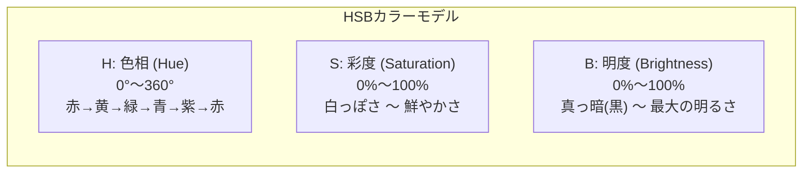
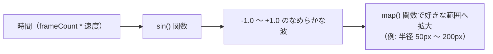
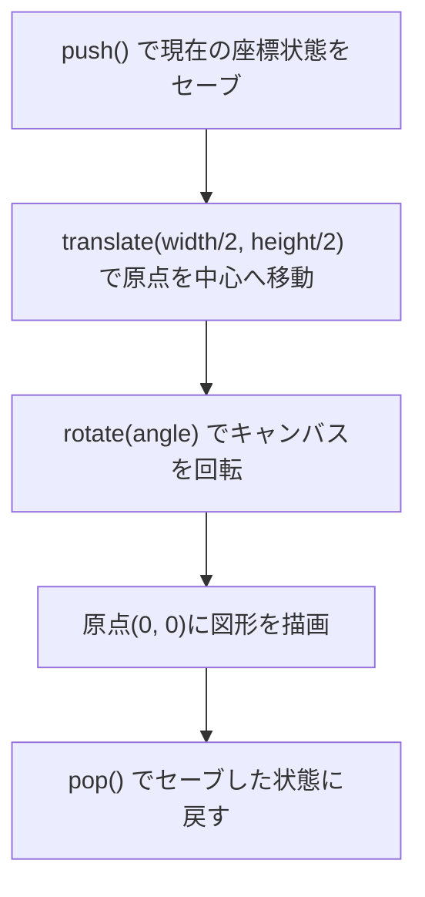

# 03_p5.jsの基礎（描画・色彩・運動の数理）

### コンテンツ制作（金1-2）

[00_導入](https://app.notion.com/p/00_-3cebdf471aca8099b067d7a323310d2e?pvs=21)

[01_Arduinoの基礎](https://app.notion.com/p/01_Arduino-3ecbdf471aca805198efd80b40681979?pvs=21)

[02_センサー入力値の調整](https://app.notion.com/p/02_-3f3bdf471aca80408e5acdb3862906cb?pvs=21)

[03_p5.jsの基礎](https://app.notion.com/p/04_p5-js-xxxx?pvs=21)

[04_p5.jsとセンサー](https://app.notion.com/p/05_p5-js-xxxx?pvs=21)

---

# 1. はじめに

## 1-1. 今回学ぶこと

前回までは「画像コマ送り」を使って、手回しアニメーションのようにイラストを動かしました。
今回は、あらかじめ描いた絵を表示するのではなく、**プログラムと数理（計算）によってリアルタイムに美しいグラフィックやアニメーションを自動生成する「クリエイティブコーディング」** の世界に足を踏み入れます。

その強力な武器となるライブラリが **p5.js（ピーファイブ・ジェーエス）** です。

- **p5.jsの実行サイクルと描画の基本（`setup` と `draw`、座標系）**
- **クリエイティブコーディングの必須色彩空間「HSBカラーモード」**
- **パラパラ漫画の原理と「光の残像エフェクト」の作り方**
- **運動の数理①：三角関数（`sin` / `cos`）による呼吸・脈動・円運動**
- **座標変換（`translate`, `rotate`, `push` / `pop`）による幾何学展開**
- **運動の数理②：乱数（`random`）とパーリンノイズ（`noise`）による有機的な揺らぎ**

---

# 2. p5.jsとは？

## 2-1. 概要

**p5.js** は、デザイナー、アーティスト、教育者、そしてプログラミング初学者のために開発された、JavaScriptのクリエイティブコーディング用オープンソースライブラリです。

| 項目 | 内容 |
|---|---|
| **起源** | メディアアートやジェネラティブアートのデファクトスタンダードである「**Processing（プロセッシング）**」の思想を、Webブラウザ環境（JavaScript / HTML5 Canvas）へ移植したもの。 |
| **特徴** | 本来なら複雑な数学やHTML5 Canvas APIの専門構文が必要な図形描画・アニメーションを、短く直感的なコードで記述できる。 |
| **公式サイト** | [p5.js 公式サイト（p5js.org）](https://p5js.org/) |
| **作品共有** | [OpenProcessing（世界中の作品コードが見られるコミュニティ）](https://openprocessing.org/) |

---

## 2-2. 最小限のHTMLテンプレートと実行サイクル

p5.jsは、HTMLファイルの中にCDN経由で読み込むだけで、すぐに使い始めることができます。

**【基本テンプレート（index.html）】**

```html
<!DOCTYPE html>
<html lang="ja">
<head>
  <meta charset="utf-8">
  <title>p5.js 基礎</title>
  <style>
    body {
      margin: 0;
      padding: 0;
      background-color: #111;
      display: flex;
      justify-content: center;
      align-items: center;
      min-height: 100vh;
    }
    canvas {
      box-shadow: 0 10px 30px rgba(0, 0, 0, 0.5);
    }
  </style>
</head>
<body>
  <!-- p5.js CDNの読み込み -->
  <script src="https://cdn.jsdelivr.net/npm/p5@1.11.11/lib/p5.min.js"></script>
  <script>
    // 1. ページ読み込み時に「1回だけ」実行される初期化関数
    function setup() {
      createCanvas(640, 480); // 幅640px, 高さ480pxのキャンバスを生成
      background(30);         // 背景色を濃いグレー（グレースケール30）で塗る
    }

    // 2. 毎フレーム（通常1秒間に60回）自動で繰り返し実行される描画ループ関数
    function draw() {
      // アニメーションの描画コードをここに書く
    }
  </script>
</body>
</html>
```

<aside>
💡

**2大コア関数：`setup()` と `draw()`**
- **`setup()`**: 画面起動時に **1回だけ** 呼び出されます。キャンバスの大きさの決定（`createCanvas`）や、カラーモードの設定など、準備作業を行います。
- **`draw()`**: スケッチが動いている間、**1秒間に約60回（60fps）自動で超高速ループ** し続けます。ここに変化する数値を渡すことで、滑らかなアニメーションが生まれます。

</aside>

---

## 2-3. p5.jsの座標系

p5.jsのキャンバスは、**「左上の角が原点 (0, 0)」** です。
- **X軸**: 右に進むほどプラス（`0` 〜 `width`）
- **Y軸**: **下に進むほどプラス**（`0` 〜 `height`）※一般的な数学のグラフと上下が逆なので注意！

p5.jsには、現在のキャンバスの幅と高さを保持する便利なシステム変数 **`width`** と **`height`** が常に用意されています。

---

# 3. 図形の描画とスタイリング

キャンバス上に基本的な幾何学図形を描画してみましょう。

```javascript
function setup() {
  createCanvas(640, 480);
  background(240); // 明るいグレー

  // 1. 点: point(x, y)
  strokeWeight(8); // 点や線の太さ（px）
  stroke(255, 0, 0); // 線の色（赤）
  point(100, 100);

  // 2. 線: line(x1, y1, x2, y2)
  strokeWeight(3);
  stroke(0, 100, 255); // 青
  line(50, 200, 250, 200);

  // 3. 矩形（四角）: rect(x, y, width, height)
  noStroke(); // 枠線を消す
  fill(0, 200, 100); // 塗りつぶしの色（緑）
  rect(350, 50, 120, 80);

  // 4. 円・楕円: circle(x, y, 直径) または ellipse(x, y, 幅, 高さ)
  fill(255, 180, 0); // オレンジ
  circle(500, 250, 100);
}

function draw() {
  // 静止画なのでdrawは空
}
```

| メソッド | 役割・説明 | 備考・注意点 |
|---|---|---|
| **`createCanvas(w, h)`** | 指定した幅と高さの描画エリア（`<canvas>`）を生成する | `setup()` の先頭で必ず呼び出します。 |
| **`background(色)`** | キャンバス全体を指定色で塗りつぶす | 過去に描いたものをすべてリセットします。 |
| **`fill(色)`** | これ以降に描く図形の「塗りつぶし色」を指定する | 別の `fill()` を呼ぶまで設定が維持されます（ステートフル）。 |
| **`noFill()`** | 図形の塗りつぶしを「なし（透明）」にする | 線画だけを描きたいときに使います。 |
| **`stroke(色)`** | これ以降に描く図形の「枠線・点」の色を指定する | `noStroke()` を呼ぶと枠線を消せます。 |
| **`strokeWeight(太さ)`** | 線の太さをピクセル単位で指定する | 初期の太さは `1` です。 |

<aside>
⚠️

**基準点の違いに注意！**
- **`circle()` / `ellipse()`**: 指定した `(x, y)` が図形の **中心** になります。
- **`rect()`**: デフォルトでは指定した `(x, y)` が図形の **左上の角** になります。
もし四角形も中心基準で扱いたい場合は、`setup()` 内で **`rectMode(CENTER);`** を実行します。

</aside>

---

## 3-1. 練習問題：国旗を描いてみよう（日本 ＆ フランスを上下に並べる）

基本図形（`circle` / `rect`）とスタイル指定（`background` / `fill` / `noStroke`）が分かったところで、**キャンバスの座標空間（X座標・Y座標・幅・高さ）** を直感的に把握するための腕試しとして、**薄いグレーの背景の上に、日本とフランスの国旗を上下に並べて** 描いてみましょう！

この練習では変数を使わず、**数値を直接指定** して座標の足し算・位置関係を身体で覚えます。

```mermaid
graph TD
    subgraph キャンバス（幅600 x 高さ500 / 背景: 薄いグレー）
        J["【上段: 日本の国旗】<br>白の枠: rect(150, 30, 300, 200)<br>赤の丸: circle(300, 130, 120)"]
        F["【下段: フランスの国旗】<br>青の矩形: rect(150, 270, 100, 200)<br>白の矩形: rect(250, 270, 100, 200)<br>赤の矩形: rect(350, 270, 100, 200)"]
        J --> F
    end
```

### 仕様・座標の計算
- **キャンバスサイズ**: 幅 600px、高さ 500px（背景: `background(230)` 薄いグレー）
- **国旗の共通サイズ**: 幅 300px × 高さ 200px（左右中央に置くため、開始X座標は **`150`**）
- **上段（日本の国旗）**:
  - 開始Y座標: **`30`**
  - 白い枠: `rect(150, 30, 300, 200)`
  - 日の丸の赤丸: 枠の中心 `(x: 150 + 150 = 300, y: 30 + 100 = 130)`、直径 `120`
- **下段（フランスの国旗）**:
  - 開始Y座標: **`270`**（上の国旗の下端 230px ＋ 隙間 40px）
  - 幅 100px の矩形を3つ横に並べる：
    - 左（青）: `rect(150, 270, 100, 200)`
    - 中（白）: `rect(250, 270, 100, 200)`（150 + 100）
    - 右（赤）: `rect(350, 270, 100, 200)`（250 + 100）

---

**【正解コード】**

```javascript
function setup() {
  createCanvas(600, 500);
  background(230); // 背景を薄いグレーにして、白い国旗の輪郭を見せる
  noStroke();      // 枠線なし

  // ===================================================
  // 1. 上段：日本の国旗（日の丸）
  // ===================================================
  // 白い旗地（左上 x:150, y:30、幅 300、高さ 200）
  fill(255);
  rect(150, 30, 300, 200);

  // 日の丸の赤（中心 x:300, y:130、直径 120）
  fill(188, 0, 45); // 日本の伝統色：紅赤
  circle(300, 130, 120);

  // ===================================================
  // 2. 下段：フランスの国旗（トリコロール）
  // ===================================================
  // 左の帯：青（x: 150）
  fill(0, 38, 84);
  rect(150, 270, 100, 200);

  // 中央の帯：白（x: 250 ＝ 150 + 幅100）
  fill(255);
  rect(250, 270, 100, 200);

  // 右の帯：赤（x: 350 ＝ 250 + 幅100）
  fill(237, 41, 57);
  rect(350, 270, 100, 200);
}

function draw() {
  // 静止画なのでdrawは空
}
```

<aside>
💡

**座標空間の把握ポイント！**
- **矩形の基準点（左上の角）**:
  `rect(x, y, w, h)` の `(x, y)` は **「長方形の左上の角」** を指します。
- **円の中心と長方形の位置関係**:
  日本の日の丸の中心は、長方形の左上の角 `(150, 30)` から「幅の半分（+150）」と「高さの半分（+100）」を足した **`(300, 130)`** になります。
- **横並びのX座標のシフト**:
  フランス国旗のように同じ幅（100px）の長方形を横に並べる時は、開始のX座標に幅の分だけ足していく（`150` ➔ `250` ➔ `350`）ことで綺麗に隣り合います。

</aside>

---

# 4. 色彩の数理：HSBカラーモードをマスターする

## 4-1. なぜクリエイティブコーディングではRGBではなく「HSB」なのか？

Webデザインではおなじみの **RGB（赤・緑・青）** は、コンピュータのディスプレイにとっては都合が良いですが、**「コードで色を滑らかに変えたい」ときには直感的ではありません**。

例えば、「色合いはそのままで少し暗くしたい」「虹色にじわじわ変化させたい」とき、RGBだと3つの数値を同時に複雑に計算しなければなりません。

そこでクリエイティブコーディングでは **HSB（Hue, Saturation, Brightness）** を使います。



- **H（色相 / Hue）: `0 〜 360`** ➔ 色の種類（色相環をぐるっと1周する角度）
- **S（彩度 / Saturation）: `0 〜 100`** ➔ 鮮やかさ（0でモノトーン、100で鮮烈なビビッドカラー）
- **B（明度 / Brightness）: `0 〜 100`** ➔ 明るさ（0で完全な黒、100で一番明るい色）
- **Alpha（透明度）: `0 〜 100`** ➔ 透け感（0で完全透明、100で不透明）

## 4-2. 実験：ランダム正方形で体感する「固定」と「ゆらぎ」

「プロの色彩ルール」をさらに深く体感するために、**画面上のランダムな位置にランダムな大きさで正方形が次々と描画されていくジェネラティブアート** を作ってみましょう。

このコードの最大のポイントは、冒頭の3つの設定（色相・彩度・明度）に **「数値を入れると固定」** され、**「null（何もない状態）にするとランダム」** になる仕掛けです。

```javascript
// ===================================================
// ★ 実験：数値を指定すると「固定」、null にすると「ランダム」になる！
// ===================================================
const FIX_HUE = null;        // 色相: 0〜360 で固定、または null（全色ランダム）
const FIX_SATURATION = 85;   // 彩度: 0〜100 で固定、または null（白っぽさランダム）
const FIX_BRIGHTNESS = 95;   // 明度: 0〜100 で固定、または null（暗さランダム）

function setup() {
  createCanvas(600, 400);
  // カラーモードを HSB（H:0〜360, S:0〜100, B:0〜100, 透明度:0〜100）に設定
  colorMode(HSB, 360, 100, 100, 100);
  background(15); // 最初に一度だけ濃いダークグレーで塗る
  noStroke();     // 枠線なし
  rectMode(CENTER);
}

function draw() {
  // 画面のランダムな位置と大きさ
  let x = random(width);
  let y = random(height);
  let size = random(20, 90);

  // 1. 色相（Hue）: 指定があればその値、nullなら 0〜360 のランダム
  let h = (FIX_HUE !== null) ? FIX_HUE : random(360);

  // 2. 彩度（Saturation）: 指定があればその値、nullなら 0〜100 のランダム
  let s = (FIX_SATURATION !== null) ? FIX_SATURATION : random(100);

  // 3. 明度（Brightness）: 指定があればその値、nullなら 0〜100 のランダム
  let b = (FIX_BRIGHTNESS !== null) ? FIX_BRIGHTNESS : random(100);

  // 透明度 60% で重ねていくことで、重なり部分が美しく透ける
  fill(h, s, b, 60);
  rect(x, y, size, size);
}
```

### 実験レシピ：数値を書き換えて試してみよう！
コード先頭の `FIX_HUE`, `FIX_SATURATION`, `FIX_BRIGHTNESS` の組み合わせを変えて実行し、画面の印象がどう変わるか確かめてみましょう。

| 実験パターン | `FIX_HUE`（色相） | `FIX_SATURATION`（彩度） | `FIX_BRIGHTNESS`（明度） | 生成されるアートの印象 |
|---|:---:|:---:|:---:|---|
| **パターン1：トーン統一（プロ推奨！）** | `null` (ランダム) | **`85`** (固定) | **`95`** (固定) | **カラフルなのに絶対に色が濁らない！** 洗練されたポップアートになります。 |
| **パターン2：単色グラデーション** | **`200`** (シアン青) | `null` (ランダム) | `null` (ランダム) | 青色の濃淡だけで構成された、統一感のあるクールなアートになります。 |
| **パターン3：すべて完全ランダム** | `null` | `null` | `null` | 濁った色やくすんだ色が混ざり、全体が少し散らかった印象になります。 |
| **パターン4：パステルトーン** | `null` (ランダム) | **`30`** (低彩度固定) | **`95`** (高明度固定) | 白が混ざったような、柔らかく優しいパステルカラーの世界になります。 |
| **パターン5：深海・ダークシック** | `null` (ランダム) | **`90`** (高彩度固定) | **`45`** (低明度固定) | 暗闇にネオンがぼんやり浮かび上がるような、重厚でシックなトーンになります。 |

<aside>
💡

**ジェネラティブアートの配色の極意**
「完全なランダム（パターン3）」は一見面白そうですが、色が濁りやすくチグハグになりがちです。
**「彩度と明度を固定して、色相だけをランダムにする（パターン1）」**、あるいは **「色相を固定して、明度だけをランダムにする（パターン2）」** のように、**「どこかを固定し、どこかにゆらぎ（ランダム）を与える」** のが、プロの美しいジェネラティブ表現の基本テクニックです！

</aside>

---

# 5. アニメーションの基礎と残像（トレイル）エフェクト

さっきの「4-2. ランダム正方形の実験」では、`background()` を `setup()` の中で1回しか呼ばなかったため、画面に描かれた正方形がずっと残り続け、最後は画面全体が埋め尽くされました。

では、**「動き続けるアニメーション」** や **「ふわっと消えていく光の残像」** はどうやって作るのでしょうか？

---

## 5-1. アニメーションは「パラパラ漫画」：消すと残すの違い

アニメーションを作る大原則は **「毎フレーム新しい絵を描く前に、前回の絵を消すこと（パラパラ漫画の原理）」** です。

試しに、さっきのコードの `draw()` の先頭に **`background(15);`** を1行追加してみましょう。

```javascript
function setup() {
  createCanvas(600, 400);
  colorMode(HSB, 360, 100, 100, 100);
  noStroke();
  rectMode(CENTER);
}

function draw() {
  // ★ 毎フレーム、画面全体を濃いグレーで完全に塗りつぶして「消す」
  background(15);

  let x = random(width);
  let y = random(height);
  let size = random(20, 90);

  fill(180, 85, 95);
  rect(x, y, size, size);
}
```

これを実行するとどうなるでしょうか？
毎フレーム前回の正方形が完全に消去されるため、**「正方形が画面中をテレポートするように1個だけチカチカ点滅する」** ようになります。

---

## 5-2. 【演出の秘訣】透明度つき背景による「光の残像（トレイル）」

ここで疑問が湧きます。
- **全く消さない（4-2）** ➔ 画面が正方形で埋め尽くされて動かなくなる
- **完全に消す（5-1）** ➔ 1個だけチカチカ点滅して余韻がない

では、その中間である **「過去の絵が、うっすら時間をかけて消えていく」** ようにするにはどうすればいいでしょうか？

その答えこそが、ジェネラティブアートの魔法のテクニック **「半透明の背景塗り」** です！
`background()` の第4引数に **透明度（Alpha: 10〜15%）** を指定して、毎フレーム薄いベールを重ねるように上書きします。

```javascript
function setup() {
  createCanvas(600, 400);
  colorMode(HSB, 360, 100, 100, 100);
  noStroke();
  rectMode(CENTER);
}

function draw() {
  // ★ 魔法の1行：透明度10%の背景を重ねる！（過去の絵が徐々にフェードアウトする）
  background(15, 10);

  let x = random(width);
  let y = random(height);
  let size = random(20, 90);

  fill(180, 85, 95, 70);
  rect(x, y, size, size);
}
```

これを実行すると、新しく現れた正方形が、過去の軌跡をぼんやり残しながらふわっと消えていく、**幻想的な残像エフェクト（トレイル）** に進化します！

---

## 5-3. 移動する図形に「光の尾」を引かせる

この半透明背景（`background(15, 15)`）の仕組みを、滑らかに移動するオブジェクト（円や図形）と組み合わせると、まるで彗星の尾やオーロラのような美しい「光の軌跡」が生まれます。

```javascript
let x = 0; // 円のX座標

function setup() {
  createCanvas(600, 400);
  colorMode(HSB, 360, 100, 100, 100);
  noStroke();
}

function draw() {
  // 半透明の背景で前フレームの残像を残す！
  background(15, 15);

  x += 4; // 毎フレーム4ピクセル右へ進める
  if (x > width) {
    x = 0; // 画面端まで行ったら左端へ戻す
  }

  // 彗星のように光の尾を引いて流れるサークル
  fill(180, 80, 100);
  circle(x, height / 2, 40);
}
```

---

# 6. 運動の数理①：三角関数（`sin` / `cos`）による生命感

ただ直線に動くだけ（`x += 3`）では、機械的で退屈な動きになってしまいます。
生物のような「呼吸」「脈動」「浮遊」「円運動」を生み出す最強の数理ツールが **三角関数（`sin` と `cos`）** です。

## 6-1. 三角関数を「-1 から +1 を行き来する振り子」と捉える

数学の難しい定理を思い出す必要はありません。プログラミングにおいて、`sin()` は **「時間を渡すと、-1.0 から +1.0 の間をなめらかに往復し続ける振り子マシン」** です。



### 呼吸する円（脈動アニメーション）

```javascript
function setup() {
  createCanvas(640, 480);
  colorMode(HSB, 360, 100, 100, 100);
}

function draw() {
  background(0, 0, 10);

  // 1. 時間の経過（frameCountに0.05などの小さい小数を掛けるのがコツ）
  let wave = sin(frameCount * 0.05); // waveは -1.0 から +1.0 を滑らかに行き来する

  // 2. 単元2で学んだ map() を使って、-1〜+1 を 半径 40px 〜 200px へ変換！
  let diameter = map(wave, -1, 1, 40, 200);

  fill(340, 80, 95); // 鮮やかなピンク
  noStroke();
  circle(width / 2, height / 2, diameter);
}
```

## 6-2. 円運動の公式（`cos` と `sin` のペア）

円周上をぐるぐる回る動きは、中学校で習った円の公式そのものです。
- **`x = 中心X + cos(角度) * 半径`**
- **`y = 中心Y + sin(角度) * 半径`**

```javascript
let angle = 0;

function setup() {
  createCanvas(640, 480);
  colorMode(HSB, 360, 100, 100, 100);
}

function draw() {
  background(0, 0, 10, 20); // 残像を残す

  let centerX = width / 2;
  let centerY = height / 2;
  let radius = 120; // 回る円の半径

  // 角度（ラジアン）を少しずつ増やす
  angle += 0.04;

  // 円運動の座標計算
  let x = centerX + cos(angle) * radius;
  let y = centerY + sin(angle) * radius;

  // 軌跡を描く惑星サークル
  fill((frameCount * 2) % 360, 80, 100);
  noStroke();
  circle(x, y, 24);
}
```

---

# 7. 座標変換（`translate`, `rotate`, `push` / `pop`）

図形そのものを回転させたり、キャンバスの中央を基準に幾何学模様を展開するときは、**「キャンバスの座標系そのものを移動・回転させる」** アプローチを取ります。

## 7-1. 原点の移動と回転



```javascript
function setup() {
  createCanvas(640, 480);
  colorMode(HSB, 360, 100, 100, 100);
  rectMode(CENTER); // 四角形を中心に描くモード
}

function draw() {
  background(0, 0, 10, 20);

  push(); // 1. 今の座標状態（原点が左上(0,0)、無回転）を記憶

  translate(width / 2, height / 2); // 2. 原点をキャンバスの中央へお引っ越し
  rotate(frameCount * 0.02);        // 3. 原点を軸にキャンバスを回転

  noFill();
  stroke(160, 80, 100); // ミントグリーン
  strokeWeight(2);
  rect(0, 0, 150, 150); // 4. 移動した新しい原点 (0, 0) を中心に四角を描く！

  pop(); // 5. 座標系を元に戻す（これ以降の描画が巻き込まれないようにする）
}
```

---

# 8. 運動の数理②：乱数（`random`） vs 有機的な揺らぎ（`noise`）

コンピュータに「ゆらぎ（偶発性）」を与える手法には、大きく分けて2種類あります。

| 手法 | 特徴 | 視覚的な動きのイメージ | 代表的な用途 |
|---|---|---|---|
| **`random()`** | **完全な乱数**。直前の値と一切関係なくバラバラの値を返す。 | カクカクと激しく点滅・振動する、砂嵐、火花 | 火花、グリッチノイズ、突発的な破片 |
| **`noise()`** | **パーリンノイズ**。連続したなめらかな乱数。隣り合う値が緩やかに繋がる。 | 水面の波、煙のゆらめき、生物のうねり | 雲、波、風、生き物の自律的な動き |

## 8-1. 比較実験：`random` と `noise` の違いを体感する

```javascript
function setup() {
  createCanvas(640, 480);
  colorMode(HSB, 360, 100, 100, 100);
}

function draw() {
  background(0, 0, 10);

  // --- 左側: random() による暴れる点 ---
  let randomY = random(height * 0.2, height * 0.8);
  fill(0, 80, 100); // 赤
  noStroke();
  circle(width * 0.3, randomY, 30);

  // --- 右側: noise() によるなめらかに浮遊する点 ---
  // noise() の引数には、少しずつ増える連続した数値（frameCount * 0.01など）を渡す
  let n = noise(frameCount * 0.01); // 0.0 〜 1.0 のなめらかな値が返る
  let noiseY = map(n, 0, 1, height * 0.2, height * 0.8);
  fill(200, 80, 100); // 青
  circle(width * 0.7, noiseY, 30);
}
```

---

# 9. 実践マイクロハンズオン：数理が生み出す幾何学曼荼羅

ここまで学んだ「HSB色彩」「三角関数（`cos`/`sin`）」「座標変換」「残像」をすべて統合した、魅惑的な幾何学曼荼羅を作ってみましょう。

```javascript
function setup() {
  createCanvas(600, 600);
  colorMode(HSB, 360, 100, 100, 100);
  rectMode(CENTER);
}

function draw() {
  background(0, 0, 8, 20); // ほのかな残像

  push();
  translate(width / 2, height / 2); // 原点を画面中央へ

  let numShapes = 12; // 並べる図形の数
  let radius = map(sin(frameCount * 0.03), -1, 1, 80, 220); // 呼吸する半径

  for (let i = 0; i < numShapes; i++) {
    let angle = (TWO_PI / numShapes) * i + frameCount * 0.01;
    let x = cos(angle) * radius;
    let y = sin(angle) * radius;

    push();
    translate(x, y);
    rotate(angle + frameCount * 0.03);

    // 色相を円周上に沿ってグラデーション配置
    let h = (i * (360 / numShapes) + frameCount) % 360;
    stroke(h, 80, 100, 80);
    strokeWeight(2);
    noFill();

    // 幾何学リング
    rect(0, 0, 40, 40);
    circle(0, 0, 20);
    pop();
  }

  pop();
}
```

---

# 10. 演習課題

## 10-1. 課題内容

本日のサンプルコードをベースに、**「色彩・三角関数・ノイズ」を活かした動的なジェネラティブグラフィック作品** を制作してください。

## 10-2. カスタマイズのヒント
1. **図形の数を変えてみる**：`numShapes` を 6個、16個、32個に変えると密度が激変します。
2. **図形の種類を変えてみる**：四角形だけでなく、`line()` や `triangle()`、大小の `circle()` を重ねてみましょう。
3. **マウスと連動させてみる**：`mouseX` や `mouseY` を半径（`radius`）や回転スピードに掛けてみましょう。
4. **色彩の世界観を作る**：全色相の虹色ではなく、「深海（シアン〜青）」「夕焼け（紫〜オレンジ）」「ネオンサイバー（ピンク〜緑）」など、自分のテーマに合わせた範囲に限定してみましょう。

---

次週（04_p5.jsとセンサー）では、このコードに **「Arduinoの距離センサーと光センサー」を合体** させ、手の動きや部屋の明暗によって有機的に蠢く本格的なジェネラティブアート（自律的集合体システム）を完成させます！
