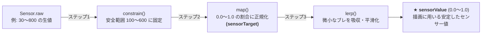
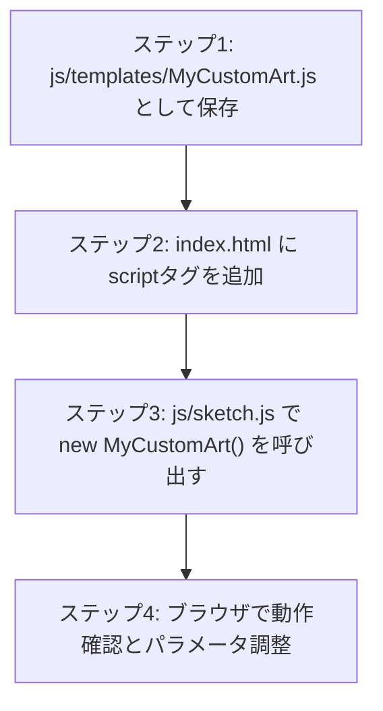

# 04_p5.js × センサー（ジェネラティブアート：自律的集合体システム）

### コンテンツ制作（金1-2）

[00_導入](https://app.notion.com/p/00_-3cebdf471aca8099b067d7a323310d2e?pvs=21)

[01_Arduinoの基礎](https://app.notion.com/p/01_Arduino-3ecbdf471aca805198efd80b40681979?pvs=21)

[02_センサー入力値の調整](https://app.notion.com/p/02_-3f3bdf471aca80408e5acdb3862906cb?pvs=21)

[03_p5.jsの基礎](https://app.notion.com/p/04_p5-js-xxxx?pvs=21)

[04_p5.jsとセンサー](https://app.notion.com/p/05_p5-js-xxxx?pvs=21)

---

# 1. はじめに

## 1-1. 今回学ぶこと

前回（単元3）は、p5.jsの基本構造、HSBカラー、三角関数（`sin` / `cos`）、座標変換、パーリンノイズ（`noise`）を用いた「運動の数理」を学びました。

今回は、**Arduinoの物理センサー（赤外線距離センサー）とp5.jsをWeb Serial APIで直結** します。

本単元の開発スタイルは **「ゼロから難しいソースコードは書かない。しかし、何が行われているのかの仕組みをしっかり理解し、パラメータを調整して自分だけの世界観を作る」** です。
さらに、**「生成AI（ChatGPT / Claude / Gemini等）を使って自分だけのオリジナル・テンプレートクラスを自動生成し、プロジェクトに合体させる手法」** まで習得します。

- **距離センサーの読取とシリアル送信（1系統に絞り、確実な動作と理解を優先）**
- **ブラウザでのシリアル受信とコンソールによる生データ（Raw Data）の観察**
- **通信処理を独立させた部品（`sensor.js`）の作成（p5.js非依存・再利用可能な純粋JavaScript）**
- **p5.js（`sketch.js`）側でのデータ処理（`constrain` ➔ `map` ➔ `lerp`）の実装**
- **「ハブ（`sketch.js`）」と「部品（クラス）」に分けるプログラム構造の理解**
- **5大ジェネラティブ・テンプレート（深海生物・幾何学曼荼羅・オーロラ流線・開花・星雲）の体験とパラメータ調律**
- **生成AIにプロンプトを出してオリジナルテンプレートを自作し、連携させる手順**

```mermaid
graph LR
    subgraph フィジカル世界（入力）
        D[手の距離<br>距離センサー A0] --> ARD[Arduino Nano R4]
    end

    subgraph 独立モジュール: sensor.js（通信部品）
        ARD -->|Web Serial API| S[sensor.js<br>生の数値 Sensor.raw を保持]
    end

    subgraph ハブ: sketch.js（p5.js データ処理 ＆ 制御）
        S --> RAW[生データ取得]
        RAW --> C["① constrain()<br>安全範囲 100〜600 に制限"]
        C --> M["② map()<br>0.0〜1.0 に正規化"]
        M --> L["③ lerp()<br>滑らかに追従・平滑化"]
        L --> HUB[★ sketch.js<br>アート選択 & パラメータ調律]
    end

    subgraph 描画テンプレート（表現）
        HUB -.->|選んで実行| T1[① Medusa: 深海生物]
        HUB -.->|選んで実行| T2[② Mandala: 幾何学曼荼羅]
        HUB -.->|選んで実行| T3[③ Flow: オーロラ流線]
        HUB -.->|選んで実行| T4[④ Bloom: デジタル開花]
        HUB -.->|選んで実行| T5[⑤ Cosmic: 星雲メッシュ]
        HUB -.->|AIで自作| T6[⑥ MyArt: AIオリジナル]
    end
```

---

# 2. ハードウェアの準備（回路とArduinoプログラム）

今回は配線ミスを防ぎ、インタラクションの質感向上とデータ処理の理解に集中するため、使用するセンサーを **「赤外線距離センサー（GP2Y0A21YK）」の1系統のみ** に絞ります。

## 2-1. 配線（距離センサーのみ）

ブレッドボードとジャンパー線を使って、距離センサーをArduino Nano R4に接続します。

```
【距離センサー（GP2Y0A21YK）】
  - 赤線（向かって右） ➔ Arduinoの 5V ピン
  - 黒線（中央）        ➔ Arduinoの GND ピン
  - 黄線（向かって左） ➔ Arduinoの A0 ピン
```

<aside>
⚠️

**安全のための注意**
配線を確認・変更する際は、**必ずUSBケーブルをPCから抜いて電源を切って** から作業してください。

</aside>

---

## 2-2. Arduinoプログラム（1つの距離値を送信）

アナログピン（A0）から距離センサーの電圧を読み取り、1行に1つの数値をPCへ高速送信（約50Hz）します。

```cpp
const int PIN_DISTANCE = A0; // 距離センサー（アナログ入力ピン）

void setup() {
  Serial.begin(9600); // 転送レート 9600bps でシリアル通信開始
}

void loop() {
  // 1. 距離センサーのアナログ電圧を読み取る（0〜1023）
  int rawDistance = analogRead(PIN_DISTANCE);

  // 2. 1行に1つの数値をPCへ送信（末尾はprintlnで改行）
  Serial.println(rawDistance);

  delay(20); // 20ミリ秒待機（1秒間に約50回送信）
}
```

### 動作確認と注意点
1. コードをArduino Nano R4に書き込みます。
2. Arduino IDE右上の **「シリアルモニタ」** を開き、`320` や `450` などの数値が1行ずつ流れることを確認します。
3. センサーの前に手をかざし、手を近づけると数値が大きくなり、遠ざけると小さくなることを確かめます。
4. **【最重要】：確認したら、必ずArduino IDEのシリアルモニタを「閉じて」ください！**
   *(シリアルモニタが開いたままだと、ブラウザのWeb Serial APIがポートを占有できず接続エラーになります)*

---

# 3. ブラウザでの受信と生データ（Raw Data）の観察

Arduinoから送信されたデータを、まずはブラウザ側（純粋なJavaScript）でそのまま受け取り、開発者ツールのコンソールに出力して観察してみましょう。

## 3-1. 受信確認用HTMLファイルの作成

ブラウザでシリアル通信を行うための最小限のHTMLファイルを作成します。この段階では p5.js は使わず、純粋な HTML と JavaScript だけで動作させます。

### ステップ1: ファイルの新規作成
VS Codeのエクスプローラーで、今回の作業フォルダ（例: `05_generative_art/`）の中に **`index.html`** を新規作成します。

### ステップ2: コードの記述
作成した `index.html` に以下のコードを記述します。
ボタンは配置せず、**キーボードの「C」キーを押すと Arduino とシリアル接続を開始** し、受信した距離データをコンソールに出力するシンプルな構成です。

```html
<!DOCTYPE html>
<html lang="ja">
<head>
  <meta charset="utf-8">
  <title>Web Serial 受信テスト</title>
  <style>
    body {
      font-family: sans-serif;
      text-align: center;
      margin-top: 80px;
      background-color: #1a1a24;
      color: #ffffff;
    }
    .guide {
      font-size: 18px;
      color: #00ffcc;
      margin-top: 20px;
    }
  </style>
</head>
<body>

  <h1>距離センサー 受信テスト</h1>
  <p class="guide">キーボードの <strong>[C] キー</strong> を押して接続してください</p>

  <script>
    let isConnected = false;

    // シリアル通信の接続と受信を行う関数
    async function connect() {
      try {
        // 1. シリアルポートを選択して開く（転送レート 9600bps）
        const port = await navigator.serial.requestPort();
        await port.open({ baudRate: 9600 });
        isConnected = true;
        console.log("🟢 Arduinoに接続しました");

        // 2. 受信バイト列を文字列（UTF-8）に変換する準備
        const textDecoder = new TextDecoderStream();
        port.readable.pipeTo(textDecoder.writable);
        const reader = textDecoder.readable.getReader();

        let buffer = '';

        // 3. 受信ループ（データが届くたびに繰り返し実行）
        while (true) {
          const { value, done } = await reader.read();
          if (done) break;

          buffer += value;
          const lines = buffer.split('\n');
          buffer = lines.pop(); // 未完了の行をバッファに残す

          for (const line of lines) {
            const trimmed = line.trim();
            if (!trimmed) continue;

            // 文字列から整数へ変換
            const raw = parseInt(trimmed, 10);
            if (!isNaN(raw)) {
              // ★ コンソールに出力して確認！
              console.log("生データ (raw):", raw);
            }
          }
        }
      } catch (err) {
        console.error("シリアル接続エラー:", err);
        alert("接続に失敗しました。Arduino IDEのシリアルモニタを閉じてから再接続してください。");
      }
    }

    // キーボードの [C] キーが押されたときに connect() を実行
    window.addEventListener('keydown', (e) => {
      if ((e.key === 'c' || e.key === 'C') && !isConnected) {
        connect();
      }
    });
  </script>
</body>
</html>
```

---

## 3-2. Live Serverでの起動とコンソールでの確認

作成したHTMLファイルをブラウザで開き、開発者ツールを使ってデータを確認します。

### 手順
1. **Live Server でブラウザを開く**:
   VS Codeのエクスプローラーで `index.html` を右クリックし、**「Open with Live Server」** を選択します（またはエディタ右下の「Go Live」をクリック）。
2. **ブラウザの開発者ツールを開く**:
   ブラウザ画面上で右クリックして **「検証」** を選択するか、ショートカットキー `F12`（Macは `Command + Option + I`）を押して開発者ツールを開き、**「Console（コンソール）」タブ** を選択します。
3. **キーボードの [C] キーを押して接続する**:
   キーボードの **`C` キー** を押します（※開発者ツールを開いた直後などでキーが反応しない場合は、ブラウザ画面内を一度クリックしてフォーカスを当ててください）。
   ブラウザ上部にシリアルポートの選択ダイアログが表示されるので、リストからお使いのArduino（例: `Arduino Nano R4` や `cu.usbmodem〜`）を選択して「接続」を押します。
4. **コンソールで数値の出力を確認する**:
   接続に成功すると、コンソールに `🟢 Arduinoに接続しました` と表示され、リアルタイムで数値が連続して出力され始めます：

```text
🟢 Arduinoに接続しました
生データ (raw): 342
生データ (raw): 345
生データ (raw): 340
生データ (raw): 344
生データ (raw): 480  ← 手を近づけたとき
生データ (raw): 560  ← さらに手を近づけたとき
生データ (raw): 120  ← 手を遠ざけたとき
```

センサーの前に手をかざし、手を近づけると数値が大きくなり、遠ざけると小さくなることをコンソール上で確認してください。

---

## 3-3. コンソールから分かる「生データ」の3つの課題

コンソールに出力される数値をよく観察すると、生データをそのままグラフィックの描画に利用できない理由が分かります：

1. **課題①：突発的な外れ値（ノイズ）の混入**
   手を素早く動かしたり、センサーの測定限界（10cm未満または80cm以上）から外れた瞬間、突発的に `800` や `30` といった極端な数値が混ざることがあります。
2. **課題②：数値の範囲が直感に反して扱いにくい**
   手元で動かしても、数値は「遠くで約100 〜 近くで約600」といった中途半端な範囲です。これをそのまま画面上の座標や色相、回転角に使うと、計算が複雑になります。
3. **課題③：手を静止させていても小刻みに数値がブレる（チャタリング）**
   人間が手を空中でピタッと静止させていても、コンソールには `342, 345, 340, 344` と毎フレーム小刻みにブレた値が出力されます。このブレをそのまま図形の位置やサイズに反映すると、画面上でプルプルと細かく震えてしまいます。

これらの課題を解決するために、**「シリアル受信処理」と「データ加工処理」を役割ごとに分離** していきます。

---

# 4. シリアル通信を独立した部品（`sensor.js`）にする

## 4-1. なぜ通信処理を独立させるのか？（p5.js非依存の部品化）

Web Serial API の接続処理や非同期受信ループは、毎回HTML内に直接書くにはコード量が多く複雑です。
また、描画コードと混ぜてしまうと再利用性が失われてしまいます。

そこで、**第3章で書いた `isConnected`、生データ（`raw`）、そして `connect()` 関数を、ひとつのオブジェクト `Sensor` にまとめて独立ファイル（`sensor.js`）へ切り出します**。

このモジュールは **p5.js に一切依存しない純粋な JavaScript（Vanilla JS）** で作られているため、次週以降の音響合成（Tone.js）や他のWeb制作でもそのまま使い回すことができます。

```
05_generative_art/
├── index.html               # 画面の土台・UI・スクリプト一括読込
├── js/
│   ├── sensor.js            # 📡【再利用部品】シリアル通信受信モジュール（純粋なJS）
│   ├── sketch.js            # ★【学生が触るハブ】p5.js によるデータ加工 ＆ アート制御
│   └── templates/           # 【描画部品】各アートの描画クラス群
```

---

## 4-2. 独立モジュール `sensor.js` の全貌

プロジェクトの `js/sensor.js` に配置する完成コードです。
特定のボタンや HTML 要素（DOM）には一切依存せず、純粋に接続と生データの受信のみを行います：

```javascript
/**
 * sensor.js - Arduino シリアル通信受信モジュール
 * -------------------------------------------------------------
 * Web Serial API を用いて Arduino からのシリアル通信を受信し、
 * 生の数値（Sensor.raw）を保持するだけの純粋な JavaScript モジュールです。
 */

const Sensor = {
  isConnected: false, // Arduinoと接続中かどうか
  raw: 0,             // センサーから届いた最新の生値（0〜1023）

  // Web Serial API で Arduino への接続を開始する
  async connect() {
    if (!('serial' in navigator)) {
      alert('Google Chrome または Microsoft Edge を使用してください。');
      return false;
    }

    try {
      // 1. ポートを選択して開く（転送レート 9600bps）
      const port = await navigator.serial.requestPort();
      await port.open({ baudRate: 9600 });
      this.isConnected = true;
      console.log('🟢 Arduinoに接続しました');

      // 2. 受信ストリームを文字列としてデコード
      const textDecoder = new TextDecoderStream();
      port.readable.pipeTo(textDecoder.writable);
      const reader = textDecoder.readable.getReader();

      let buffer = '';

      // 3. 受信ループ（第3章のコードと全く同じ構造です）
      while (true) {
        const { value, done } = await reader.read();
        if (done) break;

        buffer += value;
        const lines = buffer.split('\n');
        buffer = lines.pop(); // 未完了の行をバッファに残す

        for (const line of lines) {
          const trimmed = line.trim();
          if (!trimmed) continue;

          // 文字列から整数へ変換
          const num = parseInt(trimmed, 10);
          if (!isNaN(num)) {
            // ★ 第3章で console.log していた値を、変数に保持するだけ！
            this.raw = num;
          }
        }
      }
    } catch (err) {
      console.error('Web Serial 接続エラー:', err);
      alert('接続に失敗しました。Arduino IDE のシリアルモニタを閉じて再接続してください。');
    }
  }
};
```

### ポイント
- **第3章のコードとの違いはたった1点だけ**：
  第3章で `console.log("生データ (raw):", raw);` とコンソール出力していた部分を、**`this.raw = num;` としてオブジェクトの変数に保存するようにしただけ** です。
- `sensor.js` の中には特定のボタンを探すコード（`getElementById` など）が一切ありません。そのため、**「キーボード入力」「画面クリック」「HTMLボタン」など、どのようなトリガーからでも `Sensor.connect()` を自由に呼び出す** ことができます。
- 接続が成功するとコンソールに `🟢 Arduinoに接続しました` と出力されます。

---

## 4-3. `sketch.js` を作成してコンソールで連携を確認する

通信モジュール `sensor.js` が完成したら、**p5.js（`sketch.js`）から `Sensor` オブジェクトを呼び出し、生データが正しく取得できているか** を確認します。

まずはデータ加工（`constrain` や `map`）を入れる前の最小限のスケッチを作成し、通信の連携をテストしましょう。

### 1. `index.html` の準備

`sensor.js` と `sketch.js` を p5.js と一緒に読み込みます。

```html
<!DOCTYPE html>
<html lang="ja">
<head>
  <meta charset="utf-8">
  <title>p5.js × センサー受信テスト</title>
  <style>
    body { margin: 0; overflow: hidden; background: #111; }
  </style>
</head>
<body>

  <!-- 1. p5.js ライブラリ -->
  <script src="https://cdn.jsdelivr.net/npm/p5@1.11.11/lib/p5.min.js"></script>

  <!-- 2. 通信専用モジュール（純粋なJS） -->
  <script src="js/sensor.js"></script>

  <!-- 3. p5.js メインスケッチ -->
  <script src="js/sketch.js"></script>

</body>
</html>
```

> [!NOTE]
> スクリプトタグの読み込み順序に注意してください。`sensor.js` を先に読み込むことで、後から実行される `sketch.js` の中からグローバルオブジェクト `Sensor` を自由に参照できるようになります。

### 2. 最小限の `js/sketch.js` を作成する

`js/sketch.js` を作成し、キーボードの `[C]` キーで接続を開始して、`draw()` ループの中で `Sensor.raw` をコンソールに出力します。

```javascript
/**
 * sketch.js - センサー連携テスト
 */

function setup() {
  createCanvas(windowWidth, windowHeight);
  textSize(24);
  textAlign(CENTER, CENTER);
}

function draw() {
  background(20);

  if (Sensor.isConnected) {
    // 1. sensor.js が保持している最新の生データを取得
    let raw = Sensor.raw;

    // 2. コンソールに生データを出力して確認
    console.log("p5.js で受信した生データ (raw):", raw);

    // 3. 画面上にも現在の数値を表示
    fill(0, 255, 204);
    text(`🟢 接続中 - 生データ (raw): ${raw}`, width / 2, height / 2);
  } else {
    // 未接続時の案内
    fill(200);
    text("キーボードの [C] キーを押して Arduino に接続してください", width / 2, height / 2);
  }
}

// キーボードの [C] キーを押したときに接続を開始
function keyPressed() {
  if ((key === 'c' || key === 'C') && !Sensor.isConnected) {
    Sensor.connect();
  }
}
```

### 3. ブラウザで動作を確認する

1. VS Code で `index.html` を右クリックし、**「Open with Live Server」** を起動します。
2. ブラウザ画面を開き、開発者ツールの **「Console（コンソール）」タブ**（ショートカット: `F12` または Mac `Command + Option + I`）を表示します。
3. キーボードの **`[C]` キー** を押して、ダイアログから Arduino を選択して接続します（※キーが反応しない場合は一度ブラウザ画面をクリックしてフォーカスを当ててください）。
4. 接続に成功すると、画面中央に `🟢 接続中 - 生データ (raw): ○○` と表示され、開発者ツールのコンソールにも毎フレーム最新の生データが出力され続けます：

```text
🟢 Arduinoに接続しました
p5.js で受信した生データ (raw): 342
p5.js で受信した生データ (raw): 345
p5.js で受信した生データ (raw): 341
p5.js で受信した生データ (raw): 480  ← 手を近づけたとき
```

### これで何ができたのか？
- 純粋な JavaScript で書かれた `sensor.js` がバックグラウンドでシリアル通信を受信し、
- p5.js（`sketch.js`）の `draw()` ループが毎フレーム `Sensor.raw` から最新の値を取り出す、
という **役割分担（分離）の連携パイプライン** が完成しました。

しかし、コンソールに出力されている数値は、第3章で確認した通り「30〜800といった中途半端な範囲」であり、「手ブレによる小刻みな変動」を含んだ荒削りな生データのままです。

次の第5章で、p5.js が提供する関数（`constrain`、`map`、`lerp`）を使って、この生データをグラフィック描画に適した滑らかな値へと加工していきましょう。

---

# 5. `sketch.js` でのデータ加工と平滑化（`constrain` ➔ `map` ➔ `lerp`）

ここからは **p5.js の世界（`sketch.js`）** です！
p5.js のスケッチでは `setup()` と `draw()` が用意されているため、p5.js が提供する強力な数学関数（`constrain`、`map`、`lerp`）を自由自在に使うことができます。



### データ加工で用いる2つの重要変数

データ加工を行うにあたり、`sketch.js` の先頭（`setup()` や `draw()` の外側）で以下の2つの変数をあらかじめ定義しておきます：

```javascript
let sensorTarget = 0.2; // 【目標値】map() で 0.0〜1.0 に正規化した値
let sensorValue  = 0.2; // 【現在値】lerp() で平滑化し、描画に使う安定した値
```

- **`sensorTarget`（目標値）**: センサーが「今まさに指している目標の数値（0.0〜1.0）」です。
- **`sensorValue`（平滑化後の現在値）**: 前回の数値を記憶しておき、目標値に向かって徐々に近づいていく数値です。グラフィックの描画パラメータにはこの値を使います。

> [!NOTE]
> **なぜ関数の外側（グローバル変数）に書くのか？**
> `draw()` 関数は秒間60回（60fps）猛スピードで繰り返されます。
> もし `draw()` の中で `let sensorValue = ...` と書いてしまうと、**毎フレーム新しい変数として初期化（リセット）されてしまい、「前回のフレームの値」を記憶しておくことができなくなります**。
> `lerp()` で滑らかに徐々に追従させるためには、前のフレームの値を引き継ぐ必要があるため、関数の外側（グローバル変数）で定義します。

---

## 5-1. ステップ1: `constrain()` で範囲外の数値を制限する

`constrain()` は、指定した数値を **「最小値」と「最大値」の範囲内に収める関数** です。

```javascript
// 書式: constrain(調べる値, 最小値, 最大値);
let clamped = constrain(Sensor.raw, 100, 600);
```

- `750` が入力された場合 ➔ 上限の **`600`** に制限される
- `40` が入力された場合  ➔ 下限の **`100`** に引き上げられる
- `350` が入力された場合 ➔ 範囲内なのでそのまま **`350`**

### なぜ最初に行うのか？
突発的な外れ値をこの段階で遮断しておくことで、後続の `map()` による計算結果が想定範囲外に飛び出すのを防ぎます。

---

## 5-2. ステップ2: `map()` で「0.0 〜 1.0」に正規化する

`map()` は、ある範囲の数値を **別の範囲の数値へ比率を保ったまま変換する関数** です。

```javascript
// 書式: map(変換したい値, 現在の最小, 現在の最大, 変換後の最小, 変換後の最大);
sensorTarget = map(clamped, 100, 600, 0.0, 1.0);
```

### なぜ「0.0 〜 1.0」にするのか？（正規化の利点）
`0.0 〜 1.0` は、百分率でいう **「0% 〜 100%」** と同じです。
このように値を特定の統一規格（0.0〜1.0）に揃えることを **正規化（Normalization）** と呼びます。
ここで計算した目標値は、先ほど定義した変数 **`sensorTarget`** に格納します。

正規化値にしておくと、後からどのような描画パラメータにも掛け算ひとつで直接適用できます：

- 円の半径に使いたい場合：`sensorTarget * 300`（0px 〜 300px に変化）
- 色相（Hue）に使いたい場合：`sensorTarget * 360`（赤から一巡して赤へ変化）
- 回転速度に使いたい場合：`sensorTarget * 0.05`（静止から高速回転へ変化）
- 透明度に使いたい場合：`map(sensorTarget, 0, 1, 20, 100)`

「手が最も遠いときが `0.0`、最も近いときが `1.0`」という基準ができるため、表現の設計が格段に扱いやすくなります。

---

## 5-3. ステップ3: `lerp()` で滑らかに追従させる（平滑化 / 初登場）

正規化によって `0.0 〜 1.0` に変換できましたが、手の静止時でも値が小刻みに変動する問題は残っています。
ここで使用するのが **`lerp()`（線形補間: Linear Interpolation）** です。

`lerp()` は、**「現在の値から目標値に向かって、指定した割合だけ段階的に近づける関数」** です。

```javascript
// 書式: lerp(現在の値, 目標の値, 近づく割合);
sensorValue = lerp(sensorValue, sensorTarget, 0.08);
```

- **`sensorTarget`（第2引数）**：ステップ2の `map()` で求めた「目標値（今指している値）」です。
- **`sensorValue`（第1引数 ＆ 左辺）**：スケッチ先頭で定義したグローバル変数です。現在の値と目標値の間を8%（0.08）縮めた新しい値を計算し、自分自身（`sensorValue`）に上書きして次のフレームへと引き継ぎます。

### 計算の仕組み
`次の現在値 = 現在値 + (目標値 - 現在値) × 割合`

毎フレーム（秒間60回）実行される `draw()` の中で `lerp(..., 0.08)` を呼び出すと、以下の動作特性が得られます：

1. **差が大きいとき（手を急に動かした瞬間）**:
   目標値との差が大きいため、8%分の移動量も大きくなり、**素早く目標値に向かって加速** します。
2. **差が小さいとき（目標値に近づいたとき）**:
   目標値との差がわずかになるため、8%分の移動量も小さくなり、**自然に減速してピタッと安定** します。

この動作はアニメーションにおける **イージング（緩急）** と同じ効果をもたらします。
センサーの微小なノイズが平滑化され、急激な動きにも追従しつつ、静止時にはブレのない滑らかなインタラクションが実現します。

---

## 5-4. 3関数のデータパイプラインまとめ

| 順番 | 関数名 | 処理内容 | 目的・効果 |
|:---:|---|---|---|
| **1** | **`constrain(raw, 100, 600)`** | **【範囲制限】** 値を 100〜600 の間に制限 | センサーの突発的なノイズ・外れ値を遮断する |
| **2** | **`map(clamped, 100, 600, 0.0, 1.0)`** | **【正規化】** 生値を 0.0（遠い）〜 1.0（近い）の割合に変換 | 各種描画パラメータに掛け算で適用しやすくする |
| **3** | **`lerp(current, target, 0.08)`** | **【平滑化】** 現在値を目標値へ毎フレーム8%ずつ追従 | 手のブレを吸収し、滑らかな加減速動作を作る |

---

## 5-5. `sketch.js` での全体実装コード

`sketch.js` の中で、接続トリガーとデータ処理パイプラインがどのように実装されているかを確認しましょう：

```javascript
// =================================================================
// 1. 設定パラメータ ＆ グローバル変数
// =================================================================
const SENSOR_MIN = 100;    // 手を遠ざけた時の最小アナログ値
const SENSOR_MAX = 600;    // 手を最も近づけた時の最大アナログ値
const LERP_RATE  = 0.08;   // 平滑化の追従スピード（0.02: ゆったり 〜 0.15: 素早い）

let sensorTarget = 0.2;    // 目標値（0.0: 遠い 〜 1.0: 至近）
let sensorValue  = 0.2;    // 平滑化後の現在値（0.0 〜 1.0）

// =================================================================
// 2. p5.js 初期化 ＆ 接続トリガーの設定
// =================================================================
function setup() {
  createCanvas(windowWidth, windowHeight);
  colorMode(HSB, 360, 100, 100, 100);
  rectMode(CENTER);
  angleMode(RADIANS);

  initArt("medusa");

  // 【接続トリガーA】HTML上にボタン（#connect-btn）があればイベントを登録
  const btn = select('#connect-btn');
  if (btn) {
    btn.mousePressed(() => Sensor.connect());
  }
}

// 【接続トリガーB】キーボードの「c」キーを押して接続する
function keyPressed() {
  if ((key === 'c' || key === 'C') && !Sensor.isConnected) {
    Sensor.connect();
  }
}

// 【接続トリガーC】画面をクリックして接続したい場合は mousePressed() も利用可能
// function mousePressed() {
//   if (!Sensor.isConnected) Sensor.connect();
// }

// =================================================================
// 3. 毎フレームのデータ処理 ＆ 描画
// =================================================================
function draw() {
  // A. 生データの取得と加工（constrain ➔ map）
  if (Sensor.isConnected) {
    let raw = Sensor.raw; // sensor.js から最新の生値を取得
    let clamped = constrain(raw, SENSOR_MIN, SENSOR_MAX);
    sensorTarget = map(clamped, SENSOR_MIN, SENSOR_MAX, 0.0, 1.0);
  } else {
    // Arduino未接続時は、マウスX座標で 0.0〜1.0 をシミュレート
    sensorTarget = constrain(map(mouseX, 0, width, 0.0, 1.0), 0.0, 1.0);
  }

  // B. lerp による平滑化（滑らかな追従）
  sensorValue = lerp(sensorValue, sensorTarget, LERP_RATE);

  // C. アートクラスに加工済みの値を渡して描画！
  if (currentArt) {
    currentArt.update(sensorValue);
    currentArt.render();
  }
}
```

### トリガーの自由度
- `Sensor.connect()` は、Web Serial API の仕様上「ユーザーの操作（クリックやキー入力）」の中から呼び出す必要があります。
- `sketch.js` 側でトリガーを管理することで、**「HTML上のボタン」「キーボードの C キー」「画面クリック（`mousePressed`）」など、作品の世界観に合わせて自由に接続方法を選択** できます。
- 接続の成否はブラウザのコンソール（`🟢 Arduinoに接続しました`）で確認できます。

---

# 6. システムアーキテクチャの解説（ハブと部品の分離）

本教材では、保守性と拡張性を高めるため、**「ハブ（制御部）と部品（表現部）の分離（関心の分離）」** という構成をとっています。

## 6-1. クラス（Class）とは「設計図」

JavaScriptの **クラス（Class）** は、**「設計図」** に相当します。
- クラス（設計図）：`MedusaArt.js`（どのような数理で描画・動作させるかを定義したコード）
- インスタンス（実体）：`currentArt`（画面上で実際に生成されて動作するオブジェクト）

すべてのテンプレートクラスは、以下の **「3つの共通メソッド（インターフェース）」** で構成されています：

| メソッド名 | 役割・処理内容 |
|---|---|
| **`constructor(options)`** | **【初期状態の準備】** `sketch.js` で指定されたパラメータ（色相、触手の数、半径など）を受け取り、初期状態を設定する。 |
| **`update(dist)`** | **【状態の計算】** 毎フレーム、平滑化されたセンサー値（0.0〜1.0）を受け取り、座標や角度、速度などを計算する。 |
| **`render()`** | **【描画の実行】** 計算された座標に基づいて、p5.jsの描画命令（`circle`, `curveVertex`, `line`等）を実行する。 |

この共通仕様があるため、ハブである `sketch.js` は **クラス内部の個別の計算処理を意識することなく、`currentArt.update(sensorValue)` と `currentArt.render()` を呼び出すだけで任意のアートを制御** できます。

## 6-2. センサー値がグラフィックを変化させる仕組み

- **距離センサー値（`sensorValue: 0.0 〜 1.0`）**:
  - `0.0`（手を遠ざけた状態）：中央に小さく収束し、穏やかに微動する状態。
  - `1.0`（手を近づけた状態）：外側へ向けて大きく展開・拡散し、運動や明滅の周期が活発化する状態。

---

# 7. 【ハンズオン】最小限のテンプレート（SimplePulseArt）を作ってみよう！

まずは、基本構造（`constructor`, `update`, `render`）を理解するための最小限のアートクラス（約35行）をハンズオンで作成します。

### 作成するファイル: `js/templates/SimplePulseArt.js`

```javascript
/**
 * SimplePulseArt.js - 最小のテンプレートクラス
 * -------------------------------------------------------------
 * クラスの基本構造（constructor, update, render）を理解するための
 * シンプルな実装サンプルです（約35行）。
 */

class SimplePulseArt {
  // ステップ1: 初期化（パラメータ設定を受け取る）
  constructor(options = {}) {
    this.config = Object.assign({
      baseHue: 200,          // 基本の色相 [0〜360]
      maxRadius: 240,        // 最大半径 [100〜400]
      numRings: 5,           // 同心円の数 [1〜10]
      trailAlpha: 20,        // 残像の濃さ [10〜40]
    }, options);

    this.dist = 0.2; // 初期センサー値
  }

  // ステップ2: センサー値の受取（0.0〜1.0）
  update(dist) {
    this.dist = dist;
  }

  // ステップ3: 描画実行（p5.jsの描画コード）
  render() {
    // 1. 半透明の背景で残像を残す
    background(0, 0, 8, this.config.trailAlpha);

    push();
    translate(width / 2, height / 2); // 画面中央へ原点移動

    // 2. 手を近づけると広がる半径（0.0〜1.0 を 30〜maxRadius へ変換）
    let spread = map(this.dist, 0, 1, 30, this.config.maxRadius);

    for (let i = 1; i <= this.config.numRings; i++) {
      let r = spread * (i / this.config.numRings);
      let pulse = sin(frameCount * 0.05 + i * 0.5) * (10 + this.dist * 25);

      // 手の距離に応じて色相が変化
      let h = (this.config.baseHue + i * 15 + this.dist * 100) % 360;

      noFill();
      stroke(h, 85, 100, 80);
      strokeWeight(map(this.dist, 0, 1, 2, 6)); // 近いほど線が太くなる
      circle(0, 0, (r + pulse) * 2);
    }

    pop();
  }
}
```

### コードの解説
1. **`constructor(options)`**:
   `Object.assign` を使用し、デフォルト値に対して引数で渡された設定を上書きしています。
2. **`update(dist)`**:
   `sketch.js` から渡された `0.0〜1.0` のセンサー数値を `this.dist` に保持します。
3. **`render()`**:
   - `this.dist` を `map()` で円の半径（`spread`）や線の太さに反映。
   - `this.dist` に応じて色相（`h`）が変化。
   - `sin(frameCount * 0.05)` によって周期的な脈動アニメーションを付加しています。

### プロジェクトへの接続手順
1. `index.html` に `<script src="js/templates/SimplePulseArt.js"></script>` を追加します。
2. `sketch.js` で `initArt("simple")` を呼び出します。
3. ブラウザで手をかざし、円が広がり、変色・脈動することを確認します。

---

# 8. 5大テンプレートの特徴とパラメータ対応表

プロジェクトの `js/templates/` フォルダには、異なるアルゴリズムで構成された5つの完成テンプレートが用意されています。

---

## ① MedusaArt.js（深海の発光生物）
> **モチーフ**: 深海で発光しながら、手の接近に合わせて大きく広がる生命体。


- **数理アルゴリズム**: パーリンノイズによる多関節触手、スプライン曲線（`curveVertex`）、先端発光球。
- **パラメータ対応表**:
  | パラメータ | 意味・役割 | おすすめ範囲 | 小さくすると | 大きくすると |
  |---|---|:---:|---|---|
  | `numArms` | 触手の本数 | `6 〜 32` | シンプルな放射形状 | 高密度な触手群 |
  | `nodesPerArm` | 関節の数・しなやかさ | `4 〜 16` | 直線的な折れ線 | 滑らかにしなる曲線 |
  | `baseRadius` | 中心の最小サイズ | `10 〜 80` | 中心が引き締まる | 中心に大きな発光核 |
  | `maxSpread` | 手を近づけた時の最大半径 | `150 〜 450` | コンパクトに収まる | 画面全体に大きく展開 |
  | `pulseSpeed` | 脈動の基本スピード | `0.01 〜 0.08` | ゆったりとした動き | 活発な脈動 |
  | `baseHue` | 基本色相（0〜360） | `0 〜 360` | 0:赤, 60:黄, 180:シアン, 240:青, 320:ピンク |
  | `hueRange` | 色の広がり幅 | `20 〜 180` | 単色に近い配色 | カラフルなグラデーション |
  | `trailAlpha` | 残像の濃さ | `6 〜 30` | 長い残像 | 残像がすぐ消えて明瞭 |

---

## ② MandalaArt.js（幾何学曼荼羅・万華鏡）
> **モチーフ**: 多重回転リングと幾何学ポリゴンが重なり合って展開する幾何学システム。

- **数理アルゴリズム**: 三角関数（`cos`/`sin`）による多重回転リング、多角形ポリゴン、層ごとの逆回転。
- **パラメータ対応表**:
  | パラメータ | 意味・役割 | おすすめ範囲 | 小さくすると | 大きくすると |
  |---|---|:---:|---|---|
  | `symmetry` | 対称角数 | `4, 6, 8, 12, 16` | 4角・6角の結晶形状 | 万華鏡のような高密度パターン |
  | `numLayers` | 多重リングの層数 | `3 〜 10` | すっきりした構成 | 奥行きのある多層構造 |
  | `maxRadius` | 手を近づけた時の最大半径 | `150 〜 450` | 中央に凝縮 | 画面外まで広がる展開 |
  | `rotationSpeed` | 回転スピード | `0.005 〜 0.04` | 穏やかな低速回転 | 高速回転 |
  | `baseHue` | 基本色相 | `0 〜 360` | ゴールド(40), マゼンタ(320) など |

---

## ③ FlowFieldArt.js（オーロラ流線群）
> **モチーフ**: パーリンノイズによるベクトル場に沿って移動する光のリボン。手を近づけると中心に引力渦巻きが発生。

- **数理アルゴリズム**: 2Dパーリンノイズのベクトル場、微粒子のオイラー積分移動、中心引力シミュレーション。
- **パラメータ対応表**:
  | パラメータ | 意味・役割 | おすすめ範囲 | 小さくすると | 大きくすると |
  |---|---|:---:|---|---|
  | `numParticles` | 流線の本数 | `150 〜 800` | 繊細な光のライン | 濃密な光のカーテン |
  | `noiseScale` | 渦の大きさ・滑らかさ | `0.002 〜 0.015` | 広大で緩やかなうねり | 細かく急峻な乱気流 |
  | `flowSpeed` | 流れる基本スピード | `1.0 〜 5.0` | 穏やかな流れ | スピード感のある流れ |
  | `particleSize` | 流線の太さ | `1.0 〜 4.0` | 細い光線 | 太く強い光 |

---

## ④ BotanicalBloomArt.js（デジタル開花）
> **モチーフ**: 黄金螺旋（137.5度）に沿って花弁が展開し、手を近づけると蕾から大輪の花へ開花するボタニカルアート。

- **数理アルゴリズム**: フェルマーの螺旋、対数スケーリング、花弁の幾何配置。
- **パラメータ対応表**:
  | パラメータ | 意味・役割 | おすすめ範囲 | 小さくすると | 大きくすると |
  |---|---|:---:|---|---|
  | `numPetals` | 花弁の総枚数 | `30 〜 150` | シンプルな花弁構成 | 高密度な大輪 |
  | `spiralTightness` | 螺旋の巻きの密度 | `2.0 〜 6.0` | 密集した花弁配置 | 外側へ大きく広がる螺旋 |
  | `petalWidth` | 花弁の基本幅 | `8 〜 35` | シャープな花弁 | 丸みを帯びた花弁 |
  | `baseHue` | 基本色相 | `0 〜 360` | ピンク(340), ゴールド(40), 紫(280) |

---

## ⑤ CosmicMeshArt.js（コズミック・星雲メッシュ）
> **モチーフ**: 空間を浮遊する星々が近接ラインで結ばれ、手を近づけると中心引力で凝縮・旋回するネットワーク。

- **数理アルゴリズム**: 2点間距離（`dist()`）の総当たり判定、近接メッシュ結線、中心引力計算。
- **パラメータ対応表**:
  | パラメータ | 意味・役割 | おすすめ範囲 | 小さくすると | 大きくすると |
  |---|---|:---:|---|---|
  | `numStars` | ノード（星）の数 | `30 〜 140` | シンプルな構成 | 複雑な星雲メッシュ |
  | `connectDist` | 結線する最大距離 | `50 〜 160` | 線が少なく疎な構成 | 画面全体が網状に接続 |
  | `gravityPower` | 中心引力の強さ | `0.5 〜 3.5` | 緩やかな引き寄せ | 急速な中心凝縮 |
  | `nodeSize` | ノードの基本サイズ | `2.0 〜 8.0` | 細かい星屑 | 発光する点 |

---

# 9. ハブ（`sketch.js`）でのカスタマイズ実践

学生の皆さんが調整を行うのは、`js/sketch.js` の **`initArt()` 関数内部** です。

### カスタマイズの手順
1. VS Codeで `js/sketch.js` を開きます。
2. `initArt()` の中にある各 `currentArt = new ...` のパラメータ数値を書き換えます。
3. ブラウザを更新し、手の動きに対する反応を確かめます。

```javascript
// 例：MedusaArt のパラメータを変更する
currentArt = new MedusaArt({
  numArms: 24,          // 触手を24本に設定
  nodesPerArm: 12,      // 関節数を増やして曲線を滑らかに
  baseRadius: 40,
  maxSpread: 350,       // 手を近づけた時の最大サイズを拡大
  pulseSpeed: 0.04,
  baseHue: 45,          // 基本色相を山吹色（45）に変更
  hueRange: 50,
  trailAlpha: 10,       // 残像を長く保持
  strokeW: 2.5,
});
```

---

# 10. 【発展編】生成AIで「オリジナルのテンプレート」を作る！

クラスの基本ルール（`constructor`, `update`, `render`）を指定して生成AI（ChatGPT / Claude / Gemini等）に指示を出すことで、オリジナルの表現テンプレートを作成できます。

## 10-1. 指示プロンプトの構成

以下のプロンプトを生成AIに貼り付け、**【作りたいモチーフ】** の部分を自身のアイデアに書き換えて実行してください。

```markdown
あなたはクリエイティブコーディング（p5.js）のエンジニアです。
以下の仕様とルールに従って、アートクラスのJavaScriptコードを作成してください。

### 1. モチーフ・表現内容
【ここに表現したいモチーフを具体的に記述】
（例: 「ステンドグラスのように光が透過する幾何学万華鏡」「放射状に稲妻が広がるエレクトリックツリー」「水滴が波紋のように広がり重なる水彩クラスタ」など）

### 2. 必須のクラス設計（インターフェース仕様）
クラス名は `MyCustomArt` とし、以下のメソッドを実装してください：

1. `constructor(options = {})`:
   - `this.config = Object.assign({ ...デフォルトパラメータ... }, options);` で設定を受け取ること。
   - 色相、残像の濃さ、サイズ、速度などの調整用パラメータを含めること。
2. `update(dist)`:
   - `this.dist = dist;` （手の距離：0.0:遠い 〜 1.0:至近）
   - 距離センサーの値（0.0〜1.0）を内部の運動や物理計算に反映させること。
3. `render()`:
   - キャンバスはすでに `colorMode(HSB, 360, 100, 100, 100);` に設定されています。
   - 先頭で `background(H, S, B, trailAlpha);` を呼び出し、残像を適切に残すこと。
   - `this.dist` が 1.0（手が至近）に近づくほど、形状が大きく展開・拡散・変化すること。
   - `push()` と `pop()` を適切に使用すること。

### 3. 出力ルール
- JavaScriptコードのみを出力してください。
- 各行にわかりやすい日本語コメントを付けてください。
```

---

## 10-2. 自作テンプレートの組み込み手順



### ステップ1: ファイルを保存
生成されたコードをコピーし、`js/templates/MyCustomArt.js` という名前で新規作成して保存します。

### ステップ2: `index.html` に読み込みを追加
`index.html` を開き、他のテンプレート読み込みの下に **1行追加** します：
```html
  <script src="js/templates/BotanicalBloomArt.js"></script>
  <script src="js/templates/CosmicMeshArt.js"></script>
  <!-- 自作アートクラスの追加 -->
  <script src="js/templates/MyCustomArt.js"></script>

  <!-- ハブ -->
  <script src="js/sketch.js"></script>
```

### ステップ3: `sketch.js` で呼び出す
`js/sketch.js` の `initArt()` の中で、自作クラスをインスタンス化します：
```javascript
function initArt(artType = "custom") {
  if (artType === "custom") {
    currentArt = new MyCustomArt({
      // パラメータを設定
    });
  }
}
```

### ステップ4: ブラウザで動作確認
ブラウザをリロードし、センサーの前に手をかざして想定通りに動作することを確認します。

---

# 11. 本日の演習課題

## 11-1. 課題内容
既存テンプレートのパラメータ調整、または生成AIを活用してオリジナルのテンプレートクラスを作成し、**「手の接近距離」に滑らかに連動して変化するインタラクティブ作品** を完成させてください。

## 11-2. 評価基準
1. **センサー値への追従性**: 手の動きに対して `lerp` による滑らかな応答が得られているか。
2. **表現の工夫**: パラメータや色彩設計を工夫し、独自のテーマや世界観が表現されているか。
3. **構造の理解**: 「ハブ（`sketch.js`）」「通信モジュール（`sensor.js`）」「描画クラス（`templates/*.js`）」の役割分担を理解できているか。

---

# 12. トラブルシューティング

| 症状 | 主な原因 | 解決策 |
|---|---|---|
| 「Arduinoと接続」を押しても一覧に出ない | ケーブルの接触不良 / ブラウザ非対応 | USBケーブルを再接続する。Google Chrome または Microsoft Edge を使用する。 |
| 「Failed to open serial port」とエラーが出る | **Arduino IDEのシリアルモニタが開いたまま** | **Arduino IDE右上のシリアルモニタのウィンドウを確実に閉じて** から、ブラウザをリロードして再接続してください。 |
| 画面が黒いまま描画されない | JavaScriptのエラー（構文エラー等） | ブラウザの「検証 ➔ Console」を開き、赤文字のエラー内容を確認してください。 |
| 自作クラスを読み込んでも反応しない | `index.html` の読み込み順序 | `index.html` で、必ず **`sketch.js` よりも前に自作クラスの script タグを記述** してください。 |
| 反応が鈍い、または敏感すぎる | `sketch.js` の `LERP_RATE` 設定値 | `sketch.js` 内の `LERP_RATE: 0.08` を `0.15` に上げると素早い追従になり、`0.04` に下げると緩やかな追従になります。 |
| 手を動かしても値の変化幅が小さい | センサーのキャリブレーション範囲 | コンソールで手元・奥の生値を確認し、`sketch.js` 内の `SENSOR_MIN` と `SENSOR_MAX` をその範囲に合わせて調整してください。 |

---

次週（単元5・6）からは、このビジュアル表現に **「Tone.js（Web Audio）」による音響合成** を組み合わせます。
「手の距離に応じて幾何学が展開し、空間に和音が響く」マルチモーダルな作品へと拡張していきます。
