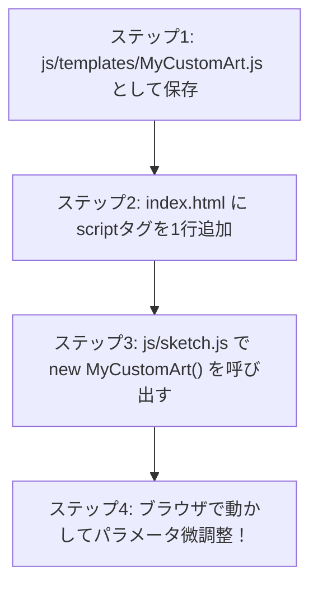

# 04_p5.js × センサー（ジェネラティブアート：自律的集合体システム）

### コンテンツ制作（金1-2）

[00_導入](https://app.notion.com/p/00_-3cebdf471aca8099b067d7a323310d2e?pvs=21)

[01_Arduinoの基礎](https://app.notion.com/p/01_Arduino-3ecbdf471aca805198efd80b40681979?pvs=21)

[02_センサー入力値の調整](https://app.notion.com/p/02_-3f3bdf471aca80408e5acdb3862906cb?pvs=21)

[03_p5.jsの基礎](https://app.notion.com/p/04_p5-js-xxxx?pvs=21)

[04_p5.jsとセンサー](https://app.notion.com/p/05_p5-js-xxxx?pvs=21)

---

# 1. はじめに

## 1-1. 今回学ぶこと

前回（単元4）は、p5.jsの基本構造、HSBカラー、三角関数（`sin` / `cos`）、座標変換、パーリンノイズ（`noise`）を用いた「運動の数理」を学びました。

今回は、いよいよ **Arduinoの物理センサー（距離センサー ＋ CdS光センサー）とp5.jsをWeb Serial APIで直結** します！

本単元の開発スタイルは **「ゼロから難しいソースコードは書かない。しかし、何が行われているのかの仕組みをしっかり理解し、パラメータをいじって自分だけの世界観を作る」** です。
さらに、**「生成AI（ChatGPT / Claude / Gemini等）を使って自分だけの第6・第7のテンプレートクラスを自動生成し、プロジェクトに合体させる手法」** まで習得します。

- **距離センサー（メイン）とCdS光センサーの同時読取とシリアル送信**
- **「ハブ（`sketch.js`）」と「部品（クラス）」に分ける美しいプログラム構造の理解**
- **第2回で学んだ「正規化（0.0〜1.0）」と「Lerp平滑化」による吸い付くような操作感**
- **5大ジェネラティブ・テンプレート（深海生物・幾何学曼荼羅・オーロラ流線・開花・星雲）の体験とパラメータ調律**
- **生成AIにプロンプトを出してオリジナルテンプレートを自作し、連携させる完全手順**

```mermaid
graph LR
    subgraph フィジカル世界（入力）
        D[手の距離<br>距離センサー A0] --> ARD[Arduino Nano R4]
        C[部屋の明暗・手の遮蔽<br>CdS光センサー A7] --> ARD
    end

    subgraph 通信 & 平滑化
        ARD -->|Web Serial API<br>カンマ区切り CSV| NORM[正規化 0.0〜1.0]
        NORM --> LERP[Lerp 線形補間<br>吸い付く追従]
    end

    subgraph ハブ & テンプレート（表現）
        LERP --> HUB[★ ハブ: sketch.js<br>パラメータ調整・アート選択]
        HUB -.->|選んで実行| T1[① Medusa: 深海生物]
        HUB -.->|選んで実行| T2[② Mandala: 幾何学曼荼羅]
        HUB -.->|選んで実行| T3[③ Flow: オーロラ流線]
        HUB -.->|選んで実行| T4[④ Bloom: デジタル開花]
        HUB -.->|選んで実行| T5[⑤ Cosmic: 星雲メッシュ]
        HUB -.->|AIで自作| T6[⑥ MyArt: AIオリジナル]
    end
```

---

# 2. ハードウェアの準備（回路とArduinoプログラム）

今回はスイッチ回路は使わず、空間の連続的なアナログ変化を味わえる **「距離センサー（メイン）」＋「CdS光センサー」** の2系統に絞ります。

## 2-1. 配線（第1回・第2回の回路そのまま）

```
【距離センサー（GP2Y0A21YK）】
  - 赤線（向かって右） ➔ Arduinoの 5V
  - 黒線（中央）        ➔ Arduinoの GND
  - 黄線（向かって左） ➔ Arduinoの A0 ピン

【CdS光センサー（10kΩ分圧回路）】
  - CdSセルの片足        ➔ Arduinoの 5V
  - CdSセルのもう片足    ➔ ブレッドボードの空き列
  - その空き列から       ➔ Arduinoの A7 ピン
  - 同じ空き列から       ➔ 10kΩ抵抗（茶黒橙金）の片足
  - 10kΩ抵抗のもう片足   ➔ Arduinoの GND
```

<aside>
⚠️

**安全のための注意**
配線を確認・変更する際は、**必ずUSBケーブルをPCから抜いて電源を切って** から作業してください。

</aside>

---

## 2-2. Arduinoプログラム（2つの値をCSV形式で送信）

2つのアナログピン（A0, A7）を読み取り、**「距離値,明るさ値」** というカンマ区切りの1行テキストとして高速送信（約50Hz）します。

```cpp
const int PIN_DISTANCE = A0; // 距離センサー
const int PIN_CDS = A7;      // CdS光センサー

void setup() {
  Serial.begin(9600); // 転送レート 9600bps
}

void loop() {
  // 1. 各センサーのアナログ電圧を読み取る（0〜1023）
  int rawDistance = analogRead(PIN_DISTANCE);
  int rawCds = analogRead(PIN_CDS);

  // 2. カンマ区切りの1行でPCへ送信（例: "340,710"）
  Serial.print(rawDistance);
  Serial.print(",");
  Serial.println(rawCds); // 末尾はprintlnで改行！

  delay(20); // 20ミリ秒待機（安定動作）
}
```

### 動作確認と超重要ルール
1. コードをArduino Nano R4に書き込みます。
2. Arduino IDE右上の **「シリアルモニタ」** を開き、`320,680` のように数値がカンマ区切りで流れることを確認します。
3. 手を近づけると左（距離）が変わり、CdSを手で覆うと右（明るさ）が下がることを確かめます。
4. **【最重要】：確認したら、必ずArduino IDEのシリアルモニタを「閉じて」ください！**
   *(シリアルモニタが開いていると、ブラウザのWeb Serial APIがポートを開けず接続エラーになります)*

---

# 3. システムアーキテクチャの解説（何が行われているのか？）

プログラミング初心者が挫折する最大の原因は、「コードが1つのファイルに何百行も書かれていて、どこが何をしているか分からない」ことです。
本教材では、プロのWeb開発現場と同じ **「ハブと部品の分離（関心の分離）」** を採用しています。

```
05_generative_art/
├── index.html               # 画面の土台・Web Serial通信・スクリプト一括読込
├── js/
│   ├── sketch.js            # ★【学生が触るハブ】アートの選択 & パラメータ調整
│   └── templates/           # 【部品】各アートの数学・描画エンジン（クラス群）
│       ├── SimplePulseArt.js    # 🔰【ハンズオン】基本パルス
│       ├── MedusaArt.js         # ① 深海の発光生物
│       ├── MandalaArt.js        # ② 幾何学曼荼羅
│       ├── FlowFieldArt.js      # ③ オーロラ流線群
│       ├── BotanicalBloomArt.js # ④ デジタル開花
│       └── CosmicMeshArt.js     # ⑤ コズミック・メッシュ
```

## 3-1. クラス（Class）とは「作品の設計図」

JavaScriptの **クラス（Class）** は、**「たい焼きの金型（設計図）」** のようなものです。
- 金型（クラス）：`MedusaArt.js`（どういう計算でクラゲを動かすかの設計図）
- 焼かれたたい焼き（実体 / インスタンス）：`currentArt`（画面上で実際に動くクラゲ）

すべてのテンプレートクラスは、以下の **「3大共通ルール（インターフェース）」** で作られています：

| メソッド名 | 役割・行われていること |
|---|---|
| **`constructor(options)`** | **【初期化】** 学生が `sketch.js` で指定したパラメータ（色、触手の数、半径など）を受け取り、初期状態を準備する。 |
| **`update(dist, light)`** | **【物理計算】** 毎フレーム、滑らかになったセンサー値（0.0〜1.0）を受け取り、触手の曲がり具合や星の引力を計算する。 |
| **`render()`** | **【描画】** 背景に残像を塗り、計算された座標にp5.jsの図形（`circle`, `curveVertex`, `line`等）を描き出す。 |

この共通ルールがあるおかげで、ハブである `sketch.js` は **クラスの中身の難しい数学を知らなくても、`currentArt.update(...)` と `currentArt.render()` を呼ぶだけでどんなアートでも動かせる** のです。

## 3-2. センサー値がグラフィックを変えるメカニズム

ブラウザ内では、第2回で学んだ **「正規化」** と **「Lerp平滑化」** が行われています。

```javascript
// 生データを 0.0〜1.0 の割合に変換（正規化）
distTarget = map(clampedDist, 100, 600, 1.0, 0.0); // 近いほど 1.0
lightTarget = map(clampedLight, 150, 850, 0.0, 1.0); // 明るいほど 1.0

// Lerpで毎フレーム吸い付くようにじわっと追従（平滑化）
distCurrent = lerp(distCurrent, distTarget, 0.08);
lightCurrent = lerp(lightCurrent, lightTarget, 0.08);
```

- **距離値（`distCurrent: 0.0 〜 1.0`）**:
  - `0.0`（手を遠ざけた時）：集合体が中央に静かに丸まり、ゆったりと眠るように微動する。
  - `1.0`（手を近づけた時）：一気に外側へ大開花・拡散！アームが大きく広がり、鼓動や引力が激化する。
- **明るさ値（`lightCurrent: 0.0 〜 1.0`）**:
  - `1.0`（部屋が明るい時）：日常のクリアな光、ゴールドやシアンのシャープな線画表現。
  - `0.0`（手でCdSを覆って暗くした時）：**深海の発光現象（Bio-Luminescence）** のように、妖しいネオンパープル＆マゼンタへ発光変色し、光の残像（トレイル）が長く伸びてオーロラのように輝く。

---

# 4. 【ハンズオン】最小限のテンプレート（SimplePulseArt）を作ってみよう！

いきなり高度な数理を使った5大テンプレートを見る前に、まずは **「たった35行で作れる最小限のアートクラス」** を講師と一緒にハンズオンで作成し、クラスの仕組みを完全に体得しましょう！

### 作成するファイル: `js/templates/SimplePulseArt.js`

```javascript
/**
 * SimplePulseArt.js - 最小のテンプレートクラス
 * -------------------------------------------------------------
 * クラスの基本構造（constructor, update, render）を理解するための
 * 最もシンプルなサンプルです（約35行）。
 */

class SimplePulseArt {
  // ステップ1: 初期化（パラメータ設定を受け取る）
  constructor(options = {}) {
    this.config = Object.assign({
      baseHue: 200,          // 基本の色相 [0〜360]
      maxRadius: 220,        // 最大半径 [100〜400]
      numRings: 5,           // 同心円の数 [1〜10]
      trailAlpha: 20,        // 残像の濃さ [10〜40]
    }, options);

    this.dist = 0.2;
    this.light = 0.8;
  }

  // ステップ2: センサー値の受取（0.0〜1.0）
  update(dist, light) {
    this.dist = dist;
    this.light = light;
  }

  // ステップ3: 描画実行（p5.jsの描画コード）
  render() {
    // 背景の残像塗り（暗いほど残像が長く伸びる）
    let trail = map(this.light, 0, 1, this.config.trailAlpha * 0.5, this.config.trailAlpha * 1.5);
    background(0, 0, 8, trail);

    push();
    translate(width / 2, height / 2); // 画面中央へ

    // 手を近づけると広がる半径
    let spread = map(this.dist, 0, 1, 30, this.config.maxRadius);

    for (let i = 1; i <= this.config.numRings; i++) {
      let r = spread * (i / this.config.numRings);
      let pulse = sin(frameCount * 0.05 + i * 0.5) * (10 + this.dist * 20);

      // 明暗で色相が変化（暗くすると紫・ピンクへ）
      let h = (this.config.baseHue + i * 15 + (1.0 - this.light) * 120) % 360;

      noFill();
      stroke(h, 85, 100, 80);
      strokeWeight(map(this.dist, 0, 1, 2, 5));
      circle(0, 0, (r + pulse) * 2);
    }

    pop();
  }
}
```

### なぜこれだけで動くのか？（コードの解説）
1. **`constructor(options)`**:
   `Object.assign` を使って、デフォルト値に学生が渡した数値を上書きしています。
2. **`update(dist, light)`**:
   Web Serial APIから送られてきた `0.0〜1.0` のセンサー数値を `this.dist` と `this.light` に保持します。
3. **`render()`**:
   - `this.dist` を `map()` して円の半径（`spread`）や線の太さに反映。
   - `this.light` を使って色相（`h`）や残像（`trail`）に反映。
   - 単元4で学んだ `sin(frameCount * 0.05)` で呼吸させています。

### プロジェクトへの接続手順
1. `index.html` に `<script src="js/templates/SimplePulseArt.js"></script>` を追加。
2. `sketch.js` で `currentArt = new SimplePulseArt({ ... })` を呼び出す。
3. ブラウザで手をかざすと、幾重もの円が波紋のように広がり、光を遮るとネオンカラーに変色します！

<aside>
💡

**クラスの本質が分かれば怖くない！**
「クラス」とは、難解な呪文ではなく **`constructor`（準備）、`update`（計算）、`render`（描画）の3つを揃えただけの便利な部品** です。
この最小テンプレートの円の部分を、触手にしたり、幾何学リングにしたり、流線にしたものが、次に紹介する「5大テンプレート」です！

</aside>

---

# 5. 5大テンプレートの特徴とパラメータ対応表

プロジェクトの `js/templates/` フォルダには、数学的アルゴリズムが根本から異なる5つの完成テンプレートが用意されています。

---

## ① MedusaArt.js（深海の発光生物）
> **モチーフ**: 漆黒の深海で妖しく光りながら、手の接近に合わせて大きく傘を開く神秘的な発光生命体。


- **数理アルゴリズム**: パーリンノイズによる多関節触手、しなるスプライン曲線（`curveVertex`）、先端発光球。
- **パラメータ対応表**:
  | パラメータ | 意味・役割 | おすすめ範囲 | 小さくすると | 大きくすると |
  |---|---|:---:|---|---|
  | `numArms` | 触手の本数 | `6 〜 32` | シンプル、蜘蛛や手裏剣風 | 緻密、高密度なクラゲ |
  | `nodesPerArm` | 関節の数・しなやかさ | `4 〜 16` | カクカクしたシャープな折れ線 | シルクのように滑らかにしなる |
  | `baseRadius` | 核の最小サイズ | `10 〜 80` | 中心が引き締まる | 中心に巨大なエネルギー球 |
  | `maxSpread` | 手を近づけた時の最大半径 | `150 〜 450` | こじんまりまとまる | 画面いっぱいに爆発拡散 |
  | `pulseSpeed` | 呼吸の基本スピード | `0.01 〜 0.08` | 深呼吸のようにゆったり | ドクドクと激しい脈動 |
  | `baseHue` | 基本色相（0〜360） | `0 〜 360` | 0:赤, 60:黄, 180:シアン, 240:青, 320:ピンク |
  | `hueRange` | 色の広がり幅 | `20 〜 180` | 単色に近いトーン | カラフルなグラデーション |
  | `trailAlpha` | 残像の濃さ | `6 〜 30` | 長く尾を引くオーロラ残像 | 残像がすぐ消えてくっきり |

---

## ② MandalaArt.js（幾何学曼荼羅・万華鏡）
> **モチーフ**: SF映画のワープエンジンや古代の魔法陣のように、精密に回転・展開する多重幾何学システム。

- **数理アルゴリズム**: 三角関数（`cos`/`sin`）による多重回転リング、多角形ポリゴン、偶数/奇数層の逆回転。
- **パラメータ対応表**:
  | パラメータ | 意味・役割 | おすすめ範囲 | 小さくすると | 大きくすると |
  |---|---|:---:|---|---|
  | `symmetry` | シンメトリー角数 | `4, 6, 8, 12, 16` | 4角・6角の幾何学結晶 | 万華鏡のような超細密パターン |
  | `numLayers` | 多重リングの層数 | `3 〜 10` | すっきりした魔法陣 | 奥行きのある多層構造 |
  | `maxRadius` | 手を近づけた時の最大半径 | `150 〜 450` | 中央に凝縮 | 画面外まで突き抜けるワープ |
  | `rotationSpeed` | 回転スピード | `0.005 〜 0.04` | 厳かな低速回転 | 高速回転・サイバー感 |
  | `baseHue` | 基本色相 | `0 〜 360` | ゴールド(40), ネオンマゼンタ(320) など |

---

## ③ FlowFieldArt.js（オーロラ流線群）
> **モチーフ**: パーリンノイズの「風の場」に身を任せて泳ぐ数百本の光のリボン。手を近づけると中央にブラックホールの渦巻きが発生。

- **数理アルゴリズム**: 2Dパーリンノイズのベクトル場、微粒子のオイラー積分移動、中心引力ブレンド。
- **パラメータ対応表**:
  | パラメータ | 意味・役割 | おすすめ範囲 | 小さくすると | 大きくすると |
  |---|---|:---:|---|---|
  | `numParticles` | 流線の本数 | `150 〜 800` | 軽快、繊細な光の糸 | 濃密な煙・オーロラのカーテン |
  | `noiseScale` | 渦の大きさ・滑らかさ | `0.002 〜 0.015` | 広大でゆったりした風のうねり | 細かく荒々しい乱気流 |
  | `flowSpeed` | 流れる基本スピード | `1.0 〜 5.0` | 穏やかなシルクの流れ | 疾走感のある流星群 |
  | `particleSize` | 流線の太さ | `1.0 〜 4.0` | 繊細なレーザー光線 | ネオン管のような太い光 |

---

## ④ BotanicalBloomArt.js（デジタル開花）
> **モチーフ**: 黄金螺旋（137.5度）に沿って花弁が渦を巻き、手を近づけると蕾（つぼみ）から大輪の花へ一気に満開になるボタニカルアート。

- **数理アルゴリズム**: フェルマーの螺旋、対数スケーリング、花弁の楕円幾何学、葉脈ライン。
- **パラメータ対応表**:
  | パラメータ | 意味・役割 | おすすめ範囲 | 小さくすると | 大きくすると |
  |---|---|:---:|---|---|
  | `numPetals` | 花弁の総枚数 | `30 〜 150` | すっきりした花（水仙、百合） | 八重桜、ダリア、菊のような大輪 |
  | `spiralTightness` | 螺旋の巻きの密度 | `2.0 〜 6.0` | 密集して丸い花弁の塊 | 外側へ大きく渦を巻く広がり |
  | `petalWidth` | 花弁の基本幅 | `8 〜 35` | 針のような繊細な花弁 | 丸みを帯びた豊かな花弁 |
  | `baseHue` | 基本色相 | `0 〜 360` | 桜ピンク(340), 山吹ゴールド(40), 藤紫(280) |

---

## ⑤ CosmicMeshArt.js（コズミック・星雲メッシュ）
> **モチーフ**: 空間を浮遊する星々が近接ラインで結ばれ、手を近づけると重力（ブラックホール）で凝縮・高速旋回する宇宙ネットワーク。

- **数理アルゴリズム**: 2点間距離（`dist()`）の総当たり判定、近接メッシュ結線、中心引力シミュレーション。
- **パラメータ対応表**:
  | パラメータ | 意味・役割 | おすすめ範囲 | 小さくすると | 大きくすると |
  |---|---|:---:|---|---|
  | `numStars` | 星（ノード）の数 | `30 〜 140` | シンプルな星座風 | 複雑な星雲ネットワーク |
  | `connectDist` | 星を結ぶ最大距離 | `50 〜 160` | 線が少なく孤立した星々 | 画面全体が光の網（メッシュ）で結ばれる |
  | `gravityPower` | ブラックホール引力 | `0.5 〜 3.5` | 緩やかな引き寄せ | 強力に一瞬で中心へダイブ |
  | `nodeSize` | 星の基本サイズ | `2.0 〜 8.0` | 繊細な星屑 | 発光する惑星 |

---

# 6. ハブ（`sketch.js`）でのカスタマイズ実践

学生の皆さんが触るのは、`js/sketch.js` の **`initArt()` 関数の中だけ** です！

### カスタマイズの手順
1. VS Codeで `js/sketch.js` を開きます。
2. `initArt()` の中にある5つの `currentArt = new ...` の中から、**気に入ったアートのパラメータ（数値）を書き換えます**。
3. ブラウザ（Live Server）を更新して、自分の手や光でどう反応するかを確かめましょう。

```javascript
// 例：Medusa（深海生物）を「黄金に輝く巨大クラゲ」に改造する
currentArt = new MedusaArt({
  numArms: 24,          // 触手を24本に増量！
  nodesPerArm: 12,      // 関節を増やしてシルクのように！
  baseRadius: 40,
  maxSpread: 350,       // 画面いっぱいに広がる！
  pulseSpeed: 0.04,
  baseHue: 45,          // ★ 色相を「ゴールド（山吹色）」に変更！
  hueRange: 50,
  trailAlpha: 10,       // ★ 残像を長くして神秘的な余韻を！
  strokeW: 2.5,
});
```

---

# 7. 【発展編】生成AIで「オリジナルのテンプレート」を作る！

5つのテンプレートを触って仕組みが分かったら、いよいよ **生成AI（ChatGPT, Claude, Gemini）をアシスタントにして、自分だけの完全オリジナルな第6・第7のテンプレート** を生み出してみましょう！

難しいコードを書く必要はありません。先ほどハンズオンで体験した **「クラスの3大ルール（constructor, update, render）」をAIに指示する** だけで、AIが完璧なクラスコードを書いてくれます。

## 7-1. コピペで使える「AI指示プロンプト」

以下のプロンプトをそのままChatGPTやClaudeに貼り付け、**【あなたの作りたい世界観】** の部分だけを自分のアイデアに書き換えて送信してください。

```markdown
あなたはクリエイティブコーディング（p5.js）のプロフェッショナルです。
以下の仕様とルールに厳密に従って、新しいアートクラスのJavaScriptコードを作成してください。

### 1. 作りタイ世界観・モチーフ
【ここに作りたいものを具体的に書く】
（例: 「ステンドグラスのように光が透過する幾何学万華鏡」「嵐の夜に稲妻が放射状に迸るエレクトリックツリー」「水滴が波紋のように広がり重なり合う水彩クラスタ」など）

### 2. 必須のクラス設計（インターフェース仕様）
クラス名は `MyCustomArt` とし、以下のメソッドを必ず実装してください：

1. `constructor(options = {})`:
   - `this.config = Object.assign({ ...デフォルトパラメータ... }, options);` で設定を受け取ること。
   - 色相、残像の濃さ、サイズ、スピードなどの調整可能パラメータを含めること。
2. `update(dist, light)`:
   - `this.dist = dist;` （手の距離：0.0:遠い 〜 1.0:至近）
   - `this.light = light;` （部屋の明るさ：0.0:真っ暗 〜 1.0:明るい）
   - 距離と明るさの数値を内部の物理計算に反映させること。
3. `render()`:
   - キャンバスはすでに `colorMode(HSB, 360, 100, 100, 100);` に設定されています。
   - 先頭で `background(H, S, B, trailAlpha);` を呼び出し、暗いほど残像が長く伸びるようにすること。
   - `this.dist` が 1.0 に近づくほど、形状が大きく開花・拡散・激化すること。
   - `this.light` が 0.0（暗黒）に近づくほど、妖しいネオン発光カラーに変色すること。
   - `push()` と `pop()` を適切に使い、描画を完了すること。

### 3. 出力ルール
- HTMLや他の説明は不要です。JavaScriptコードのみを出力してください。
- 各行に初心者向けのわかりやすい日本語コメントを付けてください。
```

---

## 7-2. 自作テンプレートを合体させる「4ステップ手順」

AIがコードを出力したら、以下の4ステップでプロジェクトに組み込みます。たったこれだけで、あなたの自作アートが動きます！



### ステップ1: ファイルを保存
AIが生成したコードをコピーし、`js/templates/MyCustomArt.js` という名前で新規作成して保存します。

### ステップ2: `index.html` に読み込みを追加
`index.html` を開き、他のテンプレートが読み込まれている部分の下に **1行追加** します：
```html
  <script src="js/templates/BotanicalBloomArt.js"></script>
  <script src="js/templates/CosmicMeshArt.js"></script>
  <!-- ★ 自作アートクラスを追加！ -->
  <script src="js/templates/MyCustomArt.js"></script>

  <!-- ハブ -->
  <script src="js/sketch.js"></script>
```

### ステップ3: `sketch.js` で呼び出す
`js/sketch.js` の `initArt()` の中で、自作クラスを `new` します：
```javascript
function initArt(artType = "custom") {
  if (artType === "custom") {
    currentArt = new MyCustomArt({
      // AIが作ったパラメータを設定！
    });
  }
}
```

### ステップ4: ブラウザで動かして調整！
Live Serverのブラウザをリロードします。手をかざして、自分の思い描いた世界観が画面上で躍動することを確認してください！

---

# 8. 本日の演習課題

## 8-1. 課題内容
既存の5大テンプレートのパラメータを極限までチューニングするか、生成AIを使ってオリジナルのテンプレートクラスを作成し、**「手のかざし方」や「光の明暗」にリアルタイムに反応して感動を与えるインタラクティブ作品** を完成させてください。

## 8-2. 評価基準
1. **フィジカル・レスポンス（手応え）**: 手を近づけた時の拡散や脈動、CdSを覆った時の発光が心地よく、触っていて気持ちいいか。
2. **世界観とオリジナリティ**: パラメータや色彩設計を工夫し、他の受講者と被らない独自のテーマ（深海、SF、ボタニカル、宇宙、幻想等）が表現されているか。
3. **構造の理解**: 「ハブ（`sketch.js`）」と「クラス（`templates/*.js`）」の役割の違いを理解できているか。

---

# 9. トラブルシューティング

| 症状 | 主な原因 | 解決策 |
|---|---|---|
| 「Arduinoと接続」を押してもリストに出ない | ケーブルの接触不良 / ドライバ未認識 | USBケーブルを挿し直す。別のUSBポートを試す。 |
| 「Failed to open serial port」とエラーが出る | **Arduino IDEのシリアルモニタが開いたまま** | **Arduino IDE右上のシリアルモニタ/プロッタのウィンドウを確実に閉じて** から、ブラウザをリロードして再接続してください。 |
| 画面が真っ暗なまま何も描画されない | JavaScriptのエラー（タイプミス等） | ブラウザの「右クリック ➔ 検証 ➔ Console（コンソール）」を開き、赤文字のエラーを確認してください。クラス名やファイル名が一致しているか確認します。 |
| 自作クラスを読み込んでも反応しない | `index.html` の読み込み順序 | `index.html` で、必ず **`sketch.js` よりも「前」に自作クラスの script タグを書いてください**。 |
| 動きがカクつく、反応が鈍い | Lerp係数の設定値 | `sketch.js` 内の `lerp(distCurrent, distTarget, 0.08)` の `0.08` を `0.15` などに上げると俊敏になり、`0.04` に下げるとゆったりになります。 |

---

次週（単元6・7）からは、このビジュアル表現に **「Tone.js（Web Audio）」による音響合成** を合体させます！
「手を近づけると幾何学が花開き、空間に神秘的な和音が鳴り響く」本格的なマルチモーダル・インタラクティブ展示作品へと進化させていきましょう！
