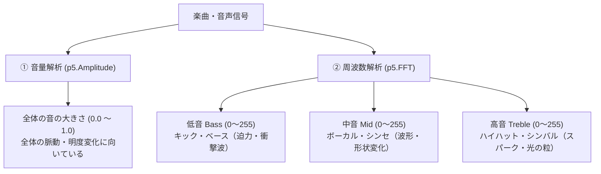
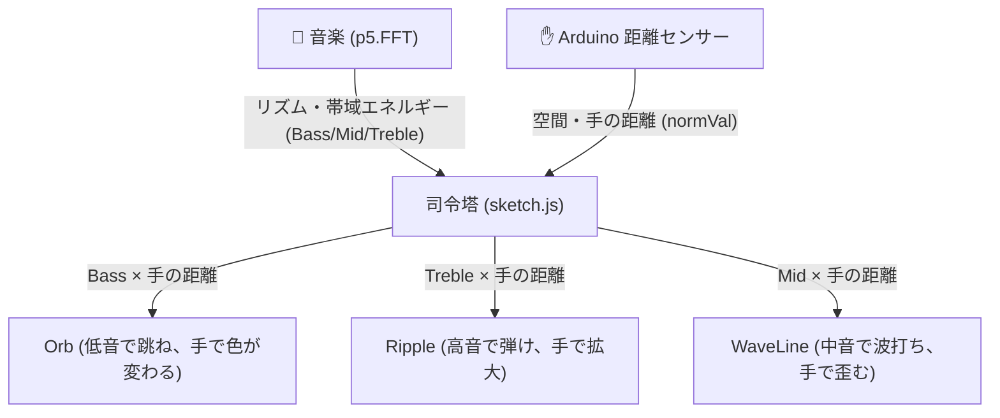

# 05_p5soundとセンサー連携（オーディオビジュアル）

### コンテンツ制作（金1-2）

[00_導入](https://app.notion.com/p/00_-3cebdf471aca8099b067d7a323310d2e?pvs=21)

[01_Arduinoの基礎](https://app.notion.com/p/01_Arduino-3ecbdf471aca805198efd80b40681979?pvs=21)

[02_センサー入力値の調整](https://app.notion.com/p/02_-3f3bdf471aca80408e5acdb3862906cb?pvs=21)

[03_p5jsの基礎](https://app.notion.com/p/03_p5js-3f9bdf471aca80839972fc3e65dda794?pvs=21)

[04_p5jsとセンサー連携](https://app.notion.com/p/04_p5js-401bdf471aca804db4e5d869edc1f966?pvs=21)

[05_p5soundとセンサー連携](https://app.notion.com/p/05_p5sound-408bdf471aca80f49f3be2b477a346e9?pvs=21)

---

# 1. はじめに

## 1-1. 今回学ぶこと

前回（単元4）は、Arduinoの赤外線距離センサーとp5.jsを結合し、JavaScriptの **「クラス（Class）」** と **「ファイル分割（モジュール化）」** を使って、手の動きに反応する美しいジェネラティブアートを作りました。

今回は、そのアートに **「音（サウンド）」** の力を注入します！

Web Audioの強力な拡張ライブラリ **「p5.sound」** を導入し、音楽ファイル（mp3）やマイクの音声をリアルタイムに周波数解析（FFT）して、ビジュアルを音楽に完全シンクロさせます。

さらに、前回学んだ **「ハブ（`sketch.js`）と部品（クラス）の疎結合設計」** の真価を発揮させます。前回作ったクラス（`Orb.js`, `Ripple.js`, `WaveLine.js`）のコードを壊すことなくそのまま流用し、**「音 × 映像 × センサー」が三位一体となった本格的なインタラクティブ・オーディオビジュアル（VJシステム）** を構築します。

- **Web Audio APIの仕組みとブラウザの安全ルール「Autoplay Policy（自動再生の禁止）」**
- **p5.soundの導入とオーディオファイル（mp3/wav）のロード・再生・ループ制御**
- **音の大きさ（音量）をリアルタイムに測る「`p5.Amplitude`」**
- **音を解剖する魔法の数理「高速フーリエ変換（`p5.FFT`）」と周波数帯域（低音 Bass / 中音 Mid / 高音 Treble）**
- **マイク入力（`p5.AudioIn`）への切り替えと、声や拍手でのインタラクション**
- **「クラス設計」の真価：前回の `Orb`, `Ripple`, `WaveLine` を1行も書き換えずに音でドライブする流用術**
- **音響エネルギーを美しく整えるデータパイプライン（`getEnergy` ➔ `map` ➔ `lerp`）**
- **「音（リズム・ビート）」×「センサー（手の接近・明暗）」が掛け合わさるマルチモーダル演出の構築**
- **生成AIを活用して、音楽の帯域に激しく反応するオリジナルVJクラスを量産する**

---

# 2. Web Audioとp5.soundの基礎知識

## 2-1. p5.sound とは？

**p5.sound** は、p5.js の公式アドオンライブラリであり、ブラウザに標準搭載されている高度な音響API **「Web Audio API」** を直感的かつクリエイティブに扱えるようにラップ（簡略化）したものです。

| 項目 | 内容 |
| --- | --- |
| **できること** | 音声ファイルの再生・停止・逆再生・音程変更、マイクからの音声取得、音量・周波数解析（FFT）、音の波形描画、シンセサイザーによる発音、ディレイ・リバーブ・フィルター等のエフェクト処理 |
| **導入方法** | HTMLの `<script>` タグで CDN から読み込むだけ（インストール不要） |
| **公式サイト** | [p5.sound リファレンス（p5js.org/reference/#/libraries/p5.sound）](https://p5js.org/reference/#/libraries/p5.sound) |

---

## 2-2. ブラウザの重要ルール「Autoplay Policy（自動再生の禁止）」

Webで音を扱う際、**全Webエンジニアが必ず直面する最も重要なセキュリティ仕様** があります。
それが **「Autoplay Policy（オートプレイ・ポリシー）」** です。

<aside>
🚨 **なぜ勝手に音が鳴ってはいけないのか？**

昔のWebサイトでは、ページを開いた瞬間に大音量でBGMや動画広告が鳴り響き、ユーザーを驚かせたり公共の場で恥をかかせたりするトラブルが多発しました。
そのため、現在の主要ブラウザ（Chrome, Safari, Edge, Firefox等）はすべて：

**「ユーザーが画面を明示的にクリック（またはタップ・キー押し）するまで、Web Audioの音声出力を自動的にミュート（一時停止）する」**

という厳格なセキュリティロックをかけています。
</aside>

このロックを解除せずに音を再生しようとすると、コンソールに以下のような警告が出ます：
`The AudioContext was not allowed to start. It must be resumed (or created) after a user gesture on the page.`

p5.sound では、画面のクリック時などに **`userStartAudio()`** という関数を呼ぶか、クリックイベントの中で `.play()` を実行することで、この制約を安全にクリアできます。

---

# 3. 音を鳴らす（音声ファイルのロードと再生制御）

まずは、ブラウザ上にボタンを用意し、好きな音楽ファイル（mp3）を読み込んで再生・一時停止する基本構成を作ってみましょう。

## 3-1. プロジェクトの準備とディレクトリ構成

本単元の作業フォルダを準備します。
プロジェクト内に `assets/` フォルダを作成し、BGMとして鳴らしたい音声ファイル（`music.mp3`）を配置してください。

```text
05_audio_visual/
├── index.html
├── assets/
│   └── music.mp3     // 好きな音楽ファイル（テンポがはっきりした曲がおすすめ）
└── js/
    └── sketch.js
```

<aside>
💡 **音源について**

テンポ感があり、ドラムのキック（低音）やハイハット（高音）がはっきりしている楽曲（EDM、HipHop、エレクトロニック、クラブミュージック等）を選ぶと、後の周波数解析（FFT）でビジュアルが気持ちよく跳ねます。
著作権フリーのBGMサイト（DOVA-SYNDROME、甘茶の音楽工房、OtoLogic等）からダウンロードしたmp3でOKです。
</aside>

---

## 3-2. HTMLの記述（p5.js と p5.sound の読み込み）

**`index.html`**

```html
<!DOCTYPE html>
<html lang="ja">
<head>
  <meta charset="UTF-8">
  <meta name="viewport" content="width=device-width, initial-scale=1.0">
  <title>p5.sound 基礎</title>
  <style>
    body {
      margin: 0;
      padding: 0;
      overflow: hidden;
      background-color: #0b0c10;
      font-family: sans-serif;
    }
    #ui-container {
      position: absolute;
      top: 20px;
      left: 20px;
      z-index: 10;
      color: #fff;
    }
    button {
      padding: 10px 20px;
      font-size: 16px;
      font-weight: bold;
      background: linear-gradient(135deg, #00ffcc, #0077ff);
      border: none;
      border-radius: 8px;
      color: #0b0c10;
      cursor: pointer;
      box-shadow: 0 4px 15px rgba(0, 255, 204, 0.4);
      transition: transform 0.1s, box-shadow 0.1s;
    }
    button:active {
      transform: scale(0.96);
    }
    p {
      margin: 8px 0 0 0;
      font-size: 13px;
      color: #8892b0;
    }
  </style>

  <!-- ① p5.js 本体 -->
  <script src="https://cdnjs.cloudflare.com/ajax/libs/p5.js/1.9.4/p5.min.js"></script>
  <!-- ② p5.sound アドオンライブラリ -->
  <script src="https://cdnjs.cloudflare.com/ajax/libs/p5.js/1.9.4/addons/p5.sound.min.js"></script>
</head>
<body>
  <div id="ui-container">
    <button id="play-btn">▶ PLAY MUSIC</button>
    <p>画面クリックまたはボタンで再生 / 一時停止</p>
  </div>

  <script src="./js/sketch.js"></script>
</body>
</html>
```

---

## 3-3. `sketch.js` でのロードと再生制御

p5.js には、大きな画像や音声ファイルを「描画が始まる前にあらかじめ完全に読み込み終わらせる」ための特別なライフサイクル関数 **`preload()`** が用意されています。

**`js/sketch.js`**

```javascript
let bgm;
let playBtn;

// ① 描画開始前に音源を完全にプリロードする
function preload() {
  soundFormats('mp3', 'ogg', 'wav');
  bgm = loadSound('assets/music.mp3');
}

function setup() {
  createCanvas(windowWidth, windowHeight);
  colorMode(HSB, 360, 100, 100, 100);

  // HTMLのボタン要素を取得してクリックイベントを登録
  playBtn = select('#play-btn');
  playBtn.mousePressed(togglePlay);
}

// 再生と一時停止を切り替える関数
function togglePlay() {
  // ブラウザのAutoplay制約を安全に解除
  userStartAudio();

  if (bgm.isPlaying()) {
    bgm.pause();
    playBtn.html('▶ PLAY MUSIC');
  } else {
    bgm.loop(); // ループ再生
    playBtn.html('❚❚ PAUSE');
  }
}

function draw() {
  background(220, 30, 10);

  fill(0, 0, 100);
  textAlign(CENTER, CENTER);
  textSize(24);

  if (bgm.isPlaying()) {
    text("🎵 音楽を再生中...", width / 2, height / 2);
  } else {
    text("ボタンを押して音楽を再生してください", width / 2, height / 2);
  }
}

// ウィンドウリサイズ対応
function windowResized() {
  resizeCanvas(windowWidth, windowHeight);
}
```

<aside>
⚠️ **重要：Live Server 等のローカルサーバーで開いてください**

音声ファイルのロード（`loadSound`）はブラウザのセキュリティ仕様（CORSポリシー）により、ローカルファイルを直接ダブルクリックして開く（`file:///...`）とエラーになります。
必ず VS Code の **Live Server 拡張機能** などを使い、`http://127.0.0.1:5500/...` のローカルサーバー環境でブラウザを開いてください。
</aside>

ボタンをクリックして、音楽がスムーズにループ再生・一時停止されることを確認してください。

---

# 4. 音を視覚化する（振幅 Amplitude と 周波数解析 FFT）

音が鳴ったら、次は **「音のデータをリアルタイムに数値として取り出す」** ステップに進みます。
音を解析するアプローチには大きく分けて2つあります。



---

## 4-1. 音の大きさ（音量）を測る：`p5.Amplitude`

**`p5.Amplitude`** は、現在鳴っている音の「総合的な音量（振幅の大きさ）」を `0.0（無音）〜 1.0（最大音量）` の数値で返してくれる最もシンプルな解析クラスです。

```javascript
let amplitude;

function setup() {
  createCanvas(windowWidth, windowHeight);
  amplitude = new p5.Amplitude(); // 音量解析オブジェクトの生成
}

function draw() {
  background(220, 30, 10, 20);

  // 現在の音量レベルを取得（0.0 〜 1.0）
  let level = amplitude.getLevel();

  // 音量に合わせて中央の円を拡大
  let size = map(level, 0, 0.5, 50, 400);

  fill(180, 80, 100);
  noStroke();
  circle(width / 2, height / 2, size);
}
```

音量解析だけでも円の大きさをビートに合わせて変化させられますが、これだけでは **「重低音のズシンというドラム」** も **「甲高いシンバルのシャーンという音」** も区別できず、すべてひとまとめに反応してしまいます。

そこで登場するのが、メディアアートやVJ演出の主役である **「周波数解析（FFT）」** です！

---

## 4-2. 音を解剖する魔法の数理：`p5.FFT`（高速フーリエ変換）

### FFT（Fast Fourier Transform）とは？
どんなに複雑な音楽も、数学的には **「様々な高さ（周波数）の純音（サイン波）が幾重にも重なり合ってできたもの」** です。
FFT（高速フーリエ変換）とは、この混ざり合った音の波を瞬時に分解し、**「どの周波数（低音・中音・高音）が、いまどれくらいの強さで鳴っているか」** を配列として取り出すアルゴリズムです。

### `p5.FFT` の生成と初期設定
```javascript
fft = new p5.FFT(smoothing, bins);
```
- **`smoothing`（平滑化係数 / 0.0〜1.0）**:
  数値をどれくらい滑らかにするか。`0.8` 前後に設定すると、ノイズが抑えられ心地よい追従になります（Lerpと同じ考え方です）。
- **`bins`（周波数分解能 / 16〜1024の2の累乗）**:
  周波数をいくつの帯域に切り分けるか。通常は `64` や `128` で十分高精細です。

---

## 4-3. 3大エネルギー帯域の抽出：`getEnergy()`

`fft.analyze()` を実行すると、周波数のスペクトル配列（波形データ）が生成されます。
さらに便利なのが、人間が直感的に理解しやすい音楽帯域を 0〜255 の数値で一発で取り出せる **`fft.getEnergy()`** メソッドです！

| 帯域キーワード | 周波数帯 | 主な楽器・音の特徴 | VJ・アート演出での定番の役割 |
|---|---|---|---|
| **`"bass"`** | 低音域（約20〜140Hz） | ドラムのキック、ベース音、爆発音 | **画面全体の拡大・衝撃波・カメラシェイク・心臓の脈動** |
| **`"mid"`** | 中音域（約400〜2600Hz） | 人の声（ボーカル）、ピアノ、メロディシンセ | **メインオブジェクトの形状変化・うねり・波打ち** |
| **`"treble"`** | 高音域（約5200〜14000Hz） | ハイハット、シンバル、ベル、金属音 | **光のスパーク、火花、細かなパーティクルの放出、発光** |

### イコライザー波形と3大エネルギーを可視化するコード

実際に周波数波形と3大エネルギー（Bass / Mid / Treble）を画面に描画して観察してみましょう。

**`js/sketch.js`**

```javascript
let bgm;
let fft;
let playBtn;

function preload() {
  soundFormats('mp3', 'ogg', 'wav');
  bgm = loadSound('assets/music.mp3');
}

function setup() {
  createCanvas(windowWidth, windowHeight);
  colorMode(HSB, 360, 100, 100, 100);

  playBtn = select('#play-btn');
  playBtn.mousePressed(togglePlay);

  // FFT解析の初期化（平滑化0.8、64バンド）
  fft = new p5.FFT(0.8, 64);
}

function togglePlay() {
  userStartAudio();
  if (bgm.isPlaying()) {
    bgm.pause();
    playBtn.html('▶ PLAY MUSIC');
  } else {
    bgm.loop();
    playBtn.html('❚❚ PAUSE');
  }
}

function draw() {
  // 残像エフェクト（暗い背景）
  background(220, 30, 10, 25);

  if (!bgm.isPlaying()) {
    fill(0, 0, 80);
    textAlign(CENTER, CENTER);
    textSize(20);
    text("上のボタンを押して音楽を再生してください", width / 2, height / 2);
    return;
  }

  // ① FFT解析を実行（スペクトル配列を取得）
  let spectrum = fft.analyze();

  // ② 3大エネルギーを取得（0 〜 255）
  let bass   = fft.getEnergy("bass");
  let mid    = fft.getEnergy("mid");
  let treble = fft.getEnergy("treble");

  // ③ 画面下部にイコライザー波形を描画
  let barWidth = width / spectrum.length;
  noStroke();
  for (let i = 0; i < spectrum.length; i++) {
    let barHeight = map(spectrum[i], 0, 255, 0, height * 0.4);
    let hueVal = map(i, 0, spectrum.length, 160, 320);
    fill(hueVal, 80, 100, 80);
    rect(i * barWidth, height - barHeight, barWidth - 2, barHeight);
  }

  // ④ 画面中央に 3大エネルギーを円で可視化
  push();
  translate(width / 2, height / 2 - 50);

  // 【低音 Bass】中央の巨大な円（キックでドクンと跳ねる）
  let bassSize = map(bass, 0, 255, 60, 300);
  fill(340, 80, 100, 40);
  circle(0, 0, bassSize * 1.4);
  fill(340, 90, 100, 80);
  circle(0, 0, bassSize);

  // 【中音 Mid】回転する多角形（ボーカル・メロディで変形）
  let midSize = map(mid, 0, 255, 40, 180);
  push();
  rotate(frameCount * 0.02);
  noFill();
  stroke(180, 80, 100, 90);
  strokeWeight(3);
  rectMode(CENTER);
  rect(0, 0, midSize, midSize);
  pop();

  // 【高音 Treble】周囲にきらめく火花（シンバルで弾ける）
  let trebleCount = floor(map(treble, 0, 255, 0, 16));
  stroke(60, 90, 100, 90);
  strokeWeight(4);
  for (let i = 0; i < trebleCount; i++) {
    let angle = TWO_PI / trebleCount * i + frameCount * 0.05;
    let dist = bassSize * 0.7 + random(10, 40);
    point(cos(angle) * dist, sin(angle) * dist);
  }

  pop();

  // 数値デバッグ表示
  fill(0, 0, 100);
  textAlign(LEFT, TOP);
  textSize(14);
  text(`Bass   : ${bass}`, 20, height - 80);
  text(`Mid    : ${mid}`, 20, height - 60);
  text(`Treble : ${treble}`, 20, height - 40);
}

function windowResized() {
  resizeCanvas(windowWidth, windowHeight);
}
```

ブラウザで再生してみてください。
低音（バスドラム）が鳴るたびに赤い円がドクンと膨張し、中音でシアンの四角形がゆらぎ、シンバルが鳴ると金色の火花が飛び散るはずです。
このように、**「音を帯域別に分けて異なるビジュアル要素に割り振る」** ことが、本格的なオーディオビジュアル制作の第一歩です。

---

# 5. マイク入力への切り替え（オプション）

音楽ファイルだけでなく、PCの内蔵マイクを使って **「自分の声」** や **「手拍子」「口笛」** でアートを動かすことも極めて簡単に実装できます。

```javascript
let mic;
let fft;

function setup() {
  createCanvas(windowWidth, windowHeight);
  
  // マイク入力の初期化と開始
  mic = new p5.AudioIn();
  mic.start();

  // マイクの音声をFFTの入力ソースに設定！
  fft = new p5.FFT(0.8, 64);
  fft.setInput(mic);
}

function touchStarted() {
  userStartAudio(); // マイクの起動ロック解除
}
```

展示作品や体験型インスタレーションで「マイクに声を吹きかけると花が開く」「拍手すると雷が落ちる」といった演出を作りたい場合は、この `p5.AudioIn` を使用してください。

---

# 6. 単元4のクラスをそのまま流用する（モジュール化の真価）

ここからが本単元のハイライトです！

前回（単元4）の講義を思い出してください。私たちは、`sketch.js` の中に全部の処理をごちゃ混ぜに書くのではなく、
- 描画する部品を独立したクラス（`Orb.js`, `Ripple.js`, `WaveLine.js`）として切り分け、
- それぞれ **「外部から数値（`update(val)`）を受け取って動くだけ」** という設計にしました。

```mermaid
flowchart LR
    subgraph 前回：単元4
        S1["Arduino 距離センサー"] -->|sensorValue: 0.0〜1.0| H1["ハブ (sketch.js)"]
        H1 -->|sensorValue| O1["Orb.js (発光球)"]
        H1 -->|sensorValue| R1["Ripple.js (波紋)"]
        H1 -->|sensorValue| W1["WaveLine.js (波線)"]
    end

    subgraph 今回：単元5
        M1["音楽 (p5.FFT)"] -->|Bass / Mid / Treble| H2["ハブ (sketch.js)"]
        H2 -->|normBass (低音)| O1
        H2 -->|normTreble (高音)| R1
        H2 -->|normMid (中音)| W1
    end
```

前回のクラスのコード（`Orb.js`, `Ripple.js`, `WaveLine.js`）は、**なんと1行も書き換える必要がありません！**
ハブである `sketch.js` の中で、**「渡す数値をセンサー値から、FFTで解析した音のエネルギー（0.0〜1.0）へ差し替えるだけ」** で、前回のジェネラティブアートが瞬時に超絶クオリティのVJアートへと生まれ変わります。

---

## 6-1. ディレクトリ構成の確認

前回の `js/templates/` フォルダの中身をそのまま配置します。

```text
05_audio_visual/
├── index.html
├── assets/
│   └── music.mp3
└── js/
    ├── sketch.js
    └── templates/
        ├── Orb.js        // ★ 前回のコードそのまま！
        ├── Ripple.js     // ★ 前回のコードそのまま！
        └── WaveLine.js   // ★ 前回のコードそのまま！
```

**`index.html`** に前回のクラスファイルを読み込ませます：

```html
  <!-- クラス部品テンプレートの読み込み -->
  <script src="./js/templates/Orb.js"></script>
  <script src="./js/templates/Ripple.js"></script>
  <script src="./js/templates/WaveLine.js"></script>

  <!-- メインハブ -->
  <script src="./js/sketch.js"></script>
```

---

## 6-2. 音響エネルギーのデータパイプライン

FFTから取得した `bass`, `mid`, `treble` は `0〜255` の整数です。
前回のクラスたちは `0.0〜1.0` の正規化された数値を受け取る設計になっているため、おなじみの3ステップで整形します：

```javascript
// 1. 低音（0〜255）を 0.0〜1.0 に正規化
let targetBass = map(bass, 0, 255, 0.0, 1.0);

// 2. Lerp平滑化で突発的なカクつきを吸収し、ヌルヌル動かす
smoothBass = lerp(smoothBass, targetBass, 0.15);

// 3. 部品へ届ける！
for (let orb of orbs) {
  orb.update(smoothBass); // ★ オーブに低音を渡す！
  orb.render();
}
```

---

## 6-3. 音響連動VJ `sketch.js` の実装

**`js/sketch.js`**

```javascript
let bgm;
let fft;
let playBtn;

// クラスのインスタンス配列
let orbs = [];
let ripples = [];
let waveLines = [];

// 平滑化された音響エネルギー（0.0 〜 1.0）
let smoothBass = 0;
let smoothMid = 0;
let smoothTreble = 0;

function preload() {
  soundFormats('mp3', 'ogg', 'wav');
  bgm = loadSound('assets/music.mp3');
}

function setup() {
  createCanvas(windowWidth, windowHeight);
  rectMode(CENTER);
  imageMode(CENTER);
  angleMode(DEGREES);
  colorMode(HSB, 360, 100, 100, 100);
  noStroke();

  playBtn = select('#play-btn');
  playBtn.mousePressed(togglePlay);

  fft = new p5.FFT(0.8, 64);

  // ① Orb（発光球）を30個生成
  for (let i = 0; i < 30; i++) {
    let rx = random(width * 0.1, width * 0.9);
    let ry = random(height * 0.1, height * 0.9);
    orbs.push(new Orb(rx, ry));
  }

  // ② Ripple（波紋）を8個生成
  for (let i = 0; i < 8; i++) {
    let rx = random(width * 0.2, width * 0.8);
    let ry = random(height * 0.2, height * 0.8);
    ripples.push(new Ripple(rx, ry));
  }

  // ③ WaveLine（波打つライン）を5本生成
  for (let i = 0; i < 5; i++) {
    let y = map(i, 0, 4, height * 0.2, height * 0.8);
    waveLines.push(new WaveLine(y));
  }
}

function togglePlay() {
  userStartAudio();
  if (bgm.isPlaying()) {
    bgm.pause();
    playBtn.html('▶ PLAY MUSIC');
  } else {
    bgm.loop();
    playBtn.html('❚❚ PAUSE');
  }
}

function draw() {
  // 残像エフェクト
  background(220, 30, 8, 20);

  if (!bgm.isPlaying()) {
    fill(0, 0, 80);
    textAlign(CENTER, CENTER);
    textSize(22);
    text("上のボタンを押して VJ をスタート！", width / 2, height / 2);
    return;
  }

  // 1. FFT解析と帯域別エネルギー抽出
  fft.analyze();
  let rawBass   = fft.getEnergy("bass");
  let rawMid    = fft.getEnergy("mid");
  let rawTreble = fft.getEnergy("treble");

  // 2. 正規化とLerp平滑化
  smoothBass   = lerp(smoothBass,   map(rawBass,   0, 255, 0.0, 1.0), 0.15);
  smoothMid    = lerp(smoothMid,    map(rawMid,    0, 255, 0.0, 1.0), 0.15);
  smoothTreble = lerp(smoothTreble, map(rawTreble, 0, 255, 0.0, 1.0), 0.2);

  // 3. 各クラスに最適な周波数帯域を割り振って更新・描画！

  // 【背景レイヤー】WaveLine には中音（ボーカル・シンセ旋律）を渡す
  for (let line of waveLines) {
    line.update(smoothMid);
    line.render();
  }

  // 【中間レイヤー】Ripple には高音（シンバル・ビートの粒）を渡す
  for (let ripple of ripples) {
    ripple.update(smoothTreble);
    ripple.render();
  }

  // 【前面レイヤー】Orb には重低音（キック・ベースの爆発）を渡す
  for (let orb of orbs) {
    orb.update(smoothBass);
    orb.render();
  }
}

function windowResized() {
  resizeCanvas(windowWidth, windowHeight);
}
```

ブラウザで再生してみてください！
- バスドラム（低音）の重低音に合わせて `Orb` がドクンと鼓動して光を放ち、
- メロディ（中音）に合わせて背景の `WaveLine` が生き物のように波打ち、
- ハイハット（高音）に合わせて `Ripple` の波紋がパッパッと弾ける！

前回のクラス設計を一切変えることなく、音響データと完璧に同期した圧巻のオーディオビジュアルが完成しました。
これがプログラミングにおける **「モジュール化（カプセル化）」** の最大のメリットです。

---

# 7. 音 × センサーのマルチモーダル統合（VJシステムの完成）

いよいよ最後のピース、**Arduinoの物理センサー（赤外線距離センサー）** を再び接続します！

```text
「音楽のビートに合わせてアートが自動で跳ねる」
　　＋
「手を近づけると、全体の色相が劇的に変化し、空間が歪む」
```

このように、**「音楽（時間軸のルール）」** と **「フィジカル（空間軸の人間操作）」** が融合したとき、画面を見ている人には **「まるで自分が魔法の手で音楽と映像を直接操っている」** かのような強烈な手応え（マルチモーダル体験）が生まれます。



---

## 7-1. `sensor.js` の復活と HTML への追加

単元4で作成した独立通信モジュール **`js/sensor.js`** をプロジェクトに配置します。

```text
05_audio_visual/
├── index.html
├── assets/
│   └── music.mp3
└── js/
    ├── sensor.js     // ★ 単元4の通信モジュール！
    ├── sketch.js     // ★ 統合ハブ
    └── templates/
        ├── Orb.js
        ├── Ripple.js
        └── WaveLine.js
```

**`index.html`** の `<head>` に `sensor.js` を追加します：

```html
  <!-- シリアル通信モジュール -->
  <script src="./js/sensor.js"></script>

  <!-- クラス部品テンプレート -->
  <script src="./js/templates/Orb.js"></script>
  <script src="./js/templates/Ripple.js"></script>
  <script src="./js/templates/WaveLine.js"></script>

  <!-- メインハブ -->
  <script src="./js/sketch.js"></script>
```

---

## 7-2. 統合ハブ `js/sketch.js` の完全実装コード

音楽の周波数エネルギーと、センサーの手の接近値（`0.0〜1.0`）を美しく掛け合わせて各クラスに渡します。

**`js/sketch.js`**

```javascript
/**
 * 05_audio_visual - 音 × 映像 × センサー 統合VJシステム
 */

// センサー調整用定数（環境に合わせて調整）
const SENSOR_MIN = 100;
const SENSOR_MAX = 600;
const SENSOR_LERP = 0.08;

let sensorTarget = 0.0;
let sensorValue  = 0.0; // 0.0 (遠い) 〜 1.0 (近い)

// サウンド & FFT
let bgm;
let fft;
let playBtn;

let smoothBass   = 0;
let smoothMid    = 0;
let smoothTreble = 0;

// クラスインスタンス配列
let orbs = [];
let ripples = [];
let waveLines = [];

function preload() {
  soundFormats('mp3', 'ogg', 'wav');
  bgm = loadSound('assets/music.mp3');
}

function setup() {
  createCanvas(windowWidth, windowHeight);
  rectMode(CENTER);
  imageMode(CENTER);
  angleMode(DEGREES);
  colorMode(HSB, 360, 100, 100, 100);
  noStroke();

  playBtn = select('#play-btn');
  playBtn.mousePressed(togglePlay);

  fft = new p5.FFT(0.8, 64);

  // インスタンスの一括生成
  for (let i = 0; i < 35; i++) {
    orbs.push(new Orb(random(width * 0.1, width * 0.9), random(height * 0.1, height * 0.9)));
  }
  for (let i = 0; i < 10; i++) {
    ripples.push(new Ripple(random(width * 0.2, width * 0.8), random(height * 0.2, height * 0.8)));
  }
  for (let i = 0; i < 6; i++) {
    let y = map(i, 0, 5, height * 0.15, height * 0.85);
    waveLines.push(new WaveLine(y));
  }
}

function togglePlay() {
  userStartAudio();
  if (bgm.isPlaying()) {
    bgm.pause();
    playBtn.html('▶ PLAY MUSIC');
  } else {
    bgm.loop();
    playBtn.html('❚❚ PAUSE');
  }
}

function draw() {
  // 手を近づけると残像が伸びて幻想的な光の尾を引く演出
  let bgAlpha = map(sensorValue, 0, 1, 25, 8);
  background(220, 30, 8, bgAlpha);

  // ① Arduino センサー値のデータパイプライン処理
  if (Sensor.isConnected) {
    let raw = Sensor.raw;
    let clamped = constrain(raw, SENSOR_MIN, SENSOR_MAX);
    sensorTarget = map(clamped, SENSOR_MIN, SENSOR_MAX, 0.0, 1.0);
    sensorValue = lerp(sensorValue, sensorTarget, SENSOR_LERP);
  }

  // ② 音響解析（FFT）処理
  if (bgm.isPlaying()) {
    fft.analyze();
    let rawBass   = fft.getEnergy("bass");
    let rawMid    = fft.getEnergy("mid");
    let rawTreble = fft.getEnergy("treble");

    smoothBass   = lerp(smoothBass,   map(rawBass,   0, 255, 0.0, 1.0), 0.15);
    smoothMid    = lerp(smoothMid,    map(rawMid,    0, 255, 0.0, 1.0), 0.15);
    smoothTreble = lerp(smoothTreble, map(rawTreble, 0, 255, 0.0, 1.0), 0.2);
  }

  // ③【マルチモーダル合成】音のビート ＋ 手の距離を合成してクラスへ届ける！
  // 例: 基本は音で跳ねつつ、手を近づけると激しさがブーストされる
  let bassCombined   = constrain(smoothBass   + sensorValue * 0.6, 0.0, 1.0);
  let midCombined    = constrain(smoothMid    + sensorValue * 0.6, 0.0, 1.0);
  let trebleCombined = constrain(smoothTreble + sensorValue * 0.6, 0.0, 1.0);

  // 背景：WaveLine
  for (let line of waveLines) {
    line.update(midCombined);
    line.render();
  }

  // 中景：Ripple
  for (let ripple of ripples) {
    ripple.update(trebleCombined);
    ripple.render();
  }

  // 前景：Orb
  for (let orb of orbs) {
    orb.update(bassCombined);
    orb.render();
  }

  // ④ UI & ステータス表示
  drawStatusUI();
}

function drawStatusUI() {
  push();
  fill(0, 0, 100);
  textSize(14);
  textAlign(LEFT, BOTTOM);

  let serialText = Sensor.isConnected 
    ? `🟢 Arduino 接続中 (raw: ${Sensor.raw} ➔ val: ${sensorValue.toFixed(2)})`
    : `⚪ [C] キーを押して Arduino を接続`;

  let audioText = bgm.isPlaying()
    ? `🎵 音楽再生中 (Bass: ${(smoothBass*100).toFixed(0)}% / Treble: ${(smoothTreble*100).toFixed(0)}%)`
    : `❚❚ 音楽停止中`;

  text(`${serialText}  |  ${audioText}`, 20, height - 20);
  pop();
}

// キーボードの [C] キーで Arduino 接続
function keyPressed() {
  if ((key === 'c' || key === 'C') && !Sensor.isConnected) {
    Sensor.connect();
  }
}

function windowResized() {
  resizeCanvas(windowWidth, windowHeight);
}
```

### 体験してみよう！
1. ブラウザをリロードし、**「▶ PLAY MUSIC」** ボタンを押して音楽を再生します。
   （音がリズムに合わせて心地よく画面を揺らします）
2. キーボードの **`[C]` キー** を押し、Arduino Nano R4 のシリアルポートを選択して接続します。
3. センサーの前に手をかざしてみましょう。
   - 音楽のビートに合わせてオーブや波紋が跳ねている空間に、
   - 手をスーッと近づけると、全体の色相が一気にサイバーなネオンカラーに変色し、残像が幾重にも伸び、波打ちが劇的に激しくなります！

音楽という **「時間の波」** と、センサーという **「身体の波」** が一体となった、極めて完成度の高いインタラクティブ・アートの誕生です。

---

# 8. 生成AIを活用したオリジナルVJクラスの量産

単元4と同様に、生成AI（ChatGPT, Claude, Gemini等）を活用して、音とセンサーの両方に反応する **「新しい第4のVJクラス」** を自作してみましょう！

## 8-1. VJクラス生成用 AI プロンプト（テンプレート）

以下のプロンプトをコピーし、**【作りたい演出モチーフ】** を書き換えてAIに入力してください。

```markdown
あなたはクリエイティブコーディング（p5.js）およびオーディオビジュアル（VJ演出）のスペシャリストです。
以下の仕様と共通ルールに厳密に従って、音楽とセンサーに反応する新しいJavaScriptクラスを作成してください。

### 1. 表現したいモチーフ・世界観
【ここに作りたい表現を具体的に記述してください】
（例:
- 「低音（Bass）のキックが鳴ると中心から外側へ高速に幾何学的な破片が飛び散る爆発エフェクト」
- 「高音（Treble）に反応して夜空に細かく弾ける放電レーザー・プラズマスパーク」
- 「中音（Mid）のメロディに合わせて曼荼羅のように多角形が回転・展開する万華鏡ポリゴン」
- 「音量と手の接近に合わせて触手がうねりながら画面を覆うサイバーネオンワーム」など）

### 2. 必須のクラス設計（インターフェース仕様）
クラス名はモチーフに合わせた英単語とし、以下のメソッドを実装してください：

1. `constructor(x, y)`:
   - 座標、基本サイズ、初期色相、寿命、速度などを `this.` プロパティとして設定すること。
   - `random()` を活用して個体ごとに個性を持たせること。

2. `update(energy)`:
   - 引数 `energy` には、音楽の帯域エネルギーと距離センサー値が合成された数値（0.0 〜 1.0）が毎フレーム渡されます。
   - この `energy` を使って、サイズ拡大、移動速度の加速、色相の劇的シフト、回転スピード、透明度のフェードアウトなどを制御してください。
   - 画面外に出た場合や寿命が尽きた際のリセット（再利用）処理を含めてください。

3. `render()`:
   - キャンバスはすでに `colorMode(HSB, 360, 100, 100, 100);` に設定されています。
   - 必ず `push()` と `pop()` で囲み、スタイル汚染を防ぐこと。
   - `translate(this.x, this.y)` を使用し、自身の相対座標で描画命令を記述すること。

### 3. 出力ルール
- 完成した JavaScript のクラスコードのみを出力してください。
- 初心者にもわかりやすい日本語の解説コメントを各行に付けてください。
```

出力されたコードを `js/templates/新しいクラス名.js` として保存し、`index.html` に `<script>` を追加して `sketch.js` から呼び出してみましょう。

---

# 9. 課題

## 9-1. 課題内容
本日の総まとめとして、**「音楽（またはマイク入力）」と「Arduinoの距離センサー」を融合させた、オリジナルのインタラクティブ・オーディオビジュアル（VJ）作品** を制作してください。

### 【制作条件】
1. **p5.sound による周波数解析（FFT）の実装**:
   - `fft.getEnergy()` を使用し、少なくとも2つ以上の周波数帯域（低音 Bass、中音 Mid、高音 Treble など）を抽出して、それぞれ異なるビジュアル要素へマッピングすること。
2. **クラスの活用（3つ以上）**:
   - `Orb`, `Ripple`, `WaveLine` の改造、または生成AIで出力した完全オリジナルクラスを含め、独立したクラスファイルを最低3つ以上組み込むこと。
3. **センサー（Web Serial）との複合演出**:
   - 音のビートに反応するだけでなく、手の距離（または明るさセンサー）によって色・広がり・残像などのビジュアルパラメータがダイナミックに変化すること。
4. **テーマと演出の調律**:
   - 選択した楽曲のジャンル・テンポ（BPM）に合わせて、アートの色彩や動きのスピード感を気持ちよく調律すること。

---

## 9-2. 次回へのステップ
次回（単元7）は、いよいよ **「音楽そのものを自分でプログラミングして創り出す」** 体験へ進みます！
ブラウザ完結の最先端ライブコーディング環境 **「Strudel (https://strudel.cc/ )」** を使ってオリジナルのビートやループトラックを作成し、今日作ったジェネラティブアートと合体させます。お楽しみに！
