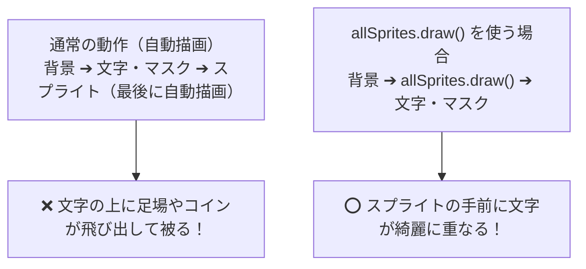

# 06_p5playの基礎

### コンテンツ制作（金1-2）

[00_導入](https://app.notion.com/p/00_-3cebdf471aca8099b067d7a323310d2e?pvs=21)

[01_Arduinoの基礎](https://app.notion.com/p/01_Arduino-3ecbdf471aca805198efd80b40681979?pvs=21)

[02_**センサー入力値の調整**](https://app.notion.com/p/02_-3f3bdf471aca80408e5acdb3862906cb?pvs=21)

[03_p5jsの基礎](https://app.notion.com/p/03_p5js-3f9bdf471aca80839972fc3e65dda794?pvs=21)

[04_ジェネラティブアートとセンサー連携](https://app.notion.com/p/04_-401bdf471aca804db4e5d869edc1f966?pvs=21)

[05_音楽とビジュアル表現](https://app.notion.com/p/05_-406bdf471aca80909716d12ac7b96a4b?pvs=21)

[06_p5playの基礎](https://app.notion.com/p/06_p5play-40cbdf471aca80909716d12ac7b96a4b?pvs=21)

---

# 1. はじめに

## 1-1. 前回の振り返りと今回の位置づけ

前回は、Web Audioの拡張ライブラリ **「p5.sound」** を導入し、音楽（mp3）の周波数解析（FFT）を行って、低音・中音・高音にシンクロして脈動するオーディオビジュアル（VJシステム）を制作しました。

今回からは、表現のステージを幾何学アートから **「スプライトと物理演算を駆使した2Dゲーム・キャラクター表現」** へと大きくステップアップさせます。その中核となる超強力なゲームライブラリが **「p5play（ピーファイブ・プレイ）」** です。

<aside>
💡

**【重要】今回の学習スタンス**

これまでの授業では、生成AIを活用してビジュアルクラスを量産するなど「AIを使って表現を広げること」を中心に進めてきました。

しかし、ゲーム制作において **「ライブラリの基本構造（スプライト、プロパティ、物理演算、コライダー、当たり判定、グループ）」を理解せずにAIに丸投げしてしまうと、少し挙動がおかしくなっただけでどこを直せばいいか全く分からなくなってしまいます。**

そのため今回は、単に完成コードを眺めるのではなく、**スプライトの基本概念やプロパティをしっかり理解した上で、1つのミニゲームをゼロから少しずつ組み立てながら、途中で実際に数値を変更したり練習問題を解きながら、自分の手で仕組みを体得していくハンズオン形式** で進めます。

基礎の土台を固めた上で、最後の課題では「AIを頼れる壁打ちパートナー」として活用し、独自のギミックやルールを肉付けした完成度の高いオリジナルゲームを作り上げます。

</aside>

---

## 1-2. 今回作るゲーム：「Coin Hunter（コインハンター）」

本日の講義を通して、以下の要素を備えた2Dアクションミニゲーム **「Coin Hunter」** をステップ・バイ・ステップで完成させます：

1. **スプライトの誕生**: 主人公と床の配置、見た目やプロパティのカスタマイズ
2. **手応えの調律**: 重力、反発（バウンド）、摩擦、回転ロックの実験
3. **コライダーの使い分け**: 落ちる主人公（`dynamic`）、頑丈な足場（`static`）、動くリフト（`kinematic`）
4. **気持ちいい操作性**: 左右ダッシュ、画面端の制限、地面にいる時だけ跳べるジャンプ
5. **アイテムと動く障害物**: ランダムなコイン生成、すり抜け回収（`overlaps`）、左右から流れてくる敵
6. **グラフィックとゲームステート**: スプライトの画像化（SVG）、スタート画面、一撃ゲームオーバー、クリア画面

---

# 2. p5playの基本知識と環境構築

## 2-1. p5playとは？（素のp5.jsとの決定的な違い）

p5.js は図形やアートを描くのには最高ですが、いざ「ゲーム」を作ろうとすると以下のような膨大な処理をすべて自力で数式を書いて実装しなければなりません：

1. **物体の座標と速度の計算**: `x += vx; y += vy;` を毎フレーム計算
2. **重力と地面の処理**: `vy += gravity;` を足し、地面のY座標を超えたら着地
3. **跳ね返りや摩擦の計算**: 壁に当たったら反射、地面を滑るときは減速
4. **当たり判定（衝突判定）の泥臭い計算**: 四角形同士が重なっているかを調べる複雑な不等式
5. **キーボード操作のフラグ管理**: 「押した瞬間だけジャンプ」「押しっぱなしでダッシュ」の判定

これらを自前で書いていると、コードが数百行の数学とフラグ処理で埋め尽くされ、Webデザイン学科の皆さんが本来こだわりたい **「キャラクターの魅力」「触って気持ちいい手応え」「ゲームの面白さ」** にたどり着く前に力尽きてしまいます。

**p5play（v3）** は、世界最高峰の2D物理演算エンジン **「Planck.js（Box2DのJavaScript移植版）」** を内部に統合し、p5.js の構文に合わせて極めて直感的に扱えるように設計されたゲーム開発ライブラリです。

| 比較項目 | 素のp5.js | p5play v3 |
| --- | --- | --- |
| **物体の生成** | `rect()` や `circle()` を毎フレーム `draw()` 内で呼び出し | `new Sprite(x, y, w, h)` を1回呼ぶだけ（自動で描画・更新） |
| **重力・物理法則** | 自力で加速度・速度・地面衝突を計算（数十行） | `world.gravity.y = 15;` と書くだけで全スプライトが自然落下 |
| **衝突・跳ね返り** | 複雑な幾何学計算と反射ベクトルの自力算出 | スプライト同士がぶつかると自動で跳ね返り、押し合う |
| **キー入力判定** | `keyIsDown()` や `keyPressed()` のイベント処理 | `kb.pressing('left')` や `kb.presses('space')` で直感判定 |
| **大量のアイテム管理** | 配列に詰めて `for` 文で手動ループ | `Group` を使えば、1行で共通の性質を持つスプライトを量産 |

---

## 2-2. ディレクトリ構成と `index.html`

作業用フォルダの中に、画像素材用の `assets` フォルダと、2つの基本ファイルを用意します。

```text
06_p5play_basics/
├── assets/
│   ├── player.svg   # プレイヤー画像
│   ├── coin.svg     # コイン画像
│   └── enemy.svg    # 障害物（敵）画像
├── index.html
└── sketch.js
```

p5play v3 を動かすためには、**スクリプトの読み込み順序** が極めて重要です。必ず以下の順番で記述します：

1. **`p5.min.js`**（p5.js 本体）
2. **`planck.min.js`**（p5playが必要とする世界標準の2D物理演算エンジン）
3. **`p5play.js`**（p5play 本体）
4. **`sketch.js`**（私たちが書くゲームコード）

**`index.html`**

```html
<!DOCTYPE html>
<html lang="ja">
<head>
  <meta charset="UTF-8">
  <meta name="viewport" content="width=device-width, initial-scale=1.0">
  <title>06_p5playの基礎 - Coin Hunter</title>
  
  <!-- ① p5.js 本体 (v1.11系推奨) -->
  <script src="https://cdn.jsdelivr.net/npm/p5@1.11.11/lib/p5.min.js"></script>

  <!-- ② 物理演算エンジン Planck.js (p5playの直前に必須) -->
  <script src="https://p5play.org/v3/planck.min.js"></script>

  <!-- ③ p5play v3 本体 -->
  <script src="https://p5play.org/v3/p5play.js"></script>

  <style>
    body {
      margin: 0;
      padding: 0;
      overflow: hidden;
      background-color: #1a1a24;
      display: flex;
      justify-content: center;
      align-items: center;
      height: 100vh;
    }
    canvas {
      box-shadow: 0 10px 30px rgba(0, 0, 0, 0.5);
      border-radius: 8px;
    }
  </style>
</head>
<body>
  <script src="sketch.js"></script>
</body>
</html>
```

---

# 3. スプライト（Sprite）の基本とプロパティ

## 3-1. スプライト（Sprite）とは何か？

ゲーム開発における **スプライト（Sprite）** とは、ゲームの世界の中に存在する **「実体（キャラクター、ボール、床、壁、コイン、敵など）」** のことです。

素のp5.jsとp5playのスプライトには、決定的な違いがあります：

| 比較項目 | 素の p5.js（`rect()` / `circle()` など） | p5play（`new Sprite()`） |
| :--- | :--- | :--- |
| **実体の扱い** | **「その場限りの描画命令」**<br>キャンバスにピクセルを塗るだけ。描いた瞬間に消えるため、毎フレーム再描画が必要。 | **「自律したオブジェクト（実体）」**<br>メモリ内に存在し続ける。一度作れば消去（`remove()`）するまで生き続ける。 |
| **データの記憶** | **記憶しない**<br>図形自身は自分の座標や速度を知らない（変数をすべて自分で管理する必要がある）。 | **自身ですべて記憶・保持**<br>位置（`x`, `y`）、速度（`vel`）、サイズ（`w`, `h`）、色などを自身の中に保持している。 |
| **描画方法** | **手動描画**<br>`draw()` の中で毎回関数を呼び出して描く。 | **自動描画**<br>物理エンジンが毎フレーム自動で移動・衝突計算を行い、自動で画面に描画される。 |
| **物理・衝突** | **自力で計算**<br>重力や当たり判定をすべて数学・if文で自作する必要がある。 | **完全自動**<br>重力やコライダー、衝突・跳ね返り（`collides` / `overlaps`）が自動で機能する。 |

---

## 3-2. スプライトの生成方法

スプライトは `new Sprite()` で生成します。引数の渡し方によって四角形や円形になります：

```javascript
// ① 四角形スプライト: new Sprite(x, y, 幅, 高さ)
let hero = new Sprite(400, 200, 40, 50);

// ② 正方形スプライト（高さを省略すると幅と同じ正方形）: new Sprite(x, y, 1辺の長さ)
let box = new Sprite(200, 200, 50);

// ③ 円形スプライト: new Sprite(x, y, 直径)
// 引数が3つの場合、3番目の数値は「直径（diameter）」として扱われ円形になります
let ball = new Sprite(600, 200, 40);
```

<aside>
💡

**基準点のルール（中心基準）**

素のp5.jsの `rect(x, y, w, h)` は「左上の角」が基準点でしたが、**p5playのスプライトは四角形も円形もすべて「中心（Center）」が基準点** になります。
例えば `new Sprite(400, 200, 40, 50)` は、キャンバスの `(400, 200)` を中心として幅40・高さ50のスプライトが作られます。

</aside>

---

## 3-3. スプライトの主要プロパティ一覧

スプライトには、位置・見た目・動きを制御するための強力なプロパティが最初から備わっています。困ったときはいつでもこの表を見返してください：

### ① 位置・サイズに関するプロパティ
| プロパティ | 型 | 説明 | 使用例 |
| --- | :---: | --- | --- |
| **`sprite.x`, `sprite.y`** | Number | スプライトの中心X座標・Y座標 | `sprite.x = 300;` |
| **`sprite.w`, `sprite.h`** | Number | 四角形スプライトの幅（width）と高さ（height） | `sprite.w = 60; sprite.h = 40;` |
| **`sprite.d`** | Number | 円形スプライトの直径（diameter） | `sprite.d = 50;` |
| **`sprite.scale`** | Number | 全体の拡大縮小倍率（1.0で原寸、2.0で2倍） | `sprite.scale = 1.5;` |
| **`sprite.visible`** | Boolean | 画面に表示するかどうか（`true` / `false`） | `sprite.visible = false;` |

### ② 外観・デザインに関するプロパティ
| プロパティ | 型 | 説明 | 使用例 |
| --- | :---: | --- | --- |
| **`sprite.color`** | Color | 塗りつぶしの色（カラー名, HEX, RGB, HSB） | `sprite.color = '#3867d6';` |
| **`sprite.stroke`** | Color | 枠線の色 | `sprite.stroke = '#ffffff';` |
| **`sprite.strokeWeight`** | Number | 枠線の太さ（ピクセル単位） | `sprite.strokeWeight = 3;` |
| **`sprite.img` / `image`** | Image | スプライトに貼り付ける画像（SVG/PNG等） | `sprite.img = playerImg;` |
| **`sprite.text`** | String | スプライトの中央に乗せる文字・絵文字 | `sprite.text = '★';` |
| **`sprite.textSize`** | Number | スプライト上の文字サイズ | `sprite.textSize = 16;` |
| **`sprite.textColor`** | Color | スプライト上の文字の色 | `sprite.textColor = '#ffffff';` |

### ③ 動き・速度に関するプロパティ
| プロパティ | 型 | 説明 | 使用例 |
| --- | :---: | --- | --- |
| **`sprite.vel.x`, `sprite.vel.y`** | Number | X方向・Y方向の移動速度（毎フレーム進む量） | `sprite.vel.x = 5;`（右へ移動） |
| **`sprite.speed`** | Number | 現在の移動スピード（速度の絶対値） | `sprite.speed = 4;` |
| **`sprite.direction`** | Number | 移動する方角（角度: 0度=右, 90度=下, 180度=左, 270度=上） | `sprite.direction = 45;` |
| **`sprite.rotation`** | Number | 現在の回転角度（0〜360度） | `sprite.rotation = 45;` |
| **`sprite.rotationSpeed`** | Number | 毎フレーム回転する速度（正で時計回り） | `sprite.rotationSpeed = 2;` |
| **`sprite.mirror.x`** | Boolean | 画像を水平（左右）に反転させるかどうか | `sprite.mirror.x = true;`（左向き） |

---

## 3-4. 実装ステップ①：主人公と地面を配置する

それでは、実際に「Coin Hunter」の制作をスタートしましょう！
作業フォルダの `sketch.js` を開き、まずはゲームの主人公となる **`player`** と、足場となる **`floor`（地面）** を配置します。

また、p5play ではスプライトの見た目として **イラスト画像（SVGやPNG）** を簡単に貼り付けることができます：
1. **`preload()` 関数**: ゲームが立ち上がる前に `loadImage()` を使って画像素材を先読み（プリロード）します。
2. **`player.img = playerImg;`**: スプライトの見た目を読み込んだ画像に設定します。
3. **`player.scale = 0.1;`**: 画像が大きすぎるため、ちょうど良いサイズ（10%の大きさ）に縮小します。
4. **`player.w = 36; player.h = 48;`**: コライダーの物理サイズを画像の表示実寸（幅36px, 高さ48px）に合わせて確定させます（床へのめり込み防止）。

**`sketch.js`（ステップ①：主人公と地面の登場）**

```javascript
let player;
let floor;
let playerImg;

// 画像アセットの先読み
function preload() {
    playerImg = loadImage('assets/player.svg');
}

function setup() {
    new Canvas(800, 500);

    // ① 主人公スプライト（画像を貼り付けてサイズ調整）
    player = new Sprite(80, 380);
    player.img = playerImg;
    player.scale = 0.1;         // 画像サイズをちょうど良い大きさに調整
    player.w = 36;              // コライダー幅
    player.h = 48;              // コライダー高さを画像実寸に合わせる
    
    // ② 地面スプライト（緑色の四角形）
    floor = new Sprite(400, 480, 800, 40);
    floor.color = '#2ed573';
}

function draw() {
    clear();
    background('#1e272e');
    // スプライトは自動描画されるので、draw() の中は背景のクリアだけでOK！
}
```

ブラウザで開いてみてください。暗い背景の中に、かわいい主人公キャラクターと緑色の地面がピタッと表示されたはずです！まだ重力がないため、プレイヤーは空中に静止しています。

---

# 4. プレイヤーの操作（キーボード入力とプロパティ）

スプライトが画面に登場したところで、まずはキーボードを使ってプレイヤーを自由に動かせるようにしてみましょう！
p5play にはキーボード操作を司る **`kb`** という超便利なオブジェクトが備わっています。

ここではまだ重力をかけていないため、**「スプライトの移動速度（`vel`）」「画像の左右反転（`mirror.x`）」「画面端の制限（`constrain`）」** といったスプライトの基本プロパティの働きをピュアに体感することができます。

---

## 4-1. `kb.pressing`（押しっぱなし）で左右移動と向きの反転

キーボードの矢印キー（または A / D キー）を押している間、プレイヤーに速度を与えます。
また、**`player.mirror.x = true / false`** を使うことで、進行方向に応じてキャラクターのイラストを左右反転させることができます！

`draw()` 内に以下のコードを記述してみましょう：

```javascript
function draw() {
    clear();
    background('#1e272e');

    let moveSpeed = 5;

    // ① 左移動（画像を左向きに反転）
    if (kb.pressing('left') || kb.pressing('a')) {
        player.vel.x = -moveSpeed;
        player.mirror.x = true;  // 左を向く
    } 
    // ② 右移動（画像を元の右向きに戻す）
    else if (kb.pressing('right') || kb.pressing('d')) {
        player.vel.x = moveSpeed;
        player.mirror.x = false; // 右を向く
    } 
    // ③ キーを離したら横移動ストップ
    else {
        player.vel.x = 0;
    }
}
```

> **ポイント**: `else { player.vel.x = 0; }` を書かないと、氷の上を滑るようにずっと進み続けてしまいます。キーを離した瞬間にピタッと止めるためにゼロを代入します。

ブラウザをリロードして ← → キー（または A / D キー）を押してみてください。キャラクターが向きを変えながらスイスイ左右に走るはずです！

---

## 4-2. `constrain()` で画面外への飛び出しを防ぐ

左右に走れるようになりましたが、そのまま進み続けると画面の外へ消えてしまいます。
壁をわざわざ作らなくても、p5.js の便利な関数 **`constrain(値, 最小, 最大)`** を使えば、1行で画面の端にストッパーをかけることができます：

```javascript
    // プレイヤーが画面の左右端（25px 〜 width - 25px）からはみ出さないように制限！
    player.x = constrain(player.x, 25, width - 25);
```

これを `draw()` の中に追加すると、画面端でピタッと止まり、画面外へ消えなくなります！

---

## 4-3. `kb.presses`（押した瞬間）でジャンプのテスト

次に、ジャンプのテストをしてみましょう。
移動は押しっぱなし判定の `kb.pressing` でしたが、**ジャンプのような単発アクションは、キーを「押し下げた最初の1フレーム」だけ判定する `kb.presses`** を使います。

<aside>
⚠️

**【超重要】`kb.presses` と `kb.pressed` の違いに注意！**

- **`kb.presses('space')`**: キーを **「押した瞬間」** に `true`（ジャンプに使うのはこちら！）
- **`kb.pressed('space')`**: p5playでは実は **「キーから指を離した瞬間（released）」** のエイリアスです。

もし `kb.pressed` を使ってしまうと、「キーを押して、指を離すまでジャンプしない」ため、**操作に重いタイムラグや反応の悪さを感じる原因** になります。必ず **`kb.presses`** を使いましょう！

</aside>

```javascript
    // スペースキーを押した瞬間に、上向き（マイナス）の速度を与える
    if (kb.presses('space')) {
        player.vel.y = -10;
    }
```

SPACEキーを押してみてください。
……あれ？ 主人公がスーッと上に浮かび上がっていきますね！
なぜでしょうか？ **「まだ世界に重力が設定されていないから」** です。

無重力空間でふわりと浮かぶ主人公を見ながら、次の章でいよいよ「重力」と「落ちない足場」を導入していきましょう！

---

## ⭐️ 練習 1: 流れる障害物（敵キャラ）を作ってみよう！

主人公が左右に走り、ジャンプ（まだ無重力ですが！）できるようになりました。
ここで、ゲームの危険な障害物となる **「流れる敵キャラ」** を追加してみましょう！
第3章で学んだスプライトの画像設定（`loadImage`・`img`・`scale`・サイズ調整）の復習にもなります。

まだコライダー（static や kinematic など）は指定せず、**素のスプライト** として敵を作成し、速度を与えてみましょう。

1. **画像の読み込み**:
   `preload()` 内で、敵の画像 `assets/enemy.svg` を `enemyImg` に読み込む。
2. **敵スプライトの作成**:
   `setup()` 内で、画面の右端（位置 x: 800, y: 350）に敵スプライト `enemy` を作成する。
3. **画像とサイズの設定**:
   敵スプライトに画像 `enemyImg` を割り当て、サイズを調整する：
   ```javascript
   enemy.img = enemyImg;
   enemy.scale = 0.09;
   enemy.w = 40;
   enemy.h = 40;
   ```
4. **左向きの速度を与える**:
   敵がスーッと左へ移動するように、左向きの速度を与える：
   ```javascript
   enemy.vel.x = -4;
   ```
5. **動作確認**:
   実行して、画面右から敵キャラがスーッと水平に流れてくることを確認する。主人公を操作して、ジャンプで敵を飛び越えてみよう！

<details>
<summary>▶ 練習1の正解コードを表示</summary>

```javascript
let player;
let floor;
let enemy;
let playerImg;
let enemyImg;

function preload() {
    playerImg = loadImage('assets/player.svg');
    enemyImg = loadImage('assets/enemy.svg');
}

function setup() {
    new Canvas(800, 500);

    // 主人公
    player = new Sprite(80, 380);
    player.img = playerImg;
    player.scale = 0.1;
    player.w = 36;
    player.h = 48;

    // 地面（まだコライダーは指定しない素のスプライト）
    floor = new Sprite(400, 480, 800, 40);
    floor.color = '#2ed573';

    // 流れる敵キャラ（まだコライダーは指定しない素のスプライト）
    enemy = new Sprite(800, 350);
    enemy.img = enemyImg;
    enemy.scale = 0.09;
    enemy.w = 40;
    enemy.h = 40;
    enemy.vel.x = -4; // 左向きにスーッと流す
}

function draw() {
    clear();
    background('#1e272e');

    let moveSpeed = 5;

    // 左右移動と向きの反転
    if (kb.pressing('left') || kb.pressing('a')) {
        player.vel.x = -moveSpeed;
        player.mirror.x = true;  // 左を向く
    } else if (kb.pressing('right') || kb.pressing('d')) {
        player.vel.x = moveSpeed;
        player.mirror.x = false; // 右を向く
    } else {
        player.vel.x = 0;
    }

    // 上向きジャンプ（無重力）
    if (kb.presses('space')) {
        player.vel.y = -10;
    }

    // 画面端の制限
    player.x = constrain(player.x, 25, width - 25);
}
```

</details>

---

# 5. 重力の追加と3大コライダータイプ

無重力空間で敵キャラを飛び越えられるようになりましたが、主人公は上へスーッと浮いてしまい、まだアクションゲームらしくありません。
いよいよ **「重力」** を追加して、本物のアクションゲームのジャンプへと進化させましょう！
しかし、重力を追加すると **「2つの大事件」** が発生します……！

---

## 5-1. 重力（`world.gravity.y`）の追加（2大事件の発生！？）

`setup()` の先頭に下向きの重力を追加してみましょう：

```javascript
function setup() {
    new Canvas(800, 500);
    world.gravity.y = 20; // ★ 下向きの重力を追加！

    // ...
```

ブラウザをリロードして実行してみてください。
SPACEキーを押すと、上に跳んだ主人公が重力でストンと引き戻され、**「本物のジャンプ」** になりました！

……しかしその瞬間、**画面内で2つの大事件** が起きていませんか？

1. **事件①：緑の地面（`floor`）が重力で下へ落下して画面外へ消えてしまう！**
2. **事件②：さっきまでスーッと水平に飛んでいた敵キャラ（`enemy`）まで、重力で地面にポトッと落ちて転がってしまう！**

「えっ、地面も敵も全部落ちちゃった！」
なぜ地面や敵まで落ちてしまうのでしょうか？ その秘密が **「コライダータイプ」** です。

---

## 5-2. 3大コライダータイプ（dynamic / static / kinematic）

スプライトを作るとき、物理世界での振る舞いを決める最も重要な設定が **「コライダータイプ（`collider`）」** です。
p5play には以下の3つのタイプがあります：

| コライダー | 性質 | 「Coin Hunter」での役割 |
| --- | --- | --- |
| **`'dynamic'`**（動的・デフォルト） | 重力で落下する。外力や衝突で押し出される。何も指定しないと自動でこれになる！ | **主人公（player）** |
| **`'static'`**（静的） | **びくともしない。** 重力で落ちず、衝突しても絶対に動かない。 | **地面・浮かぶ足場（floor, platform）** |
| **`'kinematic'`**（運動学的） | 物理衝突では押し出されず、**プログラムで速度（`vel`）を与えると等速で動く**。 | **左右から流れてくる危険な敵キャラ（enemy）** |

さっそく、先ほどの2大事件をこのコライダータイプを使って解決していきましょう！

---

### 解決①：地面に `'static'` を指定して空中に固定する
地面が落ちてしまったのは、コライダータイプを省略したためデフォルトの `'dynamic'`（落下する物体）になっていたからです。

地面の生成時に **`'static'`** を指定してみましょう：

```javascript
    // 'static' を指定することで、重力に引かれず空中にピタッと固定される！
    floor = new Sprite(400, 480, 800, 40, 'static');
    floor.color = '#2ed573';
```

ブラウザをリロードすると、地面が画面の底に頑丈に固定され、ジャンプした主人公がストンと地面の上に着地できるようになります！

---

### 解決②：敵キャラに `'kinematic'` を指定して等速直進させる
次に、ポトッと地面に落ちてしまった敵キャラ（`enemy`）です。

「地面と同じように `'static'` にすれば落ちないのでは？」と思うかもしれません。
しかし、**`'static'` は完全静止オブジェクトなので、`vel.x = -4` と速度を与えてもピクリとも動かなくなってしまいます。**

そこで使うのが **`'kinematic'`** です！
敵スプライトのコライダーを `'kinematic'` に指定してみましょう：

```javascript
    // 'kinematic' にすることで、重力で落ちず、指示した速度でスーッと等速直進する！
    enemy = new Sprite(800, 350, 'kinematic');
    enemy.img = enemyImg;
    enemy.scale = 0.09;
    enemy.w = 40;
    enemy.h = 40;
    enemy.vel.x = -4;
```

> **なぜ dynamic や static ではダメなのか？**
> - **`'dynamic'` にすると**: 敵キャラも重力の影響を受けるため、空中でポトッと地面に落ちてしまいます。
> - **`'static'` にすると**: 静止オブジェクトなので、`vel.x = -4` と速度を与えてもピクリとも動きません。
> - **`'kinematic'` だと**: **重力で下に落ちず、プログラムで指示した速度の通りに等速で直進** します！流れる障害物や動くリフトに最適なコライダーです。

これで地面が固定され、敵キャラも重力で落ちることなくスーッと水平に流れるようになりました！

---

## ⭐️ 練習 2: 浮かぶ足場（static）をステージに追加しよう！

地面と敵キャラの物理挙動が整いました。
次に、「Coin Hunter」のステージをよりアクションゲームらしくするために、主人公がジャンプで飛び乗れる **「浮かぶ足場（`platform`）」** を追加してみましょう！

1. 主人公がジャンプで飛び乗れる **浮かぶ足場（幅160, 高さ20, 位置 x: 220, y: 380）** を作成する。
2. 重力で落ちてしまわないよう、コライダーには **`'static'`** を指定する。
3. 色を地面と同じ緑色（`#2ed573`）にする。
4. 実行して、地面と浮かぶ足場が空中に固定され、主人公が足場に飛び乗れること、そして敵キャラがスーッと横切っていくことを確認する。

<details>
<summary>▶ 練習2の正解コードを表示</summary>

```javascript
let player;
let floor;
let platform;
let enemy;
let playerImg;
let enemyImg;

function preload() {
    playerImg = loadImage('assets/player.svg');
    enemyImg = loadImage('assets/enemy.svg');
}

function setup() {
    new Canvas(800, 500);
    world.gravity.y = 20;

    // 主人公
    player = new Sprite(80, 380);
    player.img = playerImg;
    player.scale = 0.1;
    player.w = 36;
    player.h = 48;

    // 地面（static で固定！）
    floor = new Sprite(400, 480, 800, 40, 'static');
    floor.color = '#2ed573';

    // 浮かぶ足場（static で空中に固定！）
    platform = new Sprite(220, 380, 160, 20, 'static');
    platform.color = '#2ed573';

    // 流れる敵キャラ（kinematic で重力を無視して等速直進！）
    enemy = new Sprite(800, 350, 'kinematic');
    enemy.img = enemyImg;
    enemy.scale = 0.09;
    enemy.w = 40;
    enemy.h = 40;
    enemy.vel.x = -4; // 左へ進む
}

function draw() {
    clear();
    background('#1e272e');

    let moveSpeed = 5;

    // 左右移動と向きの反転
    if (kb.pressing('left') || kb.pressing('a')) {
        player.vel.x = -moveSpeed;
        player.mirror.x = true;
    } else if (kb.pressing('right') || kb.pressing('d')) {
        player.vel.x = moveSpeed;
        player.mirror.x = false;
    } else {
        player.vel.x = 0;
    }

    // ジャンプ
    if (kb.presses('space')) {
        player.vel.y = -11;
    }

    // 画面端の制限
    player.x = constrain(player.x, 25, width - 25);
}
```

</details>

---

# 6. 物理マテリアルと手応えの調律（反発・摩擦・回転ロック）

地面と足場がしっかりと固定され、ジャンプして着地できるようになりました！
しかし、実際に動かしてみると **「着地の瞬間にコロンと転倒してしまう」「跳ね返り具合が不自然」** といった物理挙動の違和感に気づくはずです。

ここでは、主人公を操作したときの **「触り心地（手応え・フィジカル感）」** を調律していきましょう。

---

## 6-1. 反発係数（`bounciness`）で跳ねさせる実験

`player.bounciness`（バウンシネス）を設定すると、スプライトが衝突したときの「跳ね返り具合」を `0.0 〜 1.0` の間で指定できます。

`setup()` 内に以下の1行を一時的に追加して実験してみましょう：

```javascript
    player.bounciness = 0.8; // 実験：スーパーボールのように弾む！
```

実行してジャンプ着地させると、地面に激突した主人公が「ポヨン！ポヨン！」と何度も大きく跳ねるようになります。
- **`0.8`（スーパーボール）**: ブロックくずしやピンボールには最高ですが、**アクションゲームの主人公が弾んでしまうと、足場に着地できず操作しづらくなってしまいます**。
- **`0.0`（デフォルト）**: 粘土のように「ボフッ」と着地して一切弾みません。**2Dアクションゲームでは `0` が基本** です！

実験が終わったら、`player.bounciness = 0;` に戻すか、削除しておきましょう。

---

## 6-2. 摩擦係数（`friction`）で滑りやすさを変える

地面を走ったときのブレーキ感や滑りやすさは `friction`（フリクション: 摩擦）でコントロールします。

```javascript
    player.friction = 0; // ツルツルの氷（ブレーキが利かず滑る）
```

数値を `0` にすると氷の上をスケートするように滑り、数値を `0.5` や `1.0`（ゴム）にするとピタッとブレーキがかかります。

<aside>
💡

**【実験のポイント】摩擦を変えてもあまり変化がないときは？**

「`player.friction = 0;` にしたのに、キーを離すとピタッと止まって滑らない……」と感じたかもしれません。
それは、第5章で書いた移動コードの中に **`else { player.vel.x = 0; }`** があるためです。
キーを離した瞬間にコードが横速度を即座に `0` に上書きしているため、物理の摩擦計算が働く前に止まってしまっています。

**🧪 ツルツルの氷を体感する実験手順：**
1. `draw()` 内の `else { player.vel.x = 0; }` を一時的にコメントアウトする：
   ```javascript
   // else {
   //     player.vel.x = 0;
   // }
   ```
2. `setup()` 内で摩擦をゼロにする：
   ```javascript
   player.friction = 0;
   ```
この状態で走ると、**キーを離してもアイススケートのようにスーッと滑り続ける** のを確認できます！

※一般的な2Dアクション（マリオ等）では、滑りすぎると足場から落下して操作しづらくなるため、あえて `else { player.vel.x = 0; }` でキビキビ止める設計にすることが多いです。実験が終わったら元のコードに戻しておきましょう。

</aside>

---

## 6-3. ★超重要「回転ロック（`rotationLock`）」

物理エンジンは、現実世界と同じように「物体が傾いたり角に当たると回転する」という計算を行います。

もしキャラクターが足場の角にぶつかったり、着地の衝撃を受けると……
**なんと、主人公が「コロン」と横倒しになり、起き上がれなくなってしまいます！**

これではゲームの操作ができません。そこで以下の1行を追加します：

```javascript
    player.rotationLock = true; // 回転を禁止（常に直立させる）
```

<aside>
⚠️

**アクションゲーム制作の鉄則！**

人間や車など「常に立っていてほしいキャラクター」には、必ず **`player.rotationLock = true;`** を設定してください。
これを忘れると、敵や足場の角に触れた拍子にキャラクターが頭からひっくり返って動けなくなります。

</aside>

---

# 7. 当たり判定（衝突イベントとクリア・ミス処理）

主人公が走り、ジャンプし、敵が横切るステージができました。
しかし、今のままでは敵やコインに触れても何も起きず、すり抜けるか押し出されるだけです。
ここからは、ゲームの核心である **「当たり判定（衝突判定）」** を実装していきましょう！

---

## 7-1. 超重要：`collides` vs `overlaps` の違い

スプライト同士の当たり判定には、**2つのまったく異なる命令** があります：

| 命令 | 物理的な挙動 | すり抜け | 主な用途・使い分け |
| :--- | :--- | :---: | :--- |
| **`sprite.collides(対象)`** | **ガツン！とぶつかる**<br>（跳ね返ったり押し合ったりする） | ❌ しない | 壁、床、足場、堅いブロック |
| **`sprite.overlaps(対象)`** | **重なった瞬間を検知する**<br>（物理的な押し合いは起きない） | ⭕️ する | コインの回収、敵との接触（ミス）、ゴール通過 |

> 💡 **使い分けのコツ**:
> 物理的に「乗ったり遮られたりしたいもの（床・壁）」には **`collides`**、触れた瞬間に「消えたりイベントを起こしたいもの（コイン・敵）」には **`overlaps`** を使います！

---

## 7-2. コインの追加と獲得クリアの実装

まずはポジティブな目標として、ステージ上に **「コイン」を1つ追加し、プレイヤーが触れたら獲得してゲームクリア** になる処理を、順を追ってコードを追加しながら作っていきましょう！

### ステップ①：コイン画像の読み込みとスプライトの作成
まずはコインの画像を先読みし、空中のランダムな位置にコインを作成します：

```javascript
let coin;
let coinImg;

function preload() {
    // ...
    coinImg = loadImage('assets/coin.svg');
}

function setup() {
    // ...
    // 空中のランダムな位置（X: 100〜700, Y: 150〜350）にコインを配置
    let rx = random(100, width - 100);
    let ry = random(150, 350);
    coin = new Sprite(rx, ry, 'static'); // 空中にピタッと固定
    coin.img = coinImg;
    coin.scale = 0.08;
    coin.w = 26;
    coin.h = 34;
}
```

### ステップ②：重なり判定（`overlaps`）の登録
`setup()` 内で、プレイヤーとコインが重なった瞬間に実行する関数（コールバック関数）を登録します：

```javascript
    // プレイヤーがコインに重なった瞬間に getCoin 関数を実行！
    player.overlaps(coin, getCoin);
```

### ステップ③：コイン獲得処理とクリアテキストの表示
触れた瞬間に呼ばれる関数 `getCoin` を作成し、コインを消去（`remove()`）してクリア状態にします：

```javascript
let isClear = false;

// 触れた瞬間に自動で呼ばれる関数
// 第1引数に player、第2引数に「触れたそのコイン」が自動で渡される
function getCoin(player, coin) {
    coin.remove();  // コインを画面から消滅させる！
    isClear = true; // クリアフラグを立てる
}

function draw() {
    clear();
    background('#1e272e');

    // ... プレイヤーの移動処理 ...

    // クリア状態なら画面中央に文字を表示！
    if (isClear) {
        textAlign(CENTER, CENTER);
        textSize(40);
        fill('#2ed573');
        text('STAGE CLEAR!', width / 2, height / 2);
    }
}
```

ブラウザをリロードして実行してみましょう。主人公を操作してコインに触れると、コインが「パッ」と消えて画面中央に緑文字で「STAGE CLEAR!」と表示されるはずです！

---

## ⭐️ 練習 3: 敵キャラとの衝突判定とゲームオーバーを実装しよう！

コインの獲得処理と同じ仕組みを使って、今度は **「流れてくる敵キャラ（`enemy`）に触れたらゲームオーバーになる判定」** を自分で実装してみましょう！

1. 変数 `let isGameOver = false;` をコードの上部（`isClear` の近くなど）に用意する。
2. `setup()` 内で、プレイヤーが敵に重なった瞬間に `hitEnemy` 関数を呼び出すよう登録する（**`player.overlaps(enemy, hitEnemy);`**）。
3. 敵に触れた瞬間に呼ばれる関数 `hitEnemy` を作成する：
   - `isGameOver = true;` にする。
   - 主人公をやられたように見せるため、**`player.visible = false;`** で非表示にする。
4. `draw()` 内で、`if (isGameOver)` のときに画面中央に赤色（`#ff4757`）で **「GAME OVER」** と表示する。
5. （発展）ゲームオーバー中やクリア中は、主人公のキー操作が効かないように `if (!isGameOver && !isClear)` で囲ってみよう。

<details>
<summary>▶ 練習3の正解コードを表示</summary>

```javascript
let player;
let floor;
let platform;
let enemy;
let coin;
let playerImg;
let enemyImg;
let coinImg;

let isGameOver = false;
let isClear = false;

function preload() {
    playerImg = loadImage('assets/player.svg');
    enemyImg = loadImage('assets/enemy.svg');
    coinImg = loadImage('assets/coin.svg');
}

function setup() {
    new Canvas(800, 500);
    world.gravity.y = 20;

    // 主人公
    player = new Sprite(80, 380);
    player.img = playerImg;
    player.scale = 0.1;
    player.w = 36;
    player.h = 48;
    player.bounciness = 0;
    player.rotationLock = true;

    // 地面と足場（static）
    floor = new Sprite(400, 480, 800, 40, 'static');
    floor.color = '#2ed573';

    platform = new Sprite(220, 380, 160, 20, 'static');
    platform.color = '#2ed573';

    // 敵キャラ（kinematic）
    enemy = new Sprite(800, 350, 'kinematic');
    enemy.img = enemyImg;
    enemy.scale = 0.09;
    enemy.w = 40;
    enemy.h = 40;
    enemy.vel.x = -4;

    // コイン（static で空中に配置）
    let rx = random(100, width - 100);
    let ry = random(150, 350);
    coin = new Sprite(rx, ry, 'static');
    coin.img = coinImg;
    coin.scale = 0.08;
    coin.w = 26;
    coin.h = 34;

    // ① コインとの衝突判定
    player.overlaps(coin, getCoin);

    // ② 敵キャラとの衝突判定（★ 練習課題！）
    player.overlaps(enemy, hitEnemy);
}

// コイン獲得処理
function getCoin(player, coin) {
    coin.remove(); // コイン消滅
    isClear = true;
}

// 敵キャラ接触時の処理（★ 練習課題！）
function hitEnemy(player, enemy) {
    isGameOver = true;
    player.visible = false; // プレイヤーを非表示
}

function draw() {
    clear();
    background('#1e272e');

    let moveSpeed = 5;

    // ゲームプレイ中のみ操作可能
    if (!isGameOver && !isClear) {
        if (kb.pressing('left') || kb.pressing('a')) {
            player.vel.x = -moveSpeed;
            player.mirror.x = true;
        } else if (kb.pressing('right') || kb.pressing('d')) {
            player.vel.x = moveSpeed;
            player.mirror.x = false;
        } else {
            player.vel.x = 0;
        }

        if (kb.presses('space')) {
            player.vel.y = -11;
        }

        player.x = constrain(player.x, 25, width - 25);
    } else {
        player.vel.x = 0;
    }

    // 状態テキストの表示
    textAlign(CENTER, CENTER);
    textSize(40);
    if (isGameOver) {
        fill('#ff4757');
        text('GAME OVER', width / 2, height / 2);
    } else if (isClear) {
        fill('#2ed573');
        text('STAGE CLEAR!', width / 2, height / 2);
    }
}
```

</details>

---

## 7-3. 空中ジャンプ（無限ジャンプ）を防ぐ接地判定

コインを獲得してクリア、敵に当たってゲームオーバーというゲームの基本ルールができました！
しかし、実際に動かしてみると **「空中にいる間もSPACEキーを押せばパタパタと無限に跳べてしまう（空中散歩バグ）」** ことに気づくはずです。

ちゃんとしたアクションゲームにするため、当たり判定の命令 **`player.colliding(相手)`** を使って、**「足場の上に立っている（接触している）時だけジャンプできる」** ように制限をかけましょう！

```javascript
    // 「スペースキーを押した瞬間」かつ「地面（floor）か足場（platform）に乗っている」時だけジャンプ！
    if (kb.presses('space') && (player.colliding(floor) || player.colliding(platform))) {
        player.vel.y = -11;
    }
```

`draw()` 内のジャンプ条件をこのように書き換えると、空中でいくらSPACEキーを連打してもジャンプできず、地面や足場に着地した時だけ跳べる本物のアクションゲームの挙動になります！

---

# 8. グループ（Group）によるステージ拡張

1つのコインを取り、1体の敵を避け、足場に着地して跳ぶミニゲームができました！
しかし、このままではコインを1つ取ったら一瞬でゲームが終わってしまいます。
- 足場をもっと増やして、高いところまで登れるようにしたい！
- 敵キャラは左右から次々と現れて、プレイヤーを邪魔してほしい！
- コインは画面いっぱいに散らばっていて、たくさん集めたい！

これらをすべて個別の変数（`floor`, `platform1`, `platform2`, `coin1`, `coin2`, `enemy1`, `enemy2`...）で作っていたら、コードが何百行にも膨れ上がり、当たり判定の登録も大変なことになってしまいます。

```javascript
// もしグループがなかったら……大惨事！
player.overlaps(coin1, getCoin);
player.overlaps(coin2, getCoin);
player.overlaps(coin3, getCoin);
// これをコインの数だけ全部書くの！？
```

そこで登場するのが、p5playの真骨頂 **`Group`（グループ）** です！
グループを使えば、**「同じ性質を持ったオブジェクトの群れ」** を1つのまとまりとして管理でき、共通プロパティの設定や当たり判定もたった1行で書けるようになります。

---

## 8-1. `platforms` グループ：複数の足場を一括配置＆スマートな接地判定

まずは足場をグループ化してみましょう。
これまで個別だった `floor`（地面）や `platform`（足場）を **`platforms` グループ** にまとめます。

```javascript
let platforms;

function setup() {
    // ...
    // 足場グループの作成
    platforms = new Group();
    platforms.color = '#2ed573';
    platforms.collider = 'static'; // グループ内のスプライトはすべて静止

    // 地面
    new platforms.Sprite(400, 480, 800, 40);

    // 浮かぶ足場たち（好みの位置に配置）
    new platforms.Sprite(220, 380, 160, 20);
    new platforms.Sprite(580, 380, 160, 20);
    new platforms.Sprite(400, 300, 180, 20);
    new platforms.Sprite(200, 180, 140, 20);
    new platforms.Sprite(600, 180, 140, 20);
}
```

### 接地ジャンプの判定が劇的にシンプルに！
先ほどは `(player.colliding(floor) || player.colliding(platform))` と足場ごとに判定を書いていましたが、グループ化すると以下のように **たった1つの条件** で書けるようになります：

```javascript
    // platforms グループの「いずれかの足場に乗っている」時だけジャンプ！
    if (kb.presses('space') && player.colliding(platforms)) {
        player.vel.y = -11;
    }
```
足場が10本あっても100本あっても、この1行だけで完璧な接地判定が機能します！

---

## 8-2. `enemies` グループ：左右から流れる危険な敵の生成

次に、敵キャラもグループ化しましょう。
グループに画像やコライダーを共通設定しておけば、`new enemies.Sprite()` とするだけで同じ敵を何体でも生み出せます：

```javascript
let enemies;

function setup() {
    // ...
    // 敵キャラグループ
    enemies = new Group();
    enemies.img = enemyImg;
    enemies.scale = 0.09;
    enemies.w = 40;
    enemies.h = 40;
    enemies.collider = 'kinematic'; // 重力で落ちず、真っ直ぐ進む

    // ★ 当たり判定もグループに対して1行書くだけで、出現するすべての敵に適用される！
    player.overlaps(enemies, hitEnemy);
}

// 左右からランダムに敵キャラを流す関数
function spawnEnemy() {
    let fromLeft = random() < 0.5; // 左右どちらから流すかランダム決定
    let startX = fromLeft ? -30 : width + 30;
    let speed = random(3, 6);
    let vx = fromLeft ? speed : -speed;

    let spawnY = random([150, 250, 350, 435]);

    let e = new enemies.Sprite(startX, spawnY);
    e.vel.x = vx;

    // 進行方向に向きを合わせる（右向きなら反転）
    if (fromLeft) {
        e.mirror.x = true;
    }
}

function draw() {
    // ...
    // 75フレーム（約1.25秒）ごとに敵キャラを流す
    if (frameCount % 75 === 0) {
        spawnEnemy();
    }

    // ★ 画面外へ通り過ぎた敵キャラは自動削除（メモリ解放）
    for (let e of enemies) {
        if (e.x < -60 || e.x > width + 60) {
            e.remove();
        }
    }
}
```

> [!TIP]
> **画面外での `remove()` はゲーム制作の必須マナー！**
> 画面外に通り過ぎた敵キャラをそのまま放っておくと、何百個ものスプライトがメモリ内に溜まり続け、ゲームがどんどん重くなってしまいます。画面外に出たスプライトは `e.remove()` でこまめに消去しましょう。

---

## ⭐️ 練習 4: コインをグループ化して、8個のコイン集めゲームに進化させよう！

足場と敵キャラのグループ化をマスターしました。
最後に、先ほど練習3で1個だけ作ったコインを、**`coins` グループに進化** させてみましょう！

1. **`coins` グループの作成**:
   `setup()` 内で `coins = new Group();` を作成し、画像 `coinImg`、スケール `0.08`、幅 `26`、高さ `34`、コライダー `'static'` を設定する。
2. **`for` ループで8個配置**:
   ループを使って、画面内のランダムな位置にコインを8個配置する：
   ```javascript
   for (let i = 0; i < 8; i++) {
       let rx = random(60, width - 60);
       let ry = random(80, 420);
       new coins.Sprite(rx, ry);
   }
   ```
3. **コイン回収とクリア判定**:
   `player.overlaps(coins, getCoin)` を登録し、コインを取るたびに10点加算（`score += 10`）。すべてのコインを集めきったら（`coins.length === 0`）ゲームクリア！

<details>
<summary>▶ 練習4の正解コードを表示</summary>

```javascript
let player;
let platforms;
let coins;
let enemies;

let playerImg;
let enemyImg;
let coinImg;

let score = 0;
let totalCoins = 8;
let isGameOver = false;
let isClear = false;

function preload() {
    playerImg = loadImage('assets/player.svg');
    enemyImg = loadImage('assets/enemy.svg');
    coinImg = loadImage('assets/coin.svg');
}

function setup() {
    new Canvas(800, 500);
    world.gravity.y = 20;

    // 主人公
    player = new Sprite(80, 380);
    player.img = playerImg;
    player.scale = 0.1;
    player.w = 36;
    player.h = 48;
    player.bounciness = 0;
    player.rotationLock = true;

    // ① 足場グループ (platforms)
    platforms = new Group();
    platforms.color = '#2ed573';
    platforms.collider = 'static';
    new platforms.Sprite(400, 480, 800, 40);
    new platforms.Sprite(220, 380, 160, 20);
    new platforms.Sprite(580, 380, 160, 20);
    new platforms.Sprite(400, 300, 180, 20);
    new platforms.Sprite(200, 180, 140, 20);
    new platforms.Sprite(600, 180, 140, 20);

    // ② 敵キャラグループ (enemies)
    enemies = new Group();
    enemies.img = enemyImg;
    enemies.scale = 0.09;
    enemies.w = 40;
    enemies.h = 40;
    enemies.collider = 'kinematic';

    // ③ コイングループ (coins) - 練習課題！
    coins = new Group();
    coins.img = coinImg;
    coins.scale = 0.08;
    coins.w = 26;
    coins.h = 34;
    coins.collider = 'static';

    for (let i = 0; i < totalCoins; i++) {
        let rx = random(60, width - 60);
        let ry = random(80, 420);
        new coins.Sprite(rx, ry);
    }

    // 接触イベントの登録
    player.overlaps(coins, getCoin);
    player.overlaps(enemies, hitEnemy);
}

function spawnEnemy() {
    let fromLeft = random() < 0.5;
    let startX = fromLeft ? -30 : width + 30;
    let speed = random(3, 6);
    let vx = fromLeft ? speed : -speed;
    let spawnY = random([150, 250, 350, 435]);

    let e = new enemies.Sprite(startX, spawnY);
    e.vel.x = vx;
    if (fromLeft) {
        e.mirror.x = true;
    }
}

function getCoin(player, coin) {
    coin.remove();
    score += 10;
    if (coins.length === 0) {
        isClear = true;
    }
}

function hitEnemy(player, enemy) {
    isGameOver = true;
    player.visible = false;
}

function draw() {
    clear();
    background('#1e272e');

    if (!isGameOver && !isClear) {
        let moveSpeed = 5;

        // 左右移動
        if (kb.pressing('left') || kb.pressing('a')) {
            player.vel.x = -moveSpeed;
            player.mirror.x = true;
        } else if (kb.pressing('right') || kb.pressing('d')) {
            player.vel.x = moveSpeed;
            player.mirror.x = false;
        } else {
            player.vel.x = 0;
        }

        // 接地判定付きジャンプ
        if (kb.presses('space') && player.colliding(platforms)) {
            player.vel.y = -11;
        }

        player.x = constrain(player.x, 25, width - 25);

        // 敵の生成と管理
        if (frameCount % 75 === 0) {
            spawnEnemy();
        }

        for (let e of enemies) {
            if (e.x < -60 || e.x > width + 60) {
                e.remove();
            }
        }
    } else {
        player.vel.x = 0;
    }

    // スコアと状態の表示
    fill(255);
    textSize(20);
    textAlign(LEFT, TOP);
    text(`Score: ${score}`, 20, 20);

    textAlign(CENTER, CENTER);
    textSize(36);
    if (isGameOver) {
        fill('#ff4757');
        text('GAME OVER', width / 2, height / 2);
    } else if (isClear) {
        fill('#2ed573');
        text('STAGE CLEAR!', width / 2, height / 2);
    }
}
```

</details>

---

# 9. 完成！実践ミニゲーム「Coin Hunter」へのブラッシュアップ

練習4までで、「足場を跳び移り、流れる敵を避けながら、8個のコインを集める」というゲームの基本システムは動くようになりました！
しかし、今のままでは「ゲーム作品」として遊ぶにはいくつかの課題があります：

1. **スタート画面がない**: ページを開いた瞬間にいきなりゲームが始まってしまう。
2. **リトライができない**: ゲームオーバーやクリアになった後、再挑戦するにはブラウザ全体をリロードするしかない。
3. **文字がスプライトに隠れる**: p5playの自動描画の仕組みのせいで、足場やコインが文字の手前に重なって隠れてしまう。

この課題を1つずつ解決し、本格的なミニゲーム作品として完成させるため、**4つのステップで順にコードを追加・改良** していきましょう！

---

## 9-1. ステップ①：ステージ再生成関数（createGameWorld と startGame）の切り出し

まず解決したいのが、**「ゲーム開始時やリトライ時にステージを新しく生成・リセットできる機能」** です。
ゲームを再開できるようにするには：
1. 今あるスプライト（敵や残ったコイン）をすべて消去する。
2. スコアをゼロに戻す。
3. 最初と同じように足場・コイン・敵・プレイヤーを新しく配置し直す。
という処理が必要です。

そのため、これまで `setup()` の中に直接書いていたスプライト生成コードを、**`createGameWorld()` という関数** に切り出します：

```javascript
// ゲームの足場・コイン・敵・プレイヤーを生成する関数
function createGameWorld() {
    // ① プレイヤーの作成
    player = new Sprite(80, 380);
    // ...
    // ② 足場グループ (platforms) の作成
    // ...
    // ③ コイングループ (coins) の作成
    // ...
    // ④ 敵キャラグループ (enemies) の作成
    // ...
    // ⑤ 接触イベントの登録 (overlaps)
    player.overlaps(coins, getCoin);
    player.overlaps(enemies, hitEnemy);
}
```

そして、ステージを全消去して再生成する **`startGame()` 関数** を用意します：

```javascript
function startGame() {
    score = 0;

    // ★ 既存のスプライトを全消去して真っさらにリセット！
    allSprites.remove();
    world.gravity.y = 20; // 重力を再設定
    createGameWorld();    // 新しくステージを生成！
}
```

> [!TIP]
> **`allSprites.remove()` の威力**
> p5play にはすべてのスプライトをまとめた `allSprites` という特別なグループが自動で用意されています。`allSprites.remove()` を呼ぶだけで、画面上に残っているすべてのスプライトが一瞬で消去されます！

#### 動作確認：`setup()` から `startGame()` を呼び出す

関数を切り出せたら、`setup()` の中から `startGame()` を呼び出すように変更します：

```javascript
function setup() {
    new Canvas(800, 500);
    startGame(); // ステージを生成してスタート！
}
```

ここで一度ブラウザをリロードして動作確認してみましょう。
スプライト生成を関数に切り出した後も、**これまでと同じようにプレイヤーや足場が表示され、問題なく動いていれば切り出し成功** です！

---

## 9-2. ステップ②：ゲームステート（gameState）による画面遷移

関数への切り出しが確認できたら、いよいよ画面遷移を作りましょう。
今までは `isGameOver` や `isClear` というフラグで管理していましたが、これだと「スタート前の待機画面」が作れません。
そこで、ゲームの現在の状態を1つの文字列変数 **`gameState`** で管理します：

```javascript
let gameState = 'START'; // 'START'（タイトル）, 'PLAY'（プレイ中）, 'GAMEOVER'（ミス）, 'CLEAR'（クリア）
```

### `startGame()` に `gameState = 'PLAY';` を追加する

先ほど作った `startGame()` 関数の中に、**「ゲームプレイ中」の状態へ切り替えるコードを1行追加** します：

```javascript
function startGame() {
    score = 0;
    gameState = 'PLAY'; // ★ ここに1行追加！プレイ中状態へ切り替える

    allSprites.remove();
    world.gravity.y = 20;
    createGameWorld();
}
```

これにより、コイン獲得時や敵接触時の処理もステート変更に書き換えます：

```javascript
function getCoin(player, coin) {
    coin.remove();
    score += 10;
    if (coins.length === 0) {
        gameState = 'CLEAR'; // 全コイン集めたらクリア画面へ！
    }
}

function hitEnemy(player, enemy) {
    gameState = 'GAMEOVER'; // 敵に当たったらゲームオーバー画面へ！
    player.visible = false;
}
```

---

## 9-3. ステップ③：UI描画（drawUI）とオーバーレイ（drawOverlay）の部品化

タイトル画面・ゲームオーバー画面・クリア画面は、どれも「画面を薄暗い黒で覆い、真ん中に大きなタイトルと、下に『SPACEキーでスタート/リトライ』を表示する」という共通のデザインです。
これを1つの関数に部品化して、**共通オーバーレイ描画関数 `drawOverlay`** を作ります：

```javascript
// 半透明マスクと中央文字を描画する共通関数
function drawOverlay(titleText, titleColor, subText) {
    // 画面全体を半透明の黒（不透明度190）で覆う
    noStroke();
    fill(0, 0, 0, 190);
    rectMode(CORNER);
    rect(0, 0, width, height);

    // タイトル文字（大きく太字で表示）
    textAlign(CENTER, CENTER);
    fill(titleColor);
    textSize(46);
    textStyle(BOLD);
    text(titleText, width / 2, height / 2 - 35);

    // 操作案内（白文字で表示）
    fill(255);
    textSize(20);
    textStyle(NORMAL);
    text(subText, width / 2, height / 2 + 40);
}
```

そしてプレイ中に左上にスコアを表示する **`drawUI` 関数** も作成します：

```javascript
function drawUI() {
    fill(255);
    noStroke();
    textSize(20);
    textAlign(LEFT, TOP);
    text(`SCORE: ${score}`, 25, 20);

    textAlign(RIGHT, TOP);
    fill('#a4b0be');
    textSize(14);
    text('← → : 移動  /  SPACE : ジャンプ', width - 25, 20);
}
```

これらを使って、`draw()` の中で `gameState` に応じた画面の表示とSPACEキーでのスタート/リトライ処理を書いてみましょう：

```javascript
function draw() {
    clear();
    background('#1e272e');

    // ① プレイ中：プレイヤーの移動や敵のループ処理、スコア表示
    if (gameState === 'PLAY') {
        // ... 移動や敵の処理 ...
        drawUI();
    }
    // ② スタート画面
    else if (gameState === 'START') {
        drawOverlay('COIN HUNTER', '#feca57', 'SPACEキーでゲームスタート！');
        if (kb.presses('space')) {
            startGame();
        }
    }
    // ③ ゲームオーバー画面
    else if (gameState === 'GAMEOVER') {
        drawOverlay('GAME OVER', '#ff4757', 'SPACEキーでリトライ');
        if (kb.presses('space')) {
            startGame();
        }
    }
    // ④ ゲームクリア画面
    else if (gameState === 'CLEAR') {
        drawOverlay('GAME CLEAR!', '#2ed573', 'SPACEキーでリトライ');
        if (kb.presses('space')) {
            startGame();
        }
    }
}
```

---

## 9-4. ステップ④：超重要！`allSprites.draw()` と描画レイヤーの順序

ここでブラウザをリロードして、スタート画面を見てみましょう。
**「あれ！？ タイトルの文字の手前に、足場やコインが飛び出してきて被ってしまっている……！」** という現象に気づくはずです。

なぜでしょうか？
p5play は、**プログラマが何も書かなくても、`draw()` 関数の最後（一番手前）に自動ですべてのスプライトを描画してしまう** という仕様があるからです。
そのため、私たちが `drawOverlay()` で描いた半透明の黒マスクや文字の上に、足場やコインが後から重なって描かれてしまっています。



### 解決策：手動描画 `allSprites.draw()`
文字や画面オーバーレイを描く **前** に、明示的に **`allSprites.draw();`** を呼び出します！
一度手動で `allSprites.draw()` を呼ぶと、p5play の自動描画はストップし、描画順序を思い通りにコントロールできるようになります。

```javascript
function draw() {
    clear();
    background('#1e272e');

    if (gameState === 'PLAY') {
        // プレイヤー移動や敵のループ処理
    }

    // ★ ここに1行追加！スプライトを先に手動描画する！
    allSprites.draw();

    // ★ その手前に、UIやオーバーレイ文字を重ねて描画する！
    if (gameState === 'START') {
        drawOverlay('COIN HUNTER', '#feca57', 'SPACEキーでゲームスタート！');
        if (kb.presses('space')) startGame();
    } else if (gameState === 'PLAY') {
        drawUI();
    } else if (gameState === 'GAMEOVER') {
        drawOverlay('GAME OVER', '#ff4757', 'SPACEキーでリトライ');
        if (kb.presses('space')) startGame();
    } else if (gameState === 'CLEAR') {
        drawOverlay('GAME CLEAR!', '#2ed573', 'SPACEキーでリトライ');
        if (kb.presses('space')) startGame();
    }
}
```

これで、スプライトの手前に綺麗に半透明マスクとタイトル文字が重なり、完璧なUIになりました！

---

## 9-5. 完成コード：すべてを統合した `sketch.js`

ここまでの4つのステップをすべて統合したのが、以下の **「Coin Hunter」完全版コード** です！
`06/js/sketch.js` にこのコードを反映させて動かしてみましょう。
タイトル画面から始まり、SPACEキーでスタート、コインを集め、敵に当たるとゲームオーバー、SPACEで即座に再挑戦できる本格的な2Dアクションゲームが完成しました！

```javascript
// ========================================================
// 06_p5playの基礎: 実践ミニゲーム「Coin Hunter」
// ========================================================

let player;
let platforms;
let coins;
let enemies;

// 画像アセット用の変数
let playerImg;
let coinImg;
let enemyImg;

let score = 0;
let totalCoins = 8;
let gameState = 'START'; // 'START', 'PLAY', 'GAMEOVER', 'CLEAR'

// 画像のプリロード（ゲーム起動前に先読み）
function preload() {
    playerImg = loadImage('assets/player.svg');
    coinImg = loadImage('assets/coin.svg');
    enemyImg = loadImage('assets/enemy.svg');
}

function setup() {
    new Canvas(800, 500);
}

// ゲームステージの生成処理
function createGameWorld() {
    // ----------------------------------------------------
    // ① プレイヤーの作成（画像を設定）
    // ----------------------------------------------------
    player = new Sprite(80, 380);
    player.img = playerImg;
    player.scale = 0.1;         // 画像サイズをちょうど良い大きさに調整
    player.w = 36;              // コライダー幅
    player.h = 48;              // コライダー高さを画像の表示サイズに合わせる（床に埋まるのを防止）
    player.rotationLock = true; // 転倒防止

    // ----------------------------------------------------
    // ② 足場グループ (platforms): 自分で指定して配置 (static)
    // ----------------------------------------------------
    platforms = new Group();
    platforms.color = '#2ed573';
    platforms.collider = 'static';

    // 地面
    new platforms.Sprite(400, 480, 800, 40);

    // 浮かぶ足場たち（好みの位置に配置）
    new platforms.Sprite(220, 380, 160, 20);
    new platforms.Sprite(580, 380, 160, 20);
    new platforms.Sprite(400, 300, 180, 20);
    new platforms.Sprite(200, 180, 140, 20);
    new platforms.Sprite(600, 180, 140, 20);

    // ----------------------------------------------------
    // ③ コイングループ (coins): ランダムな位置に配置 (static)
    // ----------------------------------------------------
    coins = new Group();
    coins.img = coinImg;
    coins.scale = 0.08;
    coins.w = 26;
    coins.h = 34;
    coins.collider = 'static';

    // ランダムな位置にコインを8個配置
    for (let i = 0; i < totalCoins; i++) {
        let rx = random(60, width - 60);
        let ry = random(80, 420);
        new coins.Sprite(rx, ry);
    }

    // ----------------------------------------------------
    // ④ 危険な敵キャラグループ (enemies): 左右から流れてくる (kinematic)
    // ----------------------------------------------------
    enemies = new Group();
    enemies.img = enemyImg;
    enemies.scale = 0.09;
    enemies.w = 40;
    enemies.h = 40;
    enemies.collider = 'kinematic'; // 重力で落ちず、真っ直ぐ進む

    // ----------------------------------------------------
    // ⑤ 接触イベントの登録 (overlaps)
    // ----------------------------------------------------
    player.overlaps(coins, getCoin);
    player.overlaps(enemies, hitEnemy);
}

// 左右からランダムに敵キャラを流す関数
function spawnEnemy() {
    let fromLeft = random() < 0.5;
    let startX = fromLeft ? -30 : width + 30;
    let speed = random(3, 6);
    let vx = fromLeft ? speed : -speed;

    // 足場や地面の高さを目安に、流れる高さをランダム選択
    let spawnY = random([150, 250, 350, 435]);

    let e = new enemies.Sprite(startX, spawnY);
    e.vel.x = vx;

    // 進行方向に向きを合わせる（右向きなら反転）
    if (fromLeft) {
        e.mirror.x = true;
    }
}

// コイン獲得時の処理
function getCoin(player, coin) {
    coin.remove(); // コイン消滅
    score += 10;

    // 全てのコインを集めたらクリア！
    if (coins.length === 0) {
        gameState = 'CLEAR';
    }
}

// 敵キャラ接触時の処理（一発でゲームオーバー）
function hitEnemy(player, enemy) {
    gameState = 'GAMEOVER';
    player.visible = false; // プレイヤーを非表示
}

function draw() {
    clear();
    background('#1e272e');

    if (gameState === 'PLAY') {
        // --- プレイヤーの操作 ---
        let moveSpeed = 5;

        // 左右移動（進行方向に向きを反転）
        if (kb.pressing('left') || kb.pressing('a')) {
            player.vel.x = -moveSpeed;
            player.mirror.x = true;  // 左を向く
        } else if (kb.pressing('right') || kb.pressing('d')) {
            player.vel.x = moveSpeed;
            player.mirror.x = false; // 右を向く
        } else {
            player.vel.x = 0;
        }

        // ジャンプ（足場の上に立っているときだけジャンプ可能）
        if ((kb.presses('space') || kb.presses('up') || kb.presses('w')) && player.colliding(platforms)) {
            player.vel.y = -11;
        }

        // ★プレイヤーが画面の左右から出ないように制限
        player.x = constrain(player.x, 25, width - 25);

        // --- 敵キャラの生成と管理 ---
        // 75フレーム（約1.25秒）ごとに敵キャラを流す
        if (frameCount % 75 === 0) {
            spawnEnemy();
        }

        // 画面外へ通り過ぎた敵キャラは自動削除（メモリ解放）
        for (let e of enemies) {
            if (e.x < -60 || e.x > width + 60) {
                e.remove();
            }
        }
    }

    // ★ 全スプライトを明示的に描画（UIやオーバーレイをスプライトの最前面に重ねるため）
    allSprites.draw();

    // ★ スプライトの上にUIや画面オーバーレイを描画
    if (gameState === 'START') {
        drawOverlay('COIN HUNTER', '#feca57', 'SPACEキーでゲームスタート！');
        if (kb.presses('space')) {
            startGame();
        }

    } else if (gameState === 'PLAY') {
        drawUI();

    } else if (gameState === 'GAMEOVER') {
        drawOverlay('GAME OVER...', '#ff4757', 'SPACEキーでリトライ');
        if (kb.presses('space')) {
            startGame();
        }

    } else if (gameState === 'CLEAR') {
        drawOverlay('★ STAGE CLEAR! ★', '#2ed573', 'SPACEキーでもう一度遊ぶ');
        if (kb.presses('space')) {
            startGame();
        }
    }
}

// スコアのUI描画
function drawUI() {
    fill(255);
    noStroke();
    textSize(20);
    textAlign(LEFT, TOP);
    text(`SCORE: ${score}`, 25, 20);

    textAlign(RIGHT, TOP);
    fill('#a4b0be');
    textSize(14);
    text('← → : 移動  /  SPACE : ジャンプ', width - 25, 20);
}

// オーバーレイ画面（タイトル / ゲームオーバー / クリア）の共通描画
function drawOverlay(titleText, titleColor, subText) {
    // 画面全体を半透明の黒で覆う
    noStroke();
    fill(0, 0, 0, 190);
    rectMode(CORNER);
    rect(0, 0, width, height);

    textAlign(CENTER, CENTER);
    fill(titleColor);
    textSize(46);
    textStyle(BOLD);
    text(titleText, width / 2, height / 2 - 35);

    fill(255);
    textSize(20);
    textStyle(NORMAL);
    text(subText, width / 2, height / 2 + 40);
}

// ゲーム開始・リセット処理
function startGame() {
    score = 0;
    gameState = 'PLAY';

    // 既存のスプライトを全消去して再生成
    allSprites.remove();
    world.gravity.y = 20; // 重力設定
    createGameWorld();
}
```

---

# 10. 課題：AIと対話してゲームを進化させよう

### 課題内容

完成した「Coin Hunter」のコードをベースに、p5playの仕組みを理解した上で、**生成AI（ChatGPT / Claude / Gemini等）と対話しながら、独自のゲームギミックや新要素を1つ以上追加** してください。

> [!TIP]
> **おすすめの改造テーマ：ライフ制（残機3）の導入**
> 講義で制作したコードは、敵に触れると一発でゲームオーバーになるシンプルな一撃死ルールになっています。
> まずは「**敵に当たったらライフ（残機3）が1減り、スタート地点にリスポーン。ライフが0になったらゲームオーバー**」という本格的なライフ制の追加に挑戦してみましょう！

### 追加ギミックのアイデア例：
- **⭐️ ライフ制（残機3）の導入**:
  - `lives = 3` を用意し、敵に当たった時は `lives--` してプレイヤーをスタート位置（80, 380）に戻す。
  - 残機が0以下になったら `gameState = 'GAMEOVER'` にする。
  - `drawUI()` に `LIVES: ♥ ♥ ♥` のように残機アイコンを表示する。
- **動く足場（リフト）**: `kinematic` コライダーを使い、左右または上下に自動往復する足場を追加する。
- **制限時間タイマー**: 30秒以内に全コインを集めないとタイムアップになるカウントダウン。
- **二段ジャンプ**: 空中でもう1回だけジャンプできる「空中ジャンプカウンター（`jumpCount < 2`）」。
- **スーパージャンプ台**: 乗ると高くボヨーンと打ち上げられる高反発（`bounciness = 1.5`）のトランポリンブロック。
- **クリアタイム計測**: ゲーム開始からクリアまでの秒数を計測し、クリア画面に「CLEAR TIME: 〇〇秒！」と表示する。

---

### 【p5play拡張用 AIプロンプトテンプレート】

以下のプロンプトをコピーし、**`【追加したいギミック】`** を自分のアイデアに書き換えて生成AIに入力してください。p5play v3 の厳密な仕様に沿った安全なコードが得られます。

```markdown
あなたはクリエイティブコーディングおよびゲーム開発ライブラリ「p5play（バージョン3）」のプロフェッショナルです。
現在、p5play v3 を使用して制作した2Dアクションミニゲーム「Coin Hunter」を拡張しています。
以下の【追加したいギミック】を実装するための修正コードと、追加手順を分かりやすく教えてください。

### 1. 追加したいギミック・アイデア
【ここに実装したい内容を具体的に記述してください】
（例: 
- 現在の一撃死ルールから、残機3のライフ制に変更したい（敵に当たったらライフが1減って初期位置にリスポーンし、画面上に「♥」で残機を表示、残機が0になったらゲームオーバー）
- 左右に自動でゆっくり往復する動く足場（kinematicコライダー）を1つ追加したい
- 画面上部に30秒の制限時間タイマーを付け、0秒になったらゲームオーバーにしたい
- 乗ると高くボヨーンと打ち上げられるトランポリン足場を追加したい
- 2段ジャンプ（空中ジャンプ）ができるようにしたい
）

### 2. 現在のベースコード仕様
- ライブラリ: p5.js v1.11, p5play v3 (Planck.js使用)
- キャンバス: `new Canvas(800, 500);`
- 重力: `world.gravity.y = 20;`
- 主要オブジェクト:
  - `player`: `new Sprite(80, 380);`（画像 `assets/player.svg`, `scale = 0.1`, `rotationLock = true`, 左右移動時に `mirror.x` 反転, `constrain` による画面端制限）
  - `platforms`: `new Group();`（`collider = 'static'`、地面＋浮かぶ足場）
  - `coins`: `new Group();`（画像 `assets/coin.svg`, `scale = 0.08`, `collider = 'static'`, ランダム配置, `player.overlaps(coins, getCoin)` で獲得）
  - `enemies`: `new Group();`（画像 `assets/enemy.svg`, `scale = 0.09`, `collider = 'kinematic'`, 左右からランダムな高さと速度で流れてくる, 接触で即ゲームオーバー）
- 画面遷移: `draw()` 内で `gameState`（'START', 'PLAY', 'GAMEOVER', 'CLEAR'）を状態管理（SPACEキーでスタート/リトライ）

### 3. 出力要件
1. 既存のコードを壊さずに追加できるよう、**「どこに・どんなコードを書き加えるか」** を初心者向けにステップバイステップで解説してください。
2. p5play v3 の推奨記法（`Sprite`, `Group`, `overlaps`, `collides`, `kb.presses`, `kb.pressing` 等）に厳密に従ってください（※古いv2の構文や `kb.pressed` は使わないでください）。
3. なぜそのコードで動くのか、物理エンジンやp5playの仕組みの解説を一言添えてください。
```
