# 「コンテンツ制作」カリキュラム設計書 & 指導計画（全15週・計30コマ）
トライデントコンピュータ専門学校 Webデザイン学科 2年生 後期

---

## 1. 科目基本情報 & 受講者属性

### 1-1. 科目基本情報

- **科目名**: コンテンツ制作
- **開講時期**: 2年生 後期（金曜 1〜2限 / 180分連続）
- **総コマ数**: 全15週・計30コマ（1週＝2コマ・180分）
- **開講形式**: 講義・ライブコーディング・ハンズオン演習・作品講評
- **前提科目**: 
  - 1年次: Webデザイン基礎、HTML+CSS演習、JavaScript基礎演習
  - 2年次前期: Webアプリケーション演習（モダンJavaScript、非同期処理、DOM操作、API連携）
- **使用教室・機材**:
  - **PC環境**: Mac（VS Code, Google Chrome / Microsoft Edge, Arduino IDE 2.x）
  - **配布ハードウェアキット**: 
    - マイコンボード: Arduino Nano R4 Minima
    - ブレッドボード, USB-Cケーブル
    - センサー類: 赤外線距離センサー（GP2Y0A21YK）, 明るさセンサー（CdSセル）, タクトスイッチ
    - 出力パーツ: 小型サーボモーター（SG90等）, 振動モーター, LED, 抵抗器（10kΩ, 330Ω等）, ジャンパーワイヤー
    - 工作素材: 工作用紙, ペン, テープ等

---

### 1-2. 受講者の属性と前提知識

1. **Webフロントエンドの基礎力**:
   - HTML/CSSのセマンティックなマークアップ、Flexbox/CSS Gridによるレイアウトは自力で構築可能。
   - JavaScriptの基礎文法（変数・関数・条件分岐・ループ・配列・オブジェクト・イベントリスナー・Promise/async-await）は学習済み。
2. **デザイン・グラフィック制作力**:
   - Illustrator, Photoshop, Figma等を用いたベクター描画、キャラクター制作、UIデザイン、画像書き出しを日常的に行える。
   - 「自分がデザインしたイラストや世界観を、Web上で魅力的に動かしたい」という表現意欲が極めて高い。
3. **ハードウェア・電子工作の経験値**:
   - ほぼ全員がハードウェア・電子工作の未経験者。
   - 難解な電子工学理論に深入りしすぎず、「入力（センサー） ➔ 処理（データ整形） ➔ 出力（Web表現）」というデータパイプラインの楽しさを体感させるアプローチを重視する。
4. **生成AIの活用スタンス**:
   - ChatGPT, Claude, Gemini等を単なる「答えのコピペ」ではなく、**「コードのエラー解決」「未習得のクラスコード生成」「世界観に合わせたパラメータ調律の壁打ちパートナー」** として授業内で積極的に活用・定着させる。

---

## 2. 科目のねらい & 技術選定の背景

### 2-1. 科目のねらいとコンセプト

#### 「画面の中だけで完結しないフィジカルなモノづくり × Web表現技術」

Webブラウザはマウスやキーボード、タッチパネルだけで操作するものという固定観念を壊し、**「現実世界の物理的なアクション（手をかざす・部屋を暗くする・触る・押す）」をセンサーで検知し、Webブラウザ上のリッチな「映像（ジェネラティブアート・アニメーション）」と「音（オーディオビジュアル・自作音楽）」へリアルタイムに変換する体験型コンテンツ** をゼロから企画・制作します。

```mermaid
graph LR
    subgraph フィジカル世界（入力）
        A["手・身体・光のアクション"] --> B["センサー・スイッチ"]
        B --> C["Arduino Nano R4"]
    end

    subgraph 通信・データ処理
        C -->|Web Serial API| D["ブラウザ JavaScript"]
        D --> E["正規化 (0.0〜1.0) / 平滑化 (Lerp) / 閾値判定"]
    end

    subgraph デジタル世界（Web表現出力）
        E --> F["p5.js ジェネラティブアート"]
        E --> G["p5.sound & Strudel 音響表現"]
        E --> H["p5play スプライト & ゲーム"]
    end
```

---

### 2-2. 技術選定の理由と教育的意図

#### ① Three.js（3D）を除外した理由
- **学習コストの適正化**: 3Dグラフィックス（ポリゴン・3次元座標・カメラ・ライティング・行列変換）の概念習得には最低3〜4回の講義が必要であり、初学者にとってハードルが高く消化不良を起こすリスクがあります。
- **最終制作の完成度最大化**: 2Dのジェネラティブアート（p5.js）、スプライトアニメーション/ゲーム（p5play）、音響表現（p5.sound / Strudel）にフォーカスすることで、デザイン学科の学生が強み（イラスト・世界観設計・UI）を存分に発揮でき、最終課題の制作・調整期間を5回分（展示含む）しっかり確保できます。

#### ② Tone.jsではなく「p5.sound ＋ Strudel」を採用した理由
- **クラス設計の流用性（教育的効果）**: 単元4で学んだJavaScriptのクラス構造（`Orb`, `Ripple`, `WaveLine`）を壊すことなく、周波数解析（`p5.FFT`）の低音・中音・高音エネルギーを流し込むだけで瞬時にオーディオビジュアルへと昇華できます。
- **コードで音楽を創る体験**: 最先端のライブコーディング環境 [Strudel](https://strudel.cc/) を取り入れることで、音源を用意するだけでなく「自分でプログラミングしてビートやメロディを作る楽しさ」を体験し、自作音楽と自作アートの完全同期を実現します。

#### ③ スプライト・ゲーム表現に「p5play」を採用した理由
- **「抽象」から「具象」への自然なステップアップ**: 前半の幾何学図形や光の演出（抽象アート）でデータパイプラインを固めた後、後半はスプライトや物理演算を使ったキャラクター・ゲーム表現（具象アート）へ進むことで、受講者が飽きずに表現の幅を広げられます。
- **最終課題での多彩な選択肢**: 学生が「① オーディオビジュアル / VJ派」「② キャラクター / アニメーション派」「③ フィジカルゲーム派」のいずれかから、自分の最も得意な武器を選んで勝負できます。

#### ④ センサー入力値の調整における「二重構造」
- 生データのノイズや激しい揺らぎを抑えるため、**「Arduino側（ハードウェア近傍）」** と **「JavaScript側（表現近傍）」** の両面でデータ加工を徹底します。
  - **Arduino側**: `constrain()` による外れ値カット、`map()` によるスケーリング、指数平滑（RCフィルタ）によるゆらぎ除去。
  - **JavaScript側**: `0.0〜1.0` への正規化（Normalize）、線形補間（Lerp）による滑らかなイージング・加減速処理。

---

## 3. 全体スケジュール構成（全15週・計30コマ）

- **標準的な1回の授業サイクル（計180分）**:
  1. **復習・概念解説（約25分）**: 前回の振り返りと、当日扱うコア概念・数学的/工学的背景の解説
  2. **ライブコーディング & マイクロハンズオン（約50分）**: 講師の画面をトレースしながら回路作成・コード実装
  3. **応用演習・クリエイティブ制作（約75分）**: 学んだ仕組みをベースに各自のアイデアやグラフィックを組み込む実践ワーク
  4. **作品共有・トラブルシューティング・まとめ（約30分）**: 各自の進捗確認、詰まったポイントの共有、AIを活用した解決法の振り返り

```mermaid
gantt
    title カリキュラム フェーズ別タイムライン（全15回）
    dateFormat  X
    axisFormat  第%d回
    section 入力・データ基盤
    第1回 Arduino基礎・WebSerial        :0, 1
    第2回 出力値の調整・平滑化(Lerp)      :1, 2
    section ビジュアル表現
    第3回 p5.js 基礎(数理・描画)         :2, 3
    第4回 p5.js × センサー(クラス設計)   :3, 4
    section サウンド・視聴覚統合
    第5回 p5.sound 基礎(再生・FFT解析)   :4, 5
    第6回 クラス流用 × オーディオビジュアル:5, 6
    第7回 Strudel 基礎 & 自作音楽連携    :6, 7
    section アニメーション・ゲーム表現
    第8回 p5play 基礎(スプライトアニメ)  :7, 8
    第9回 p5play × センサー(キャラ操作)  :8, 9
    第10回 p5play ゲーム & 最終課題企画   :9, 10
    section 最終課題制作・展示
    第11回 企画設計・ハード試作         :10, 11
    第12回 Web実装・素材制作            :11, 12
    第13回 インタラクション調整・AI活用 :12, 13
    第14回 筐体組み込み・実機テスト     :13, 14
    第15回 体験型展示会 & 成果講評      :14, 15
```



---

## 4. 全15回 コマシラバス一覧

| 回 | 週 | 単元名・テーマ | 主な学習目標・ハンズオン内容 | 配布・使用機材 / ライブラリ |
|:---:|:---:|---|---|---|
| **第1回** | 第1週 | **単元1: Arduinoの基礎とWeb Serial API入門**<br>【実施済】 | Arduino IDE環境設定、LED点滅（デジタル出力）、PWM明滅（アナログ出力）、距離センサー読取、Web Serial APIによるブラウザ接続（DOM拡大縮小） | Arduino Nano R4, LED, 抵抗, シャープ距離センサー, Web Serial API |
| **第2回** | 第2週 | **単元2: センサー入力値の調整とフィジカルギミック**<br>【実施済】 | 明るさセンサー（CdSセル）の回路（分圧回路）とコード、生データのノイズ・揺らぎ軽減（指数平滑・移動平均）、Arduino側の整形（`constrain`, `map`）、サーボモーター・振動モーターの制御、JS側の正規化（0.0〜1.0）とLerp平滑化の基礎。<br>【課題】入力（スイッチ/距離/CdS）× 出力（サーボ/振動モーター）で触って動く楽しいクラフト作品制作 | Arduino Nano R4, 距離センサー, CdS光センサー, 10kΩ抵抗, サーボモーター, 振動モーター, タクトスイッチ, 工作用紙/ペン |
| **第3回** | 第3週 | **単元3: p5.js 基礎（描画・色彩・運動の数理）**<br>【実施済】 | Canvas描画の基本、`setup()` / `draw()` ループ構造、HSBカラーモード、光の残像エフェクト、三角関数（`sin` / `cos`）による周期振動・円運動、座標変換（`push`/`pop`/`translate`/`rotate`）、パーリンノイズ（`noise`）による有機的な揺らぎ | p5.js (CDN) |
| **第4回** | 第4週 | **単元4: p5.js × センサー連携（ジェネラティブアートとクラス設計）**<br>【実施済】 | Web Serial APIとp5.jsの結合、独立モジュール（`sensor.js`）、3大数理パイプライン（`constrain` ➔ `map` ➔ `lerp`）、JavaScriptクラス（`Orb`, `Ripple`, `WaveLine`）によるオブジェクト指向設計、ハブ（`sketch.js`）と部品の連携、生成AIプロンプトによる表現クラス量産 | p5.js, Arduino Nano R4, 距離センサー, 生成AI |
| **第5回** | 第5週 | **単元5: p5.sound 基礎（音声再生・マイク入力・FFT周波数解析）** | Web Audio APIの制約（Autoplay Policy）、p5.soundの導入、オーディオファイルのロードと再生制御、マイク入力（`p5.AudioIn`）、音量解析（`p5.Amplitude`）、高速フーリエ変換（`p5.FFT`）による周波数帯域（Bass / Mid / Treble）の抽出と波形可視化 | p5.js, p5.sound (CDN), マイク/オーディオ音源 |
| **第6回** | 第6週 | **単元6: p5.sound × クラス流用 & センサー（オーディオビジュアル）** | 「単元4」で構築したクラス設計（`Orb`, `Ripple` 等）をそのまま流用し、センサー値の代わりに音の周波数・音量を流し込むリファクタリング。音に激しく連動するVJアートの構築。さらに距離・光センサーを組み合わせ、音と手の動きの両方で変容する「音 × 映像 × センサー」の複合演出 | p5.js, p5.sound, Arduino Nano R4, 距離/光センサー |
| **第7回** | 第7週 | **単元7: Strudel 基礎 & 自作音楽連動（コードで創る音楽とアートの同期）** | ライブコーディング音楽環境「Strudel (https://strudel.cc/ )」の基礎。ブラウザ上でコードを書いてリズム（ドラムパターン）・ベースライン・メロディを生成。自作トラックを取り込み、p5.jsのジェネラティブアートと完全同期させる「自作音楽 × 自作アート」の統合制作 | Strudel (Web), p5.js, p5.sound |
| **第8回** | 第8週 | **単元8: p5play 基礎（スプライトとフレームアニメーション）** | p5.js用ゲーム・スプライトエンジン「p5play」導入。Spriteの生成・位置・速度・回転制御。スプライトシート・連番画像のプリロード、アニメーション定義（待機・歩行・ジャンプ・表情変化）とステート管理 | p5.js, p5play (CDN), 連番画像素材 |
| **第9回** | 第9週 | **単元9: p5play アニメーション × センサー（フィジカル・キャラクター制御）** | センサー入力値（距離・光・スイッチ）とp5playのスプライトアニメーションを直結。手を近づけると歩く/走る、部屋を暗くすると眠る、手を振ると表情が変わるなど、物理世界のアクションで生きているように動くインタラクティブキャラクターの制作 | p5.js, p5play, Arduino Nano R4, 距離/光/スイッチ |
| **第10回** | 第10週 | **単元10: p5play ゲーム制作 & センサーコントローラー / 最終課題企画** | p5playの物理シミュレーション（重力・反発・摩擦・衝突判定）。センサーを使ったオリジナルフィジカルコントローラーの構築。最終課題（オープンキャンパス体験展示）のガイダンス、企画ブレインストーミング、体験シナリオ策定 | p5play, Arduino Nano R4, 企画シート, 生成AI |
| **第11回** | 第11週 | **最終制作①: 企画設計・ハードウェアプロトタイプ** | 体験シナリオ決定、入力センサーの選定と回路配線、ハードウェア筐体（ダンボール・紙・アクリル等）の設計・モックアップ制作 | Arduino, クラフト資材, 工具 |
| **第12回** | 第12週 | **最終制作②: ソフトウェア実装・ビジュアル＆サウンド制作** | アニメーション画像・p5.js描画・サウンド（p5.sound / Strudel）・p5playゲーム素材の制作、Web Serial通信との結合、メインロジックのコーディング | VS Code, Figma, p5.sound, p5play, Strudel |
| **第13回** | 第13週 | **最終制作③: インタラクション調整・AIデバッグ** | Lerp係数の最適化（操作の気持ちよさ）、誤検知・ノイズ防止、生成AIを活用したエラー解消・リファクタリング | AI（ChatGPT/Claude/Gemini） |
| **第14回** | 第14週 | **最終制作④: 筐体組み込み・実機テスト・展示設営準備** | 回路と画面を筐体に組み込み、初見ユーザーが直感的に触れるUI/サインの設置、自動リセット・フェイルセーフの動作検証 | 筐体・展示POP・ケーブル固定 |
| **第15回** | 第15週 | **最終成果発表会: 体験型展示会（オープンキャンパス想定）** | ブース設営、来場者体験・相互講評、教員レビュー、全15回の総括 | 展示ブース, 相互評価シート |

---

## 5. 各単元詳細（第1回〜第15回）

---

### 第1回: 単元1: Arduinoの基礎とWeb Serial API入門（実施済）
> **目標**: Arduino Nano R4の基本構造と開発環境を理解し、ブレッドボードでの基本回路（LED・スイッチ・センサー）の構築、およびWeb Serial APIを用いたブラウザ連携の基本手順を体験する。

- **内容振り返り**:
  - Arduino IDE 2.xのセットアップとLチカ（Blink）
  - 回路の基本原則（5V → 負荷 → GND）
  - 距離センサー（GP2Y0A21YK）のアナログ値読取（`analogRead`）とシリアルモニタ出力
  - Web Serial API経由でブラウザ上のHTML要素（緑のbox）の拡大縮小（`scale`）を制御

---

### 第2回: 単元2: センサー入力値の調整とフィジカルギミック（実施済）
> **目標**: スイッチによるデジタル制御、距離センサー（復習）および明るさセンサー（CdSセル・分圧回路）のアナログ入力を扱い、センサー生データの課題（ノイズ・揺らぎ）を軽減するアルゴリズム（指数平滑）や値の整形（`constrain`, `map`）を実践する。サーボモーターや振動モーターの出力を安定制御し、入力（スイッチ/距離/CdS）と出力（サーボ/振動）を組み合わせた「触って動く楽しいクラフト作品」を制作できる。また、次週以降のWeb表現につながる「正規化（0〜1）」「Lerp平滑化」の基礎概念を理解する。

- **主要内容**:
  - 明るさセンサー（CdSセル）の仕組みと10kΩ分圧回路の構築・読取
  - 生データの課題と加工: `constrain` による異常値カット、`map` によるサーボ角度（0〜180）への変換
  - ゆらぎの軽減: 指数平滑フィルタ（RCローパスフィルタ）の実装
  - 出力パーツの制御: サーボモーター（SG90）、振動モーター（PWM）
  - ミニ制作課題: 「触って動く楽しいクラフト作品」（イラストを貼ったサーボ/振動ギミック）

---

### 第3回: 単元3: p5.js 基礎（描画・色彩・運動の数理）（実施済）
> **目標**: クリエイティブコーディングライブラリ「p5.js」の描画構造（`setup`, `draw`）を理解し、数学（三角関数・乱数・ベクター）と色彩（HSB）を用いた動的なグラフィックを生成できる。

- **主要内容**:
  - p5.jsの基本サイクル: `setup()`（初期化）と `draw()`（60fpsループ構造）
  - 基本図形とスタイリング（`fill`, `stroke`, `strokeWeight`）
  - 色彩空間: HSBカラーモード（色相 Hue 0〜360度、彩度 Saturation、明度 Brightness）
  - 光の残像エフェクト: アルファ付き `background()` による軌跡描画
  - 運動の数理①: 三角関数（`sin` / `cos`）による周期振動・呼吸のような脈動・円運動
  - 座標変換: `push()` / `translate()` / `rotate()` / `pop()` による幾何学展開
  - 運動の数理②: 乱数（`random`）とパーリンノイズ（`noise`）による有機的な揺らぎ
- **演習課題**:
  - マウスや時間経過に応じて、有機的に形や色が変わるジェネラティブグラフィック作品の作成

---

### 第4回: 単元4: p5.js × センサー連携（ジェネラティブアートとクラス設計）（実施済）
> **目標**: Web Serial APIで受信したセンサー値をp5.jsの描画パラメータに統合し、JavaScriptの「クラス（Class）」を活用してモジュール化された高度なジェネラティブアートを構築できる。また、生成AIを活用してオリジナル表現クラスを量産・拡張できる。

- **主要内容**:
  - 通信モジュールの分離: 接続処理を独立させた `sensor.js` の設計と活用
  - 3大数理パイプライン: 生値を整える `constrain` ➔ `map` ➔ `lerp`
  - JavaScriptのクラス（Class）基礎: `constructor`, プロパティ、`update()`, `render()`
  - オブジェクト指向によるレイヤー設計:
    - `Orb`（中央で呼吸し脈動する光の球体）
    - `Ripple`（距離が近づくと波紋を放つエフェクト）
    - `WaveLine`（パーリンノイズで波打つ背景ライン群）
  - 「ハブ（`sketch.js`）」と「部品（クラス）」の疎結合アーキテクチャ
  - 生成AIプロンプトを活用した新規表現クラスの自作と合体
- **演習課題**:
  - 手の距離に応じて幾何学パターンやパーティクルが有機的に反応する、画面いっぱいのビジュアルインスタレーション

---

### 第5回: 単元5: p5.sound 基礎（音声再生・マイク入力・FFT周波数解析）
> **目標**: Web Audio APIの基本構造とブラウザ制約（Autoplay Policy）を理解し、p5.soundライブラリを用いて音声ファイルの再生制御、マイクからのリアルタイム音量取得、および高速フーリエ変換（FFT）による周波数解析を実装できる。

- **概念・キーワード**:
  - Web Audio APIの制約と `userStartAudio()` による安全なロック解除
  - `loadSound()` による音源プリロードと、再生・ループ・一時停止・音量・速度制御
  - `p5.Amplitude`: 全体の音量レベル（0.0〜1.0）の取得
  - `p5.FFT`: 周波数スペクトルの解析と `fft.getEnergy()` による3大帯域抽出
    - 低音（`"bass"`）: キック・ベース
    - 中音（`"mid"`）: ボーカル・メロディ
    - 高音（`"treble"`）: シンバル・ハイハット
- **演習課題**:
  - 音楽（またはマイク入力）の低音・中音・高音に反応して、図形の大きさや色相がダイナミックに跳ねるオーディオビジュアライザーを作る。

---

### 第6回: 単元6: p5.sound × クラス流用 & センサー（オーディオビジュアル）
> **目標**: 「単元4」で作成したクラス設計（`Orb`, `Ripple`, `WaveLine`）をそのまま流用し、センサー入力だけでなく音響解析値（FFT / Amplitude）を統合することで、音楽と手の動きの両方に反応する高度なオーディオビジュアル（VJシステム）を構築できる。

- **概念・キーワード**:
  - クラス設計の流用性（再利用性）の実感（部品は数値を受け取るだけ）
  - 周波数帯域ごとの役割分担（低音 ➔ `Orb`、中音 ➔ `WaveLine`、高音 ➔ `Ripple`）
  - 音響エネルギーのデータパイプライン（`getEnergy` ➔ `map` ➔ `lerp`）
  - 音 × センサーのマルチ入力マッピング（ビートで跳ね、手の距離で色彩・残像が劇的に変化）
- **演習課題**:
  - 単元4で作成したオリジナル作品に音響解析（FFT）をドッキングし、音楽に激しく同期しながらセンサーでも操れる「インタラクティブ・VJアート」を完成させる。

---

### 第7回: 単元7: Strudel 基礎 & 自作音楽連動（コードで創る音楽とアートの同期）
> **目標**: ブラウザ上で動作する最新のライブコーディング音楽環境「Strudel」の基本を学び、コードによって自作のビート・ベース・メロディを作成できる。さらに自作音楽をp5.jsジェネラティブアートと連動させ、「自作音 × 自作映像」の総合作品を完成させる。

- **概念・キーワード**:
  - **Strudel（https://strudel.cc/ ）とは？**: Webブラウザ上で1行のコードから本格的なビート・音楽トラックを生成するライブコーディング環境
  - パターン記法の基本: リズム（ドラムパターン `s("bd sd, hh*4")`）、音階シンセ（`note(...)`）、フィルター/エフェクト
  - 自作トラックの書き出しとp5.soundへの組み込み
  - 「自作の音楽 × 自作のアート」による世界観の完全調律
- **演習課題**:
  - Strudelで自分だけのオリジナルビート・ループを作成し、p5.soundと連携させて完全オリジナルのオーディオビジュアル作品を制作・発表する。

---

### 第8回: 単元8: p5play 基礎（スプライトとフレームアニメーション）
> **目標**: p5.jsのゲーム・アニメーション拡張ライブラリ「p5play」の基本を理解し、スプライト（Sprite）の生成、移動、スプライトシート・連番画像を用いた本格的なキャラクターアニメーションを実装できる。

- **概念・キーワード**:
  - p5playの導入とSpriteの生成・位置・速度・回転・スケール
  - `loadAni()` による連番画像やスプライトシートのアニメーション読み込み
  - アニメーションのステート管理（待機 `idle`、歩行 `walk`、疾走 `run`、ジャンプ `jump`）
- **演習課題**:
  - 待機状態と移動・アクション状態を持つオリジナルキャラクターのアニメーションを実装し、キーボードやマウスで自然に切り替える。

---

### 第9回: 単元9: p5play アニメーション × センサー（フィジカル・キャラクター制御）
> **目標**: Arduinoのセンサー入力（距離・光・スイッチ）とp5playのスプライトアニメーションを結合し、物理世界のアクション（手をかざす・部屋を暗くする等）に応じてキャラクターが生き生きと反応するインタラクティブコンテンツを構築できる。

- **概念・キーワード**:
  - センサー値によるアニメーションステート制御（手を近づけると走る、暗くすると眠る、手を振ると表情変化）
  - Lerp平滑化による滑らかな加減速と生き物らしい「慣性」の表現
  - キャラクターの目線追尾や吹き出しなど、思わず触りたくなるUI演出
- **演習課題**:
  - 距離センサーや光センサーを使って、手をかざすと駆け寄ってきたり、暗くすると眠ったりする「バーチャルペット / デジタルサイネージ」を制作する。

---

### 第10回: 単元10: p5play ゲーム制作 & センサーコントローラー / 最終課題企画
> **目標**: p5playの物理シミュレーション（当たり判定・重力・衝突）を理解し、センサーを用いたオリジナルコントローラーで遊べるミニゲームを実装する。また、最終課題（オープンキャンパス体験展示）の要件を理解し、各自の制作テーマと体験シナリオを設計する。

- **概念・キーワード**:
  - 物理シミュレーション（重力、反発、摩擦、`collides`, `overlaps`）
  - フィジカルコントローラーの構築（距離でバー移動、光を遮ってジャンプ）
  - 最終課題ガイダンス & 企画ブレインストーミング（3つの系統から選択）
- **演習課題**:
  - センサーで操作するミニゲームを試作し、最終課題の「体験シナリオシート」（誰が・どう触ると・何が起きるか）を策定する。

---

### 第11回: 最終制作①: 企画設計・ハードウェアプロトタイプ
> **目標**: 企画書を具体化し、必要なセンサー・電子部品の回路を組み、ダンボール・厚紙・アクリルなどのクラフト素材を用いてハードウェア筐体のモックアップを制作する。

- **内容**:
  - 企画の確定と機能要件の洗い出し（必要なセンサー数、スイッチの配置）
  - 回路の確定と配線テスト（ブレッドボード上での安定動作確認）
  - 外装・筐体のモックアップ制作（画面とセンサーの物理的な位置関係、配線の隠し方の検討）
  - 講師による個別企画レビュー（実現可能性・スコープ調整のアドバイス）

---

### 第12回: 最終制作②: ソフトウェア実装・ビジュアル＆サウンド制作
> **目標**: 画面上に表示するビジュアル素材（イラスト・スプライト・p5.jsコード）とサウンド（p5.sound / Strudel素材）を制作し、Web Serial API通信とメインロジックを結合させる。

- **内容**:
  - グラフィック・スプライト素材の制作（Illustrator, Figma, Photoshop等からの書き出し）
  - サウンド素材の準備（p5.sound / Strudelによる自作ループ音源やSEの組み込み）
  - センサー入力値とビジュアル/ゲーム/サウンドパラメータのバインド
  - 基本機能が通しで動作するアルファ版の完成

---

### 第13回: 最終制作③: インタラクション調整・AIデバッグ
> **目標**: 操作の手応え（Lerp係数・遊び・感度）をチューニングし、生成AIを活用してエラー解消やコードの整理を行い、体験の「気持ちよさ」を極限まで高める。

- **内容**:
  - センサー値の閾値やLerp係数のマイクロチューニング（触ったときの反応の良さ・ラグの解消）
  - チャタリング防止、外乱光・ノイズによる誤作動のフィルタリング
  - 生成AI（ChatGPT / Claude / Gemini）を用いたコードリファクタリング、未解決バグの自己解決
  - ベータ版の完成と学生同士でのテストプレイ

---

### 第14回: 最終制作④: 筐体組み込み・実機テスト・展示設営準備
> **目標**: 回路とPCを物理筐体に固定し、初見のユーザーが説明なしで楽しめるUI/サイン（遊び方ガイド）を整備して、長時間の連続稼働に耐える展示用作品を完成させる。

- **内容**:
  - 回路・ケーブルの固定（断線事故防止、テープ・結束バンドでの補強）
  - アフォーダンスの強化: 「ここを押してね」「手をかざしてみて」等の案内サイン・POPの制作
  - フェイルセーフ設計: 一定時間人が離れたら自動で初期画面・デモモードに戻るリセットタイマーの実装
  - 最終リハーサル（ブース配置確認、電源確保、照明環境のチェック）

---

### 第15回: 最終成果発表会: 体験型展示会（オープンキャンパス想定）
> **目標**: 学校イベント・オープンキャンパスを想定した模擬展示形式でブースを設営し、来場者に作品を体験してもらいながらプレゼンテーションを行い、相互講評を通じてモノづくりの視座を深める。

- **授業のタイムスケジュール（180分）**:
  - **0:00〜0:30（30分）**: 展示ブース設営・最終導通確認
  - **0:30〜2:00（90分）**: **体験型展示セッション（前半・後半入れ替え制）**
    - 前半（45分）: Aグループが出展・説明、Bグループが来場者として体験・投票
    - 後半（45分）: Bグループが出展・説明、Aグループが来場者として体験・投票
  - **2:00〜2:40（40分）**: 相互講評・教員総評・優秀作品発表
  - **2:40〜3:00（20分）**: 片付け・授業全体の振り返りと後期の学びの総括

---

## 6. 課題仕様書 & 評価ルーブリック

### 1. 第2回ミニ制作課題 仕様書（第2回授業内 制作・発表）【実施済】
- **テーマ**: **「触って動く楽しいクラフト作品」**
- **目的**: センサーの入力値を適切な範囲に加工（`constrain`, `map`）し、ゆらぎを軽減した上で、サーボモーターまたは振動モーターを意図通りに動かす楽しさを体験する。
- **入力パーツ**: スイッチ / 距離センサー / 明るさセンサー（CdS）から選択
- **出力パーツ**: サーボモーター / 振動モーターから選択
- **制作要件**: イラストを貼り付け、物理的に動くクラフトギミックを作成。

---

### 2. 中間成果物 仕様書（第6回〜第7回制作 / サウンド×ビジュアル×センサー統合）
- **提出物**:
  1. ソースコード一式（GitHubリポジトリ または Zip）
  2. 作品画面のキャプチャまたは動作動画
- **必須要件**:
  - Arduinoのセンサー（距離または光）を使用し、Web Serial APIで接続していること。
  - p5.soundによる音声再生または周波数解析（FFT）が組み込まれていること。
  - 単元4で学んだクラス構造（`Orb`, `Ripple` 等）を流用・拡張し、音とセンサーの両方に反応するジェネラティブアートになっていること（Strudelの自作音楽連動も歓迎）。

---

### 3. 最終課題 仕様書（第11回〜第14回制作 / 第15回展示）
- **テーマ**: **「思わず触りたくなる、体験型インタラクティブ作品」**
- **想定シーン**: 学校のオープンキャンパス・募集イベントで、来場した高校生や一般客がブースの前で直感的に遊べる展示作品。
- **選べる3つの制作系統**:
  1. **オーディオビジュアル / VJ展示**: 音楽やマイク入力に反応し、手をかざすと幻想的にグラフィックが変容する空間演出
  2. **インタラクティブ・キャラクター展示**: 手の動きや明暗に応じて表情や仕草が生き生きと変わるデジタルサイネージ / バーチャルペット
  3. **フィジカルゲーム展示**: センサーを使ったオリジナルの専用コントローラーで遊ぶアーケードゲーム
- **必須要件**:
  1. **フィジカル入力（ハードウェア）**:
     - Arduino Nano R4とセンサー/スイッチを用いた独自の入力装置があること。
  2. **データ最適化**:
     - 生データをそのまま使わず、ノイズ対策・正規化・Lerp補間・閾値処理が適切に組み込まれていること。
  3. **魅力的なWeb表現（出力）**:
     - p5.jsによるジェネラティブ表現、p5playによるキャラクター/ゲーム表現のいずれかが高品質に動作すること。
     - p5.soundによる効果音や音楽（Strudel自作音源等）が組み込まれていること。
  4. **クラフト・筐体**:
     - ブレッドボードやマイコンがむき出しにならず、作品の世界観に合わせた外装・筐体（ダンボール、工作用紙、アクリル、木箱等）が作られていること。
  5. **UI/UX & 展示設計**:
     - 初見のユーザーが「どこをどう触ればいいか」わかる視覚的サインやアフォーダンスがあること。
     - 人が離れた後に初期状態に戻る「オートリセット機能」または「待機画面」が実装されていること。

---

### 4. 成績評価配分 & ルーブリック（配点基準）

#### 成績評価の配分（シラバス準拠）
- **課題作品の完成度と独創性（40%）**: 中間制作（15%）＋ 最終課題（25%）。技術的要件、クラフト性、触りたくなるUI/UX、演出のクオリティ。
- **基礎理解度（30%）**: センサー回路の理解、Web Serial通信、正規化・Lerp、各ライブラリ（p5.js / p5.sound / p5play）の構造理解。
- **授業への取り組み姿勢・AI活用度（30%）**: 演習での試行錯誤、生成AIをパートナーとした主体的なエラー解決、展示会でのプレゼン・相互フィードバックの積極性。

#### 評価ルーブリック表

| 評価項目 | 配点 | S（極めて優秀） | A（良好） | B（標準） | C（要努力） |
|---|:---:|---|---|---|---|
| **独創性・体験価値**<br>（アイデア・楽しさ） | **25%** | 他にない斬新な発想で、初見のユーザーが歓声を上げて夢中になる体験が設計されている。 | コンセプトが明確で、触ったときの驚きや楽しさが十分に感じられる。 | 既成のサンプルコードから一歩進んだ独自のアイデアが盛り込まれている。 | サンプルコードの数値を少し変えた程度にとどまっている。 |
| **技術実装力**<br>（通信・データ処理・制御） | **25%** | Web Serial通信、正規化・Lerp、クラス設計、p5.sound / p5playが破綻なく高度に統合されている。 | センサーと映像・音が安定して連動し、ノイズやカクつきが適切に抑えられている。 | 必須要件を満たし、基本的な連動処理が正しく動作している。 | 通信が頻繁に途切れる、またはデータの整形が不十分で挙動が不安定。 |
| **クラフト & UI/UX**<br>（筐体・アフォーダンス） | **25%** | 筐体の作り込みが美しく、説明不要で誰でも直感的に遊べるサインやリセット処理が完璧である。 | 外装が工夫されており、遊び方の案内やケーブルの固定がしっかりなされている。 | むき出しを避け、最低限の筐体や操作説明が用意されている。 | 部品が散乱して配線が抜けやすく、遊び方が全くわからない。 |
| **取り組み姿勢 & AI活用**<br>（試行錯誤・デバッグ） | **25%** | 生成AIを相棒として深く活用し、自力でエラーを解決しながら意欲的に機能拡張に取り組んだ。 | AIやドキュメントを参照しながら自力でトラブルを解決し、期日通りに完成させた。 | 授業中の指導やAIの助けを受けながら、最後まで作り切ることができた。 | エラーで手が止まり、制作意欲や相互講評への参加度が低い。 |

---

## 7. トラブルシューティング & 指導ガイド

### 7-1. Web Serial API 特有のトラブルと回避策
1. **「ポートがビジーで開けない / Failed to open serial port」**:
   - **原因**: Arduino IDEの「シリアルモニタ」が開いたまま、あるいは別ブラウザタブで接続したままになっている。
   - **対処法**: Arduino IDEのシリアルモニタを「×」で閉じ、ブラウザの再読み込み（F5 / Cmd+R）を行う。
2. **「データが途切れる・NaNになる」**:
   - **原因**: シリアル通信はバイト単位で届くため、改行コード（`\n`）の途中で読み取ってしまうことがある。
   - **対処法**: `sensor.js` のようにバッファ変数を用意し、完全な1行が得られた場合のみ数値化する定型モジュールを徹底する。

### 7-2. p5.sound / Web Audio 特有のトラブルと回避策
1. **「The AudioContext was not allowed to start」**:
   - **原因**: ブラウザの自動再生ポリシー（Autoplay Policy）により、ユーザーのクリック等のジェスチャー前に音が鳴ろうとした。
   - **対処法**: `mousePressed()` やスタートボタンのクリックイベント内で `userStartAudio()` を呼び出す。
2. **「マイク入力が取得できない / 音量が0のまま」**:
   - **原因**: ブラウザのマイクアクセス許可がブロックされている、またはローカルファイル（`file://`）で実行している。
   - **対処法**: ローカルサーバー（Live Server等）経由で `http://localhost:...` で開き、ブラウザのアドレスバー左側の鍵アイコンからマイク権限を許可する。

### 7-3. 生成AIを活用したトラブル解決プロンプト例
学生が自力でエラーを解決できるよう、以下のプロンプトテンプレートを推奨する：

> **【エラー解決プロンプト例】**
> ```text
> 私はArduino Nano R4とブラウザをWeb Serial APIで接続し、距離センサーの値とp5.soundの低音（FFT）でジェネラティブアートを動かすプログラムを書いています。
> ブラウザのコンソールに「Uncaught TypeError: Cannot read properties of undefined」と表示されて動かなくなりました。
> 関連するJavaScriptのコードは以下の通りです：
> [コードを貼り付け]
> 原因と、修正すべきコードを初心者向けに分かりやすく解説してください。
> ```
